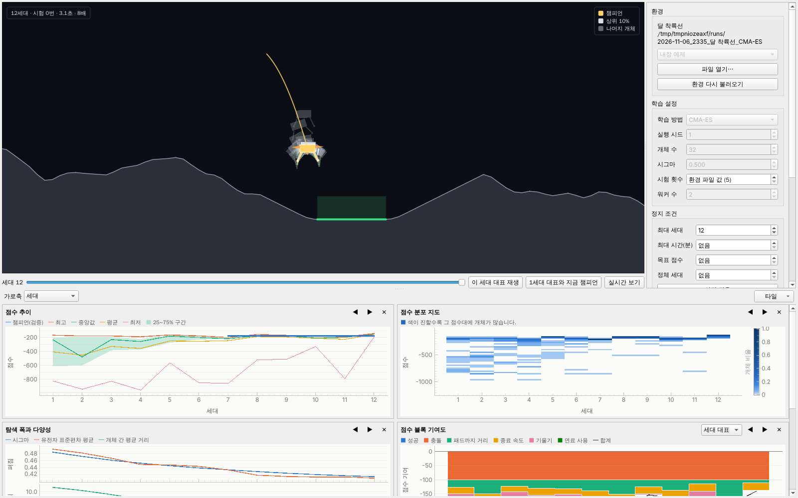

# M3 보고: 실험실 화면



## 바뀐 것

- **학습 프로세스(engine/session.py)**: 화면과 파이프 두 개로만 이야기한다. 시작·멈춤·이어서·한 세대만, 관전/고속 전환,
  멈춘 상태에서 정지 조건·시험 횟수 바꾸기와 환경 교체(세대 경계, events.jsonl 기록, 그 지점 체크포인트 보호),
  평가 오류 때 마지막 체크포인트로 되돌리고 멈춤, 화면이 사라지면 이번 세대를 마치고 체크포인트를 남긴 뒤 끝남.
- **관전 모드**: 워커가 모든 개체의 시험 0번 궤적을 2스텝마다 기록(점수는 같음), 화면이 1·2·4·8배속으로 재생.
  세대 N을 재생하는 동안 N+1을 계산하고, 재생이 끝났다는 알림 없이는 그보다 앞서지 않는다.
- **고속 모드**: 기다리지 않고, 정해진 세대 간격마다 지금 챔피언을 전시 시드로 다시 시뮬레이션해 반복 재생.
- **관전 화면**: 집단을 반투명하게 겹쳐 그리고 상위 10%는 진하게, 세대 대표는 강조색·지나온 궤적·추진기 불꽃.
  개체를 클릭하면 그 개체를 화면 프로세스에서 다시 시뮬레이션해 스텝마다 센서 값과 뉴런 활성화를 보여 준다.
- **세대 타임라인**: 아무 세대의 대표를 전시 시드로 다시 시뮬레이션해 재생. "1세대 대표와 지금 챔피언" 겹쳐 보기.
  고친 환경이면 그 세대를 계산할 때의 환경 버전으로 재생.
- **통계 대시보드**: 명세의 1차 그래프 전부(점수 추이 + 25~75% 띠 + 챔피언 검증 + 내 최고 기록 선 + 정체 음영,
  점수 분포 지도, 가로축 전환(세대·누적 시험·경과 시간), 탐색 폭과 다양성(시그마, 유전자 표준편차, 개체 간 거리),
  점수 블록 기여도(세대 대표 / 집단 평균), 종료 원인 비율, 처리 성능(세대 시간, 초당 스텝, 워커 사용률)).
  이어한 지점·환경 수정·설정 변경·분기는 모든 그래프에 세로선. 타일 켜고 끄기·순서·열 수는 사용자별로 저장.
- **기록 화면**: 실행 목록(환경, 방법, 시작 시각, 세대 수, 최고 점수, 메모), 열기, 이어하기(최신이 아닌 체크포인트면
  새 실행 폴더로 분기, run.json에 부모와 세대), 복제해서 새 실행, 삭제(실행 폴더만, 확인 후), 메모.
- 통계 열 추가: 개체 간 거리, 블록 기여도(세대 대표·집단 평균), 개체별 점수(분포 지도용), 워커 사용률.

## 실행 명령

```powershell
.\evolab.exe          # 창. 실험실 탭에서 '새로 시작'
```

## 직접 확인할 항목

1. 실험실에서 '새로 시작' → 관전 모드에서 집단이 겹쳐 내려오고, 배속을 바꾸면 재생 속도와 학습 속도가 같이 바뀌는지
2. 학습 중 창을 움직이거나 탭을 바꿔도 끊기지 않는지(입력 지연 100ms 이하가 목표)
3. 멈춤 → 정지 조건(최대 세대 등) 바꾸고 '설정 적용' → '이어서'. 그래프에 세로선이 생기는지
4. 타임라인 슬라이더로 예전 세대 대표 재생, '1세대 대표와 지금 챔피언' 겹쳐 보기, 개체 클릭 들여다보기
5. 기록 탭에서 실행을 열고, 예전 체크포인트에서 이어하면 새 실행(분기)으로 만들어지는지

## 측정

- **입력 지연**(10ms 타이머의 실제 간격 = 이벤트 루프가 막힌 시간, 리눅스 4코어 컨테이너): 착륙선, 개체 32, 워커 3,
  관전 1배속, 60초 동안. 다른 실험(워커 3개)이 같이 돌아 코어보다 프로세스가 많은 상태에서
  - 중앙값 10ms, p99 19ms, 세대 결과가 도착할 때 최대 **45~73ms** (목표 100ms 이하)
  - 학습을 시작한 직후 한 번 645ms(대시보드·캔버스를 처음 그릴 때). 학습 중이 아니라 시작 순간이라 목표 밖으로 봤지만,
    실제 PC에서 거슬리면 첫 그리기를 나누는 방법이 있다.
  - 고치기 전에는 세대가 도착할 때 70~110ms였다(1MB 관전 궤적을 화면 스레드가 다 받을 때까지 기다림) → 받기를 스레드로.
- 대시보드 `add_row`: 1000세대 이상에서 타일 6개 + 표시선 포함 중앙값 1.0~1.3ms, 최대 2.8ms.
- 관전 캔버스: 개체 256개 1280×720 한 프레임 5~9ms(부하 중), 64개 약 2.8ms.

## 테스트

- 학습 프로세스(멈춤·한 세대·관전 대기·설정과 환경 바꾸기·거절·되돌리기·이어하기·정리 없이 끝내기), 실험실 화면 통합
  (고속 모드 학습 → 타임라인·겹쳐 보기 → 다시 열기, 관전 모드 전 세대 재생 + 클릭 검사 + 이벤트 루프 간격, 멈춤 → 설정
  적용 → 이어서), 대시보드, 캔버스, 기록 화면과 분기(분기 후 이어 돌리면 부모 실행과 통계가 같음).
- 관전·멈춤·설정 적용을 거친 학습의 통계가 화면 없는 Trainer와 같음(결정성).

## CI

- 윈도우 CI 14번(커밋 18fc471): 테스트, 실제 창 자체 점검, exe 묶기, 한글 경로에서 두 exe 자체 점검 모두 성공. exe 폴더 154MB.
  산출물: https://github.com/Gemini-25/evo/actions/runs/42311791500 (Artifacts의 evolab-windows)
- 그 전 CI들에서 드러난 윈도우 전용 멈춤 두 가지를 고쳤다: (1) 죽은 워커의 파이프에 쓰기가 끝나지 않음 → 보내기를 스레드로,
  워커가 죽으면 파이프를 닫아 쓰기 취소, (2) 정리하지 않은 학습 프로세스를 multiprocessing이 끝날 때 기다리며 서로 막힘 →
  atexit에서 파이프를 먼저 닫음. 둘 다 회귀 테스트 포함.
