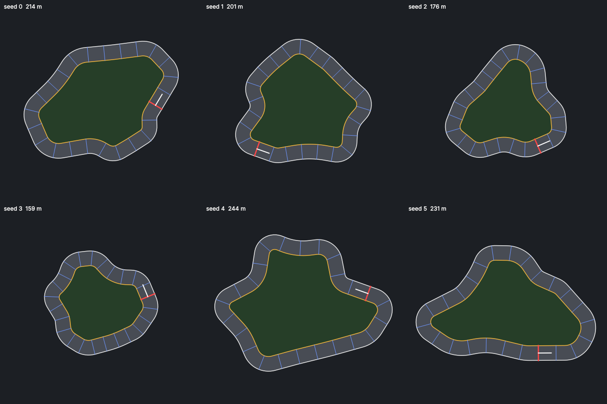

# M4 보고: 트랙 자동차

## 바뀐 것

- **차량 구동기**: 자전거 모형(가속 throttle × max_accel, 구름 저항 drag — 지수 감쇠로 정확히 적분해 최고 속도 = max_accel/drag,
  옆미끄럼 lateral_grip, 조향 = 앞뒤 속도 × tan(steer × max_steer)/wheelbase, 횡가속도 한계 max_lateral_accel: 빠르면 덜 꺾임).
- **레이 센서**: pymunk 선분 질의(감지 대상만 범주 비트로 거름, 자기 몸 제외), 값 = 맞은 거리/길이(안 맞으면 1).
- **체크포인트 선**: 순서대로, 선의 왼쪽 끝 → 오른쪽 끝 기준 앞쪽으로 지날 때만 셈(앞뒤로 흔들어 세지 못함), 한 스텝에 여러 선도 셈,
  바퀴 수·바퀴 시간·마지막 통과 뒤 시간·중심선 진행 거리(<id>.count/.laps/.since/.progress). 순환은 선 3개 이상.
- **트랙 생성기**: 꼭짓점 섭동 다각형의 모서리를 원호로 깎은 닫힌 트랙(직선 + 코너), 길이 범위·최소 곡률 반지름(폭/2 × 1.2 초과)·
  벽 교차 없음 보장, 트랙 하나 약 3ms, 학습 트랙 세트(set_seed, 5개), 직접 그린 중심선 트랙. 학습 = 세트의 트랙 번호,
  검증·비교·판정 = 시험 시드로 새 트랙(처음 보는 트랙).
- **track_car.evoenv**: 레이 7개(앞쪽 180°, 40m) + 앞뒤·옆 속도 → 가속·조향, 뇌 9-16-2(194개). 점수: 체크포인트 +10,
  진행 거리 +1/m, 완주 +100, 랩 시간 −1/초, 벽 충돌 −50, 정체 종료 −50, 부드러움 −0.1. 종료: 2바퀴 완주, 벽 충돌,
  5초 동안 다음 체크포인트 못 지남, 이탈, 시간 초과(60초).
- 직접 조종 키(↑↓/WS 가속, ←→/AD 조향), 관전 화면 개체 클릭 때 센서 레이 표시.

## 트랙 크기 (명세: "값은 M4에서 확정")

손 조종기(tests/track_pilot.py: 중심선 추종 + 앞 코너 곡률에 맞춘 속도, 최고 16m/s, 횡가속도 7m/s²로 운전):

| 트랙 | 완주 | 2바퀴 시간 |
| --- | --- | --- |
| 학습 트랙 5개 + 새 트랙 20개 (차량 저항 수정 전) | 25/25 | 중앙값 36.8초, 최대 44.0초 |
| 학습 트랙 5개 + 새 트랙 10개 (리뷰 수정 후) | 15/15 | 중앙값 37.0초, 최대 42.9초 |

→ 길이 120~200m, 폭 8m, 체크포인트 24개로 확정(잘 달리면 2바퀴가 60초 안에 넉넉히 들어옴).

## 완료 기준

"고정 실행 시드 3개로 학습해, 30분 시점의 챔피언이 판정용 자동 생성 트랙(판정 시드 공간) 10개 중 7개 이상 완주. 중앙값으로 판정."

리눅스 4코어 컨테이너, 워커 3개, 30분(측정 중 다른 검토 작업이 같은 PC에서 돌아 실제보다 불리한 조건):

| 실행 시드 | 세대 | 챔피언(검증) | 판정 트랙 10개 완주 | 비교 세트 성공률 70% 첫 도달 |
| --- | --- | --- | --- | --- |
| 1 | 261 | 884.2 (257세대) | **10/10** (평균 904.4점) | 32세대, 93초 |
| 2 | 311 | 884.5 (288세대) | **10/10** (평균 905.0점) | 38세대, 104초 |
| 3 | 245 | 883.9 (163세대) | **10/10** (평균 904.1점) | 13세대, 21초 |

중앙값 10/10 → 완료 기준(7) 만족. 학습 시작 후 2분 안에 새 트랙 대부분을 완주하기 시작한다.

## 성능

- 학습된 챔피언 에피소드: 약 1800스텝, 세계 만들기(벽 약 400선분) 5.9ms = 에피소드 시간의 5.4%. 무작위 개체(약 130스텝)는 43%지만
  짧다. 정적 벽 캐시는 쓰지 않기로 함(결정 A14). Numba 레이캐스트도 필요 없음(30분 목표를 크게 넘김).
- 실제 세대 시간 중앙값 5.7~7.0초(개체 32 × 트랙 5, 대부분 60초 가까이 달림, 다른 작업과 함께).

## 리뷰에서 고친 것 (모두 회귀 테스트)

체크포인트 방향 무시(흔들어 바퀴 세기), 한 스텝에 여러 선을 지나면 하나만 셈, 차량 저항 명시적 적분 발산, 정적 선분이 많을 때
경계 상자 트리 넣기 제곱 시간, 큰 hold·작은 dt 넘침, 세계 물체에 단 레이의 자기 몸 충돌.

## 직접 확인할 항목

1. 실험실 → 트랙 자동차 → 관전 모드로 학습: 처음엔 벽에 박다가 2~3분 안에 트랙을 도는지
2. 직접 조종으로 2바퀴 돌아 보기(1분 안에 되는지, 코너에서 감속이 필요한지)
3. 관전 화면에서 차를 클릭하면 레이 7개가 보이는지
4. `evolab-cli.exe judge <실행 폴더> --seeds 10`으로 처음 보는 트랙 10개 완주 수
