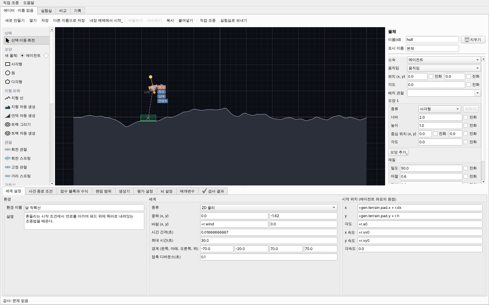

# M5a 보고: 에디터 1부

## 바뀐 것

- **문서 모델**(app/editor/document.py): 편집 중인 환경 파일 하나. 모든 편집은 되돌리기 한 단계(같은 칸을 이어서 바꾸면
  한 단계로 합침), 실시간 검사(구조·참조·수식 + 관절로 안 붙은 에이전트 물체, 시작할 때 겹친 물체), 진화 대상 켜고 끄기
  (매개변수 p.<id> 만들고 칸을 "=p.<id>"로), 복사·붙여넣기(함께 복사한 부품끼리의 참조는 새 id로), 이름 바꾸기
  (참조 칸·수식·p.*·gen.*·센서 채널 이름까지, 종류 값과 태그는 그대로).
- **캔버스와 도구**(canvas.py, tools.py, palette.py): 미리보기 시험으로 런타임과 똑같이 그림(수식·생성기 계산), 오류가 있으면
  그 부품만 빼고 그림. 확대·이동, 격자 맞춤(0.5m, Alt로 끔), 선택·여러 개 선택·끌어 옮기기·회전 손잡이·Delete·화살표.
  도구: 사각형·원·다각형, 지형 선, 지형 자동 생성, 트랙 그리기(중심선)·자동 생성, 관절(회전·회전 스프링·고정·거리 스프링,
  place_by 자동), 추진기(위치·방향 끌기, 키 자동 배정), 연료 탱크, 차량 구동기, 센서 7종(레이·몸 상태·접촉·목표 위치·
  관절 각도·남은 연료·남은 시간), 영역(목표·위험·착륙 패드), 체크포인트, 시작 위치. 수식 칸은 끌어도 덮어쓰지 않음.
- **속성 패널과 아래 탭**(forms.py, properties.py, tabs.py): 환경 파일 모델에서 만든 일반 양식(숫자·수식 칸, 진화 체크박스와
  최솟값·최댓값, 참조 고르기, 종류 바꾸기, 모양 목록, scale 표). 탭: 세계 설정, 사건·종료 조건, 점수 블록과 수식, 랜덤 범위,
  생성기, 평가 설정, 뇌 설정(입력 순서, 파라미터 수), 매개변수, 검사 결과(더블클릭하면 그 부품 선택).
- **에디터 화면**(view.py): 새로 만들기·열기·저장·다른 이름으로 저장·내장 예제에서 시작, 되돌리기·다시하기, 복사·붙여넣기,
  직접 조종, 실험실로 보내기. 실험실의 '에디터에서 고치기' → 고친 뒤 '실험실로 보내기'면 멈춘 학습이 그 환경으로 이어진다
  (유전자 차원·점수 블록·종료 조건 목록이 같을 때만, 아니면 이유를 알림).

## 완료 기준

"에디터만으로 착륙선과 트랙 자동차를 처음부터 다시 만들어 저장한 파일이 내장 예제와 같은 수준으로 학습된다."

`tests/test_editor_rebuild.py`: 빈 문서에서 시작해 부품은 모두 에디터 도구 함수(캔버스 도구가 부르는 것)로 만들고, 이름과 값은
속성 패널·탭이 쓰는 문서 편집으로만 채운 뒤 저장한다.

| 예제 | 도구 사용 | 이름 바꾸기 | 칸 고치기 | 결과 |
| --- | --- | --- | --- | --- |
| 달 착륙선 | 15 | 12 | 61 | 내장 예제와 내용 해시 같음, 같은 시드 3세대 학습 통계 같음 |
| 트랙 자동차 | 5 | 1 | 21 | 내용 해시 같음 |
| 언덕 넘는 자동차(M5b) | 12 | 9 | 55 | 내용 해시 같음, 학습 통계 같음 |

파일이 같으면 결정성 때문에 학습 결과도 같다(내장 예제의 학습 측정은 M2·M4 보고서).

## 직접 확인할 항목

1. 에디터 탭 → '내장 예제에서 시작' → 달 착륙선 → 캔버스에서 본체를 끌어 보기, 되돌리기·다시하기
2. 다리 길이 칸 옆 '진화'를 켜고 최솟값·최댓값을 적은 뒤 '실험실로 보내기' → 실험실에서 새로 시작(몸 수치가 함께 진화)
3. 아래 '검사 결과' 탭: 센서의 물체 칸을 없는 이름으로 바꾸면 오류가 뜨고 더블클릭하면 그 부품이 선택되는지
4. 실험실에서 학습 멈춤 → '에디터에서 고치기' → 중력 바꾸기 → '실험실로 보내기' → '이어서'. 그래프에 세로선
5. '직접 조종'으로 고친 환경을 바로 몰아 보기

## 리뷰에서 고친 것

- 문서의 이름 바꾸기가 종류 값(`"kind": "fuel"`)과 태그까지 바꾸고 p.*·gen.* 참조는 놓침 → 속성 패널 구현으로 통일(테스트 포함).
