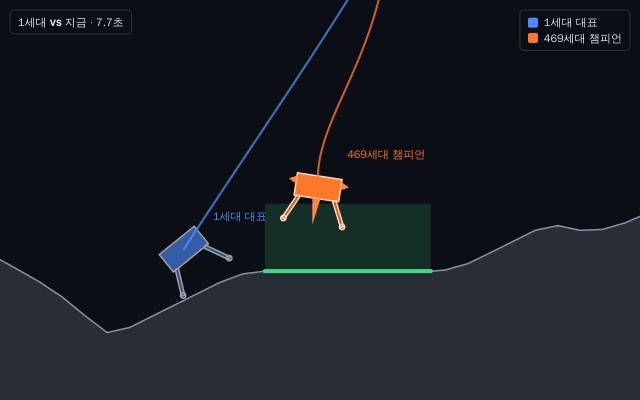

# M6 보고: 비교와 내보내기

## 바뀐 것

- **유전 알고리즘**(learners/ga.py): 개체 64, 엘리트 2(지난 세대 그대로 다음 후보에 넣어 이번 세대 시험으로 다시 평가),
  토너먼트 3, 균등 교차 0.7, 유전자별 돌연변이 확률 0.1·가우시안 폭 0.1, 폭 감쇠, 몸 수치는 −1..1로 자름.
- **담금질**(learners/sa.py): 한 단계에 [현재해, 이웃 8개]를 함께 평가(현재해도 매 단계 다시 평가), 최고 이웃이 나으면 받아들이고
  못하면 exp(Δ/T) 확률로, 초기 온도 = 첫 이웃 점수 표준편차, 단계마다 × 0.995.
- 세 방법 모두 ask/tell, 전용 난수, 체크포인트에서 비트 동일 이어하기(ask와 tell 사이에 저장해도). 실험실에서 방법을 고르면
  명세 표의 "화면에서 바꿀 수 있는 값"만 보인다. `--method ga|sa`.
- **비교 평가 세트**: 챔피언이 바뀔 때마다 선정에 쓰지 않은 시드 32개로 다시 재서 stats.csv의 compare_score(점수),
  compare_success(성공 비율)에 남긴다. 비교 그래프·표의 기본 값.
- **비교 화면**: 실행 여러 개를 겹쳐 그림(가로축 누적 시험 횟수 기본, 경과 시간·세대로 전환, 세로축 비교 점수 기본),
  반복 실행 묶음은 평균 선 + 최소~최대 띠, 표(최종 점수, 목표 점수 도달까지 시험 횟수, 시간, 성공률), 그래프 PNG·표 CSV 저장.
  기록 화면에서 여러 실행을 골라 '비교'.
- **반복 실행**: 같은 설정을 시드만 바꿔 N번(기본 5) 차례로 돌리고 run.json에 묶음(group)을 남김.
- **재현 묶음**: run.json + 환경 버전 사본 + events.jsonl + stats.csv를 zip으로. `evolab reproduce`가 기록된 세대 경계마다 같은
  설정 변경·환경 교체를 적용해 다시 돌리고 원래 통계와 비교(같으면 종료 코드 0). 기록 화면 '재현 묶음…'.
- **통계 CSV**: BOM 붙은 UTF-8(한국어 엑셀에서 바로 열림). 기록 화면 '통계 CSV…', `evolab csv`.
- **챔피언 영상**: 세대 대표 재생, "1세대 대표와 지금 챔피언" 겹쳐 보기를 GIF로(실험실 '영상 저장…', 640×400, 20fps).
  MP4는 만들지 않음(ffmpeg 필요, 결정 A19).

## 완료 기준

1. "착륙선에서 세 방법을 각각 시드 5개로 돌린 비교 그래프가 나온다." → 아래 측정
2. "재현 묶음으로 같은 PC에서 다시 돌린 결과가 원래와 같다."
   - `tests/test_bundle.py`: 3세대 학습 → 멈춘 상태에서 정지 조건·시험 횟수 바꾸기 + 중력 바꾼 환경 → 6세대. 묶음으로 다시 돌리면
     (워커 수를 1개에서 2개로 바꿔도) 시간 열을 뺀 통계가 모두 같고, 변경을 하나 지우면 다르게 나온다.
   - 윈도우 CI: 묶은 exe로 한글 경로에서 학습 → 묶음 → 다시 돌림 → 비교(같아야 통과).
