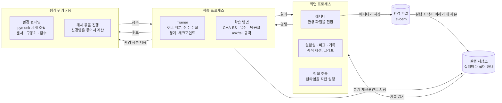

# 진화 실험실 설계 명세서

기준일: 2026-11-06 · 개정: 2026-11-06 구현 전 검토 반영 (맨 끝 "검토 반영 결정" 참고)

## 개요와 목표

진화 실험실의 최종 목표는 사용자가 실험 환경을 직접, 쉽게 설계하고 그 안에서 학습이 해법을 찾아가는 과정을 보는 범용 플랫폼이다. 달 착륙선이나 언덕 넘는 자동차는 내장 예제이면서, 환경 만들기 도구로 똑같이 만들 수 있어야 하는 기준 사례다.

- **만들기**: 물체, 센서, 움직이는 장치, 점수 기준을 조합해 새 실험 환경을 만든다.
- **돌리기**: 고른 학습 방법으로 진화시키고, 세대별 진행을 그래프와 화면으로 본다.
- **비교하기**: 같은 환경에서 학습 방법이나 설정을 바꿔 결과를 나란히 비교한다.

1차 구현은 달 착륙선과 트랙 자동차 두 환경, 그리고 진화 전략과 비교용 두 방법으로 한정한다. 두 환경도 처음부터 환경 만들기 형식으로 정의해서, 그 형식이 실제로 쓸 만한지 1차에서 검증한다.

## 확정된 결정 사항

윈도우 PC에서 도는 파이썬 프로그램으로, 진화 전략(CMA-ES)을 기본 엔진 삼아 여러 문제를 스스로 풀어가는 과정을 보여준다.

| 영역 | 항목 | 결정 |
| --- | --- | --- |
| 방향 | 최종 목표 | 사용자가 실험 환경을 쉽게 직접 만드는 범용 진화 실험실 |
| 방향 | 핵심 구조 | 문제(환경)와 학습 방법을 독립된 두 축으로 두고 조합해서 실행 |
| 플랫폼 | 실행 환경 | 윈도우 PC 데스크톱 프로그램. 웹, 폰 앱은 제외 |
| 플랫폼 | 언어 | 파이썬 |
| 플랫폼 | 화면 도구 | PySide6 (Qt) |
| 플랫폼 | 화면 언어 | 한국어 |
| 플랫폼 | 실행 방식 | 개발 중엔 명령으로 실행. M0부터 마일스톤마다 exe를 묶어 자체 점검과 함께 제공(GitHub Actions 윈도우 빌드) |
| 학습 | 기본 방법 | 진화 전략, CMA-ES |
| 학습 | 비교용 방법 | 단순 유전 알고리즘, 담금질 |
| 학습 | 진화 대상 | 몸과 뇌, 환경마다 선택. 몸은 1차에 수치만, 구조 변경은 나중 |
| 학습 | 뇌 | 고정 구조 신경망. 층 수와 뉴런 수만 환경에서 설정 |
| 학습 | 시작 조건 | 환경에 랜덤 범위를 정하고 개체마다 여러 번 시험해 집계. 같은 세대 개체는 같은 시험 조건(공통 시드) |
| 환경 | 만드는 방식 | 1차부터 화면 에디터. 결과는 환경 파일로 저장 |
| 환경 | 에디터 범위 | 물체, 추진기, 센서, 지형, 목표에 관절과 모터까지 |
| 환경 | 세계 종류 | 2D 물리와 격자. 격자는 명세만 두고 구현은 2차 |
| 환경 | 물리 엔진 | pymunk 하나로 통일, 개체는 CPU 코어마다 나눠 병렬 |
| 환경 | 외부 환경 | Gymnasium 등은 쓰지 않고 전부 직접 구현 |
| 환경 | 지형·트랙 | 직접 그리기와 시드 기반 자동 생성 둘 다 |
| 환경 | 점수 | 점수 블록과 가중치가 기본, 고급 사용자는 수식 입력 |
| 환경 | 직접 조종 | 학습 전에 키보드로 직접 조종해보는 기능 포함 |
| 화면 | 관전 | 관전 모드(집단 전체 실시간)와 고속 모드(챔피언만 주기 재생) 전환 |
| 화면 | 그래프 | 통계 그래프를 최대한 다양하게. 볼거리가 많도록 |
| 화면 | 경주 | 1차는 실행 기록을 한 그래프에 겹쳐 비교, 분할 화면은 2차 |
| 화면 | 학습 중 개입 | 멈추고 환경 수정 후 이어서 학습 |
| 기록 | 저장 | 자동 저장, 이어하기, 과거 실행 기록 보관 |
| 기록 | 재현 범위 | 비트 단위로 같은 결과는 같은 PC, 같은 빌드에서만 보장. 다른 PC에서는 같은 설정을 여러 시드로 돌린 결과 분포가 비슷한 수준(통계적 재현) |
| 1차 범위 | 환경 | 달 착륙선, 트랙 자동차 |
| 1차 범위 | 이후 환경 | 언덕 넘는 자동차, 글라이더 날개, 미로 찾는 점들, 점프 게임 AI, 자기끼리 두는 오목 |
| 개발 | 구현 주체 | 이 명세서를 Claude Code에 넘겨 구현 |
| 개발 | 진행 방식 | 마일스톤 하나 끝날 때마다 멈추고 사용자 확인 후 다음 단계 |

## 전체 구조

프로그램은 화면 프로세스 하나, 학습 프로세스 하나, 평가 워커 여러 개로 나뉘고, 이들은 환경 파일과 메시지 큐로만 이어진다. 화면은 학습용 물리를 돌리지 않으므로 학습이 무거워도 멈추지 않는다.



직접 조종, 에디터 미리보기, 재생(타임라인, 개체 클릭 검사, 영상 내보내기)은 같은 환경 런타임 코드를 화면 프로세스 안에서 직접 쓴다. 그래서 사람이 몰아본 결과, 다시 본 결과, 학습 중 시험 결과가 같은 규칙을 따른다. 재생은 저장된 유전자와 시험 시드로 다시 시뮬레이션하므로 궤적을 모두 저장하지 않아도 된다.

- **화면 프로세스 (PySide6)**: 에디터, 실험실, 비교, 기록 화면. 물리는 직접 조종, 에디터 미리보기, 재생에서만 직접 돌린다.
- **학습 프로세스 (Trainer)**: 학습 방법에서 후보를 받아 워커에 나눠주고, 점수를 모아 학습 방법에 돌려준다. 세대 통계 계산과 체크포인트 저장도 맡는다.
- **평가 워커 (논리 프로세서 수 − 1개, 최소 1개)**: 학습 프로세스가 보낸 환경 사본 내용으로 물리 세계를 만든다(사용자가 편집 중인 디스크 파일을 직접 읽지 않는다). 받은 후보를 시험해 점수, 점수 블록별 내역, 종료 원인, 필요하면 궤적을 돌려준다. 프로그램 시작 시 한 번 띄워 계속 재사용한다. 워커가 죽거나 환경 오류가 나도 학습이 멈추지 않고 오류로 보고하며, 창을 닫으면 자식 프로세스까지 정리한다.
- **환경 런타임**: 환경 파일을 읽어 pymunk 세계, 센서, 구동기, 점수 계산기를 조립한다. 워커, 직접 조종, 재생이 모두 같은 코드를 쓴다.
- **학습 방법**: CMA-ES, 유전 알고리즘, 담금질. 모두 같은 ask/tell 규격이라 서로 바꿔 끼운다.
- **실행 저장소**: 실행마다 폴더 하나. 설정, 시드, 환경 사본, 통계, 체크포인트, 챔피언을 담는다.

| 방향 | 메시지 |
| --- | --- |
| 화면 → 학습 | 시작, 멈춤, 한 세대만 진행, 관전/고속 전환, 재생 배속, 학습 설정 변경과 환경 교체(둘 다 멈춘 상태에서만) |
| 학습 → 화면 | 세대 통계, 챔피언 유전자와 궤적, 관전용 집단 궤적, 진행률, 경고와 오류 |
| 학습 → 워커 | 유전자 묶음, 개체별 시험 시드, 궤적 기록 여부 |
| 워커 → 학습 | 개체별 점수, 점수 블록별 값, 종료 원인, 행동 통계, 궤적(요청 시) |

**관전 모드**는 워커가 기록한 궤적을 화면이 재생한다. 세대 N을 재생하는 동안 세대 N+1을 계산하고, 재생이 느리면 학습이 재생 속도(1~8배속)에 맞춰 기다린다. **고속 모드**는 기다리지 않고, 정해진 세대 간격마다 챔피언 궤적만 받아 재생한다.

**결정성**: 시험 시드는 (실행 시드, 세대, 시험 번호)에서 `numpy.random.SeedSequence`로 만든다. 개체 번호는 넣지 않는다. 같은 세대 개체들은 같은 조건에서 시험하므로(공통 시드) 순위 잡음이 줄고, 관전 화면에서 집단을 같은 지형·트랙 위에 겹쳐 그릴 수 있다. 워커 수나 처리 순서가 달라도 실행 시드가 같으면 결과가 같아야 한다.

- 시험 결과는 (환경 버전, 유전자, 시험 시드)만의 함수다. 워커가 앞서 무엇을 시험했는지와 무관하다. 그래서 물리 세계는 시험마다 새로 만든다(성능 요구사항 참고).
- 워커 수는 "몇 개를 동시에 평가하느냐"에만 쓰고 학습 방법에 넘기지 않는다. 개체 수, 이웃 수 같은 값은 실행을 만들 때 숫자로 정해 `run.json`에 저장한다.
- 시드 공간은 셋으로 나눈다: 학습(위 공식), 검증(챔피언 선정과 비교 그래프용 고정 세트), 판정(완료 기준용, 학습에 쓰지 않음).
- 학습 프로세스 코드는 numpy 전역 난수(`np.random.rand` 등)를 쓰지 않는다. 학습 방법마다 전용 난수 생성기를 두고 체크포인트에 함께 저장한다. 정렬은 동점에서도 순서가 같은 안정 정렬을 쓴다.
- 재현 범위는 같은 PC, 같은 빌드다. `run.json`에 프로그램과 의존성 버전, OS, CPU를 기록하고, 다른 환경에서 열면 "비트 재현 보장 안 됨"을 알린다. 테스트는 정답 해시를 박지 않고 같은 머신에서 두 번 돌려 비교한다.

## 공통 인터페이스

모든 것은 세 가지 규격으로 이어진다. 환경 파일(무엇을 시험하나), 유전자 벡터(무엇이 진화하나), ask/tell(어떻게 개선하나). 이 셋만 지키면 환경과 학습 방법은 서로를 몰라도 된다.

### 환경 파일 (.evoenv)

에디터가 쓰고 런타임이 읽는 JSON 파일이다. pydantic 모델로 검증하고, `version` 필드로 이전 버전 파일을 자동 변환한다. 단위는 SI(미터, 초, 킬로그램, 라디안).

| 구역 | 내용 |
| --- | --- |
| `world` | 종류(`physics2d` 또는 `grid`), 중력, 경계, 시간 간격(기본 1/60초), 최대 시간 |
| `bodies` | 물체. 모양(사각, 원, 다각형, 선 체인), 위치, 각도, 밀도, 마찰, 탄성, 정적/동적, 소속(`agent` 또는 `world`) |
| `joints` | 관절. 회전, 고정, 스프링. 회전 관절에는 모터를 달 수 있음 |
| `actuators` | 움직이는 장치. 추진기(물체, 위치, 방향, 최대 힘, 연료 소모), 모터(관절, 최대 토크, 최대 속도), 차량 구동기(가속, 조향, 옆미끄럼 마찰) |
| `sensors` | 센서. 레이(시작점, 각도, 길이, 감지 대상), 몸 상태(속도, 각도, 각속도), 목표 상대 위치, 접촉, 관절 각도, 남은 연료, 남은 시간 |
| `regions` | 영역. 목표, 위험, 착륙 패드, 순서 있는 체크포인트 선 |
| `events` | 접촉이나 영역 진입으로 생기는 사건(예: 몸통이 땅에 닿음 = 충돌) |
| `termination` | 종료 조건. 최대 시간, 경계 이탈, 특정 사건, 성공 조건(예: 두 다리 접촉 + 속도 0.5m/s 미만이 1초 유지) |
| `randomize` | 시험마다 뽑는 값의 범위. 시작 위치, 속도, 각도, 바람, 중력, 지형 시드, 트랙 시드 |
| `generators` | 자동 생성기 설정. 지형(높이맵 거칠기, 패드 폭), 트랙(구간 수, 곡률, 폭) |
| `scoring` | 점수 블록 목록과 가중치, 선택적으로 수식 |
| `genome` | 뇌(입력 센서 순서, 은닉층 크기, 활성화 함수, 출력 구동기 순서)와 진화 대상 몸 수치(경로, 최솟값, 최댓값, 초깃값) |
| `evaluation` | 개체당 시험 횟수(기본 3), 집계 방식(평균 기본, 최솟값, 하위 25%), 목표 점수 |

M1에서 이 형식을 굳힐 때 함께 정하는 것:

- **id와 참조**: 모든 부품은 id를 가진다. 센서, 사건, 점수 블록, 랜덤 범위, 몸 유전자는 id(와 필드 이름)로 대상을 가리킨다. 생성기는 정해진 id로 결과(예: `terrain`, `pad`, `walls`, `checkpoints`)를 내놓고, 다른 부품은 그 id를 참조한다.
- **조건 언어**: 사건과 종료 조건은 점수 수식과 같은 파서로 쓴다. 비교, `and or not`, 접촉·영역 안 같은 술어, "N초 유지"를 지원한다. 같은 스텝에 여러 종료 조건이 겹치면 목록 순서가 우선순위다.
- **센서 정규화**: 센서마다 `scale`(기본값은 종류별로 정함)을 두고 관측 = 값 ÷ scale로 넣는다. 각도는 −π..π로 감싼다.
- **구동기 범위**: 신경망 출력은 tanh라 −1..1이다. 0..1 구동기에는 (출력 + 1) ÷ 2로 바꿔 넘긴다.
- **랜덤 범위 대상**: 바람, 초기 속도, 시작 위치 구역 등 랜덤으로 뽑을 필드를 스키마에 둔다.

### 환경 런타임

```python
class Episode:
    def __init__(self, spec: EnvSpec, body_params: np.ndarray, seed: int): ...
    def observe(self) -> np.ndarray            # 센서 값, 정규화된 float32 벡터
    def step(self, action: np.ndarray) -> None # 구동기 출력, 범위 -1..1 또는 0..1
    @property
    def done(self) -> bool
    def result(self) -> EpisodeResult          # 점수, 블록별 값, 종료 원인, 행동 통계
    def snapshot(self) -> FrameState           # 궤적 기록과 화면 그리기용
```

워커는 맡은 개체들의 Episode를 함께 한 스텝씩 진행하고, 신경망 계산은 묶어서 한 번에 한다.

### 유전자 벡터

유전자는 float 벡터 하나다. 앞쪽은 몸 수치, 뒤쪽은 뇌 가중치.

- 몸 수치는 유전자에서 -1..1로 다루고 환경 파일의 최솟값~최댓값으로 바꾼다. CMA-ES는 pycma의 경계 처리를 써서 평균이 범위 밖으로 떠내려가지 않게 하고, 다른 방법은 범위를 넘으면 잘라낸다.
- 뇌는 tanh 활성화 MLP. 가중치와 편향을 순서대로 펼쳐 담는다.
- 차원 = 몸 수치 개수 + 뇌 파라미터 수. 환경 구조가 바뀌면 차원이 바뀌고, 이때는 이어하기가 불가능하다.

### 학습 방법 규격 (ask/tell)

```python
class Learner(Protocol):
    def ask(self) -> np.ndarray                  # (개체 수, 차원) 후보
    def tell(self, candidates: np.ndarray, scores: np.ndarray) -> None  # 점수는 높을수록 좋음
    def best(self) -> tuple[np.ndarray, float]
    def stats(self) -> dict                      # 시그마, 다양성 등 그래프용
    def state_dict(self) -> dict                 # 체크포인트 저장
    def load_state_dict(self, d: dict) -> None
```

### 점수 블록

최종 점수 = 블록 값 × 가중치의 합. 수식이 있으면 수식이 우선한다.

| 블록 | 값 | 집계 시점 |
| --- | --- | --- |
| 목표까지 거리 | 물체와 목표 영역 사이 거리 | 종료 시, 또는 최소 |
| 진행 거리 | 지정 방향 또는 트랙 중심선을 따라 간 거리 | 종료 시 |
| 생존 시간 | 종료까지 걸린 초 | 종료 시 |
| 사건 발생 | 지정 사건(성공, 충돌 등)이 일어났으면 1 | 종료 시 |
| 종료 속도 | 종료 순간 속력 | 종료 시 |
| 기울기 | 각도의 절댓값 | 종료 시, 또는 평균 |
| 에너지 사용 | 구동기 출력 크기의 누적(연료 포함) | 누적 |
| 체크포인트 | 순서대로 통과한 수 | 누적 |
| 랩 시간 | 한 바퀴 완주 시간 | 완주 시 |
| 접촉 시간 | 지정 물체가 닿아 있던 시간 | 누적 |
| 부드러움 | 스텝 간 행동 변화량 | 누적 |

수식은 블록 이름과 `time`, `success` 같은 에피소드 값을 변수로 쓰고, `min max abs sqrt exp log clamp` 함수만 허용한다. 파이썬 `eval`은 쓰지 않고 전용 파서로 계산한다. 같은 파서를 사건·종료 조건에도 쓴다.

## 학습 방법

기본은 CMA-ES이고, 유전 알고리즘과 담금질은 같은 환경에서 나란히 비교하기 위한 기준선이다. 세 방법 모두 ask/tell 규격을 따르고, 점수는 높을수록 좋다는 방향으로 통일한다.

| 방법 | 구현 | 기본값 | 화면에서 바꿀 수 있는 값 |
| --- | --- | --- | --- |
| CMA-ES | `cma` 라이브러리(pycma) 감싸기. pycma는 최소화이므로 점수 부호를 뒤집어 넘김. 전용 난수 생성기를 넘기고 화면·파일 출력은 끔 | 개체 수 32(워커 수와 무관한 고정값), 초기 시그마 0.5, 차원 1000 초과 시 대각 공분산(sep-CMA) 자동 전환 | 개체 수, 초기 시그마, 정체 시 개체 수를 2배로 늘려 재시작(기본 꺼짐) |
| 유전 알고리즘 | 직접 구현 | 개체 수 64, 엘리트 2, 토너먼트 크기 3, 균등 교차 확률 0.7, 유전자별 돌연변이 확률 0.1, 가우시안 폭 0.1. 엘리트는 매 세대 다시 평가 | 개체 수, 엘리트 수, 교차 확률, 돌연변이 확률과 폭, 폭 감쇠 |
| 담금질 | 직접 구현. 코어를 쓰려고 매 단계 이웃 여러 개를 동시에 평가하고, 그중 최고 이웃에 수락 판정. 현재해는 매 단계 다시 평가 | 이웃 수 8(워커 수와 무관한 고정값), 이웃 폭 0.1, 초기 온도 = 첫 이웃들 점수 표준편차, 단계마다 온도 × 0.995 | 이웃 수, 이웃 폭, 초기 온도, 감쇠율 |

공통 시드에서는 세대마다 시험 조건이 바뀌므로, 지난 세대 점수를 그대로 들고 가는 유전 알고리즘 엘리트와 담금질 현재해는 매 세대 다시 평가한다. 다시 평가한 시험도 누적 시험 횟수에 넣는다.

**초기 유전자**: 몸 수치는 환경 파일의 초깃값, 뇌 가중치는 0. CMA-ES는 이 점을 평균으로 시작한다.

**챔피언**: 잡음 섞인 학습 점수의 최고 개체를 그대로 챔피언으로 쓰지 않는다(운 좋은 개체가 뽑힌다). 세대마다 후보(CMA-ES는 평균 벡터 포함, 학습 점수 상위 몇 개)를 검증 시드 세트로 다시 평가해 가장 좋은 것을 챔피언으로 한다.

**공통 실행 설정**: 실행 시드, 개체당 시험 횟수, 종료 조건(최대 세대, 최대 시험 횟수, 최대 시간, 목표 점수 도달, N세대 정체 중 하나 이상).

**공정한 비교**: 방법마다 한 세대의 크기가 다르므로 비교 그래프의 기본 가로축은 누적 시험 횟수다. 경과 시간과 세대로도 바꿀 수 있다. 세로축도 학습 점수의 세대 최고점을 쓰지 않는다(개체가 많은 방법이 운으로 높게 나온다). 누적 시험 일정 횟수마다 각 방법의 현재 챔피언을 같은 검증 시드 세트로 잰 값을 기본 선으로 쓰고, 비교 표의 최종 점수와 목표 점수 도달 시점도 이 값으로 정한다. 검증 시험은 누적 시험 횟수와 따로 센다.

**2차 이후 후보**: 강화학습, 새로움 탐색, 몸 구조까지 바뀌는 진화(가변 길이 유전자). ask/tell 규격 안에 들어오지 않는 방법은 별도 규격을 추가한다.

## 실험별 명세

1차 환경 두 개는 내장 예제 환경 파일로 제공하고, 에디터로도 똑같이 다시 만들 수 있어야 한다. 나머지 다섯 개는 구조가 그것들을 수용하는지 확인하는 용도로 요약만 둔다.

### 달 착륙선 (1차)

흔들리는 시작 조건에서 연료를 아끼며 패드 위에 똑바로 내려앉는 조종법을 배운다.

| 항목 | 명세 |
| --- | --- |
| 세계 | `physics2d`, 중력 1.62m/s², 시간 간격 1/60초, 최대 20초 |
| 몸 | 본체 사각형, 다리 2개(스프링 관절), 아래쪽 주 추진기 1개, 좌우 측면 추진기 2개, 연료 탱크 |
| 지형 | 자동 생성 높이맵 + 평평한 착륙 패드. 패드 위치와 폭은 시드로 결정 |
| 센서 (9) | 패드 기준 상대 위치 x·y, 속도 x·y, 각도, 각속도, 왼다리·오른다리 접촉, 남은 연료 비율 |
| 행동 (3) | 주 추진 0..1, 왼쪽 측면 0..1, 오른쪽 측면 0..1 |
| 뇌 기본 | 9 → 16 → 3, tanh. 파라미터 211개 |
| 진화 대상 기본 | 뇌만. 몸 진화 예시로 다리 길이, 다리 벌림 각도, 측면 추진기 높이를 켜고 끌 수 있음 |
| 랜덤 범위 | 시작 x(패드 기준 ±15m), 시작 높이, 초기 속도, 초기 각도(±0.3rad), 수평 바람 |
| 종료 | 성공: 두 다리가 패드 위에 접촉, 속력 0.5m/s 미만, 1초 유지 · 패드 밖 착지: 같은 조건인데 패드 밖(실패) · 충돌: 본체가 지형에 닿음 · 이탈: 경계 밖 · 시간 초과 |
| 점수 기본 | 성공 +100, 충돌 −100, 종료 시 패드까지 거리 −10/m, 종료 속도 −5/(m/s), 기울기 −20/rad, 연료 사용 −0.3/단위. 연료 1단위 = 주 추진기를 최대 출력으로 1초 쓴 양(측면 추진기는 최대 힘 비율만큼) |
| 완료 기준 | 판정용 시드(학습에 쓰지 않음) 100개에서 챔피언의 성공률(패드 위 착지) 80% 이상 |

### 트랙 자동차 (1차)

위에서 내려다보는 트랙을 레이 센서로 보며 벽에 닿지 않고 빨리 도는 운전법을 배우고, 처음 보는 트랙에서도 달린다.

| 항목 | 명세 |
| --- | --- |
| 세계 | `physics2d`, 중력 0(위에서 본 시점), 시간 간격 1/60초, 최대 60초 |
| 몸 | 차체 사각형 + 차량 구동기(앞뒤 가속, 조향, 옆미끄럼 마찰) |
| 트랙 | 닫힌 길의 안쪽·바깥쪽 벽(정적 선 체인), 순서 있는 체크포인트 선. 직접 그리기(중심선 + 폭) 또는 시드로 자동 생성 |
| 센서 (9) | 앞쪽 −90°~+90° 부채꼴 레이 7개의 벽까지 거리, 앞뒤 속도, 옆 미끄럼 속도 |
| 행동 (2) | 가속 −1..1, 조향 −1..1 |
| 뇌 기본 | 9 → 16 → 2, tanh. 파라미터 194개 |
| 진화 대상 기본 | 뇌만. 몸 진화 예시로 레이 각도 간격, 차체 길이 |
| 학습 트랙 | 자동 생성 트랙 여러 개(기본 5개) 세트. 모든 개체가 같은 세트로 시험 |
| 시험 | 개체당 시험 = 학습 트랙 5개를 한 번씩(시험 횟수 5). 시험 번호가 곧 트랙 번호 |
| 트랙 크기 | 생성기가 트랙 길이를 차량 최고 속도에 맞춰 제한해서, 잘 달리면 2바퀴가 60초 안에 충분히 들어오게 한다(값은 M4에서 확정) |
| 랜덤 범위 | 출발 각도(±0.2rad) |
| 종료 | 벽 충돌, 5초 동안 다음 체크포인트 미통과(정체), 2바퀴 완주, 시간 초과 |
| 점수 기본 | 체크포인트당 +10, 진행 거리 +1/m, 완주 +100, 랩 시간 −1/초, 벽 충돌 −50, 정체 종료 −50, 부드러움 −0.1 |
| 완료 기준 | 판정용 자동 생성 트랙(학습에 쓰지 않음) 10개 중 7개 이상 완주 |

### 이후 환경 (2차 이후)

| 환경 | 세계 | 진화 대상 | 필요한 부품 | 점수 핵심 | 구조상 확인할 점 |
| --- | --- | --- | --- | --- | --- |
| 언덕 넘는 자동차 | physics2d | 몸 수치(바퀴 반지름, 차체 꼭짓점) | 회전 관절 + 모터 바퀴, 자동 생성 언덕 | 전진 거리 | 1차 에디터로 만들 수 있어야 함(데모 대상) |
| 글라이더 날개 | physics2d | 몸 수치(날개 꼭짓점, 무게 중심) | 간이 양력·항력 모델 | 비행 거리 | pymunk에 공기가 없으므로 "공기역학" 힘 부품을 추가해야 함 |
| 미로 찾는 점들 | grid 또는 physics2d | 뇌 | 벽 격자, 목표 | 목표까지 거리, 도착 | 새로움 탐색과 비교하기 좋은 환경 |
| 점프 게임 AI | physics2d | 뇌 | 점프 추진기, 움직이는 장애물 | 생존 시간 | 장애물이 스스로 움직이는 "움직이는 정적 물체" 부품 필요 |
| 자기끼리 두는 오목 | grid (9×9 판부터) | 뇌(수 평가) + 얕은 수읽기 | 두 에이전트 차례 진행 | 대국 승률 | 에이전트 두 명이 겨루는 구조와 상대 풀 관리가 필요 |

## 화면과 조작

창 하나에 에디터, 실험실, 비교, 기록 네 화면을 탭으로 둔다. 모든 문구는 한국어이고, 문자열은 한 파일에 모아 관리한다. 그래프는 실시간 갱신이 빠른 pyqtgraph로 그린다.

### 에디터

- **배치**: 왼쪽 부품 팔레트, 가운데 캔버스(확대·이동, 격자 맞춤), 오른쪽 속성 패널, 아래쪽 탭(세계 설정, 사건·종료 조건, 점수 블록, 랜덤 범위, 생성기, 평가 설정, 뇌 설정, 검사 결과).
- **도구**: 선택·이동·회전, 사각형, 원, 다각형, 지형 선, 지형 자동 생성, 트랙 그리기(중심선 + 폭), 트랙 자동 생성, 관절(회전, 고정, 스프링), 모터, 추진기, 연료 탱크, 차량 구동기, 센서(레이, 몸 상태, 접촉, 목표 위치, 관절 각도, 남은 연료, 남은 시간), 영역(목표, 위험, 착륙 패드), 체크포인트, 시작 위치.
- **나눠 만들기**: M5a에서 내장 예제 두 개를 처음부터 다시 만드는 데 필요한 것(위 탭 전부, 사각형·원·다각형·지형·트랙 도구, 추진기, 연료, 차량 구동기, 센서, 영역, 체크포인트)을 만들고, M5b에서 관절·모터, 나머지 그리기 도구, 언덕 넘는 자동차 데모를 만든다.
- **진화 대상 표시**: 숫자 속성 옆 체크박스를 켜면 그 값이 몸 유전자가 되고, 최솟값·최댓값을 적는다.
- **실시간 검사**: 센서나 구동기가 없음, 아무 데도 안 붙은 부품, 겹친 물체, 점수 블록 없음, 수식 오류를 아래 탭에 표시하고 해당 부품을 강조한다.
- **기본 기능**: 새로 만들기, 열기, 저장, 다른 이름으로 저장, 되돌리기·다시하기, 복사·붙여넣기, 내장 예제에서 시작하기.

### 직접 조종

에디터에서 바로 실행한다. 구동기마다 키를 지정하고(기본은 방향키와 WASD), 연속 출력은 키를 누르는 동안 1로 본다. 화면에 점수 블록별 값이 실시간으로 뜬다. 끝나면 내 기록을 저장할 수 있고, 실험실 점수 그래프에 "내 최고 기록" 가로선으로 표시된다.

### 실험실

- **배치**: 가운데 시뮬레이션 화면, 오른쪽 제어 패널, 아래쪽 통계 대시보드.
- **제어 패널**: 학습 방법 선택과 설정값, 시작·멈춤·한 세대만, 관전/고속 모드 전환, 재생 배속(1·2·4·8배), 고속 모드 챔피언 재생 간격.
- **관전 화면**: 집단 전체를 반투명하게 겹쳐 그리고(공통 시드라 같은 지형·트랙 위), 상위 10%는 진하게, 챔피언은 강조색과 지나온 궤적으로 표시. 관전용 궤적은 시험 0번만 기록한다. 개체를 클릭하면 화면 프로세스가 그 개체를 다시 시뮬레이션해서 센서 레이와 신경망 활성화를 보여준다.
- **세대 타임라인**: 아래 슬라이더로 아무 세대의 챔피언이나 다시 재생. "1세대 챔피언과 지금 챔피언 겹쳐 보기" 버튼.
- **학습 중 개입**: 멈춘 뒤 에디터로 넘어가 환경을 고치고 이어서 학습한다. 유전자 차원이 그대로인 수정(중력, 지형, 트랙, 랜덤 범위, 점수 가중치)만 이어하기를 허용하고, 센서나 구동기 추가처럼 차원이 바뀌면 새 실행으로 시작하라고 안내한다. 이어한 지점은 모든 그래프에 세로선으로 표시한다.

### 통계 대시보드

그래프는 타일로 배치하고, 사용자가 켜고 끄고 순서를 바꿀 수 있다. 배치는 사용자별로 저장된다.

| 그래프 | 보여주는 것 | 1차 |
| --- | --- | --- |
| 점수 추이 | 세대별 최고·평균·중앙값·최저, 25~75% 띠, 내 최고 기록 선 | 예 |
| 점수 분포 지도 | 가로 세대 × 세로 점수 구간 히트맵. 집단이 어떻게 위로 이동하는지 | 예 |
| 가로축 전환 | 점수 추이를 세대·누적 시험 횟수·경과 시간 기준으로 | 예 |
| 탐색 폭과 다양성 | CMA-ES 시그마, 유전자 표준편차 평균, 개체 간 평균 거리 | 예 |
| 점수 블록 기여도 | 챔피언과 집단 평균의 블록별 점수를 쌓은 막대 추이 | 예 |
| 종료 원인 비율 | 세대별 성공·충돌·이탈·시간 초과 비율을 쌓은 영역 | 예 |
| 정체 표시 | N세대 동안 최고점이 안 오르면 점수 추이에 구간 음영 | 예 |
| 처리 성능 | 세대당 소요 시간, 초당 시뮬레이션 스텝, 워커 사용률 | 예 |
| 유전자 지도 | 집단을 2D로 투영(PCA)한 산점도. 세대가 지나며 어디로 모이는지 애니메이션 | 2차 |
| 몸 수치 추이 | 진화 대상 수치별 평균과 범위 | 2차 |
| 뇌 들여다보기 | 챔피언 신경망 가중치 그림, 재생 중 뉴런 활성화 | 2차 |
| 궤적 밀도 | 집단이 지나간 위치의 히트맵 | 2차 |
| 행동 분포 | 구동기 출력 분포(예: 주 추진기를 얼마나 세게 자주 쓰는지) | 2차 |

### 비교

기록 화면에서 실행을 여러 개 고르면 같은 그래프에 겹쳐 그린다. 같은 설정을 시드만 바꿔 N번 돌리는 "반복 실행" 버튼이 있고, 반복 실행 묶음은 평균 선과 최소~최대 띠로 표시한다. 그래프 아래 표에 최종 점수, 목표 점수 도달까지 시험 횟수, 소요 시간을 나란히 둔다. 분할 화면 동시 관전은 2차다.

## 저장, 기록, 내보내기

실행마다 폴더 하나를 만들고, 그 폴더만 있으면 이어하기, 다시 보기, 재현이 모두 된다. 기본 위치는 `문서\진화실험실\`이고 설정에서 바꿀 수 있다.

```text
문서\진화실험실\
  environments\           사용자 환경 파일 (.evoenv)
  runs\
    2026-11-07_1530_착륙선_CMA-ES\
      run.json            학습 설정, 실행 시드, 프로그램 버전, 환경 파일 사본
      stats.csv           세대별 통계 (그래프가 쓰는 값 전부)
      events.jsonl        멈춤, 이어하기, 환경 수정, 설정 변경 기록
      checkpoints\        학습 방법 상태 + 난수 상태 (gen_0010.pkl …)
      champions\          세대별 챔피언 유전자와 점수 (gen_0010.npz …)
      exports\            내보낸 영상, CSV
```

- **자동 저장**: 기본 10세대마다, 그리고 멈춤과 종료 때 체크포인트를 저장한다. 최근 5개와 100세대마다 하나씩만 남기고 정리한다.
- **챔피언**: 매 세대 저장한다. 크기가 작아서 타임라인 재생이 가능하다.
- **이어하기**: 아무 체크포인트에서나 이어간다. 끊김 없이 계속 돌린 경우와 결과가 같아야 한다.
- **기록 화면**: 실행 목록(환경, 방법, 시작 시각, 세대 수, 최고 점수, 메모)과 열기, 이어하기, 복제해서 새 실행, 삭제.

내보내기는 아래 순서로 만든다.

| 내보내기 | 내용 | 단계 |
| --- | --- | --- |
| 재현 묶음 | `run.json` 하나로 같은 실험을 그대로 다시 실행 | 1차 |
| 통계 CSV | 세대별 통계 전체 | 1차 |
| 챔피언 영상 | 고른 세대 챔피언 재생을 GIF 또는 MP4로. "1세대 vs 지금" 겹친 영상 포함 | 1차 |
| 폰 뷰어용 파일 | 환경 파일 + 챔피언 유전자 + 재생 궤적을 담은 JSON | 2차 |

## 성능 요구사항

시간 대부분은 시뮬레이션에서 쓰이므로, 성능 작업은 "한 스텝당 파이썬이 하는 일을 줄이고 코어를 다 쓰는 것"에 집중한다. PC 사양을 아직 모르므로 코어 수는 실행 시 감지하고, 기준 PC는 4코어로 잡는다.

| 목표 | 기준 |
| --- | --- |
| 착륙선 세대 시간 | 개체 32, 시험 3회, 최대 20초 기준, 4코어에서 세대당 3초 이내 |
| 착륙선 학습 | 4코어에서 15분 안에 "실험별 명세"의 완료 기준(성공률 80%) 도달. 화면 없는 `evolab train` 또는 고속 모드 기준 |
| 트랙 자동차 학습 | 4코어에서 30분 안에 완료 기준(새 트랙 10개 중 7개 완주) 도달. 측정 기준은 위와 같음 |
| 화면 | 관전 모드에서 개체 256개까지 60fps, 학습 중 창 입력 지연 100ms 이하 |
| 결정성 | 같은 실행 시드면 워커 수 1개와 N개의 결과가 같음 |

**구현 원칙**

- 워커 풀은 한 번 띄워 재사용한다. 세대마다 프로세스를 새로 만들지 않는다.
- 워커는 맡은 개체들의 에피소드를 한 스텝씩 함께 진행하고, 신경망 계산은 묶어서 한다. 개체마다 가중치가 다르므로 (개체 수, 1, 입력) × (개체 수, 입력, 출력) 묶음 행렬 곱 하나로 한다. 학습, 재생, 직접 조종 모두 같은 순전파 함수를 쓴다(계산 경로가 다르면 재생 결과가 달라진다).
- 레이캐스트는 인터페이스 뒤에 두고 pymunk 질의로 먼저 구현한다. 트랙 자동차가 30분 목표를 못 맞추면 그때 정적 벽용 Numba 함수를 넣는다. 두 구현을 조용히 섞어 쓰지 않는다(결과가 미세하게 달라진다).
- 유전자, 점수, 궤적은 NumPy 배열로 주고받는다. 궤적은 관전 모드나 챔피언 재생 때만 기록하고, 화면 갱신에 충분한 간격(기본 2스텝마다)으로 줄인다.
- 물리 세계는 시험마다 새로 만든다. pymunk는 위치·속도를 되돌려도 관절에 쌓인 충격량과 접촉 캐시가 남아, 재설정 재사용이 결정성을 깬다(검토 실험: 40번 중 1번만 일치). 새로 만드는 비용은 착륙선 에피소드의 약 2%다. 최적화가 필요하면 (환경 버전, 지형·트랙 시드)별로 정적 부분만 워커에 캐시하고 움직이는 부분은 매번 새로 만들되, 비트 동일성 테스트를 통과한 방식만 쓴다.
- 학습 프로세스와 워커는 BLAS 스레드를 1개로 둔다(코어를 워커끼리 나눠 쓰므로).

**측정 도구**: `evolab bench <환경 파일>` 명령이 단일 코어 초당 스텝, 워커 수별 세대 시간, 신경망 계산 비율을 출력한다. 마일스톤 보고 때마다 이 수치를 붙인다.

**그래픽카드**: 1차에는 쓰지 않는다. 학습이 모두 CPU에서 돌도록 만들고, GPU 가속은 사양 확인 후 2차에서 검토한다.

## 프로젝트 구조와 개발 환경

윈도우 10/11, 파이썬 3.12, 패키지 관리는 uv를 쓴다. 패키지 이름은 `evolab`이다.

| 의존성 | 용도 |
| --- | --- |
| PySide6 | 화면 전체 |
| pyqtgraph | 실시간 그래프 |
| numpy | 유전자, 점수, 신경망 계산 |
| numba | (선택) 트랙 자동차 레이캐스트가 느릴 때만 M4에서 추가 |
| pymunk | 2D 물리 |
| cma | CMA-ES |
| pydantic | 환경 파일 검증 |
| imageio, imageio-ffmpeg | GIF, MP4 내보내기 |
| pytest, pytest-qt | 테스트 |
| pyinstaller | exe 묶기 (개발용) |

의존성 버전은 `uv.lock`으로 고정하고, 개발 실행과 exe가 같은 lock을 쓴다. PySide6는 필요한 모듈만 든 `PySide6-Essentials`를 쓴다(배포본 크기).

```text
evolab\
  pyproject.toml
  src\evolab\
    app\          화면. main.py, editor\, lab\, charts\, compare\, records\, play\, strings.py
    spec\         환경 파일 모델, 검증, 버전 변환
    world\
      physics2d\  pymunk 세계 조립, 구동기, 센서, 사건, 공기역학(2차)
      grid\       격자 세계 (2차)
    scoring\      점수 블록, 수식 파서
    policy\       신경망, 유전자 ↔ 몸·뇌 변환
    learners\     cmaes.py, ga.py, sa.py
    engine\       Trainer, 워커 풀, 시드 관리, 체크포인트
    generators\   지형, 트랙 자동 생성
    runs\         실행 폴더 저장·불러오기·내보내기
    cli.py        evolab train / bench / play / selftest 명령
    selftest.py   설치 상태 자체 점검
  environments\   내장 예제 (lander.evoenv, track_car.evoenv)
  packaging\      exe 묶기 설정 (evolab.spec, entry.py)
  .github\workflows\windows.yml   윈도우 테스트, exe 묶기, exe 자체 점검
  docs\spec.md    이 문서
  tests\
```

**실행 명령**

- `uv run evolab` — 프로그램 실행
- `uv run evolab train environments\lander.evoenv --method cmaes --seed 1` — 화면 없이 학습
- `uv run evolab bench environments\lander.evoenv` — 성능 측정
- `uv run pytest` — 테스트 (느린 학습 테스트는 `-m slow`로 따로)
- `uv run evolab selftest` — 설치 상태 점검. exe에서는 `evolab.exe selftest`

**코드 규칙**: 모든 함수에 타입 힌트. 화면 문구는 `strings.py`에만(테스트로 검사). 물리 값은 SI 단위. numpy 전역 난수 금지(테스트로 검사). 화면 코드는 `world`, `engine`을 직접 부르지 않고 메시지로만 학습 프로세스와 대화한다(직접 조종, 미리보기, 재생은 예외로 런타임을 직접 쓴다). 파일은 항상 UTF-8로 읽고 쓴다(윈도우 기본 인코딩은 cp949).

## 구현 단계와 완료 기준

1차는 M0, M1, M2, M3, M4, M5a, M5b, M6, M7 아홉 단계다. 각 단계가 끝나면 Claude Code는 멈추고 실행 방법, 확인할 항목, 측정 수치를 보고한 뒤 사용자 확인을 기다린다. 마일스톤마다 GitHub Actions가 윈도우에서 테스트하고 exe를 묶어 자체 점검까지 돌린 결과를 함께 낸다. 에디터는 1차 범위지만, 런타임과 학습이 먼저 검증된 뒤(M5a)에 만든다. 에디터가 쓸 환경 파일 형식을 M1에서 먼저 굳히기 위해서다.

1. **M0 뼈대**: uv 프로젝트, 빈 창, 테스트 환경, 폴더 구조, exe 묶기 설정, 자체 점검(`evolab selftest`), 윈도우 CI.
    - 완료: `uv run evolab`으로 한국어 제목의 빈 창이 뜨고, `uv run pytest`가 통과한다. 윈도우 CI에서 묶은 exe가 한글 경로에서 자체 점검을 통과한다.
2. **M1 환경 파일과 물리 런타임 + 착륙선**: 환경 파일 모델과 검증, pymunk 조립기, 추진기·스프링 관절·몸 상태·접촉 센서, 사건, 종료, 랜덤 범위, 점수 블록과 수식 파서, 지형 자동 생성, `lander.evoenv`, 직접 조종 창.
    - 완료: 키보드로 착륙선을 몰아 착륙할 수 있고 점수 블록별 값이 보인다. 같은 시드와 같은 입력 기록으로 두 번 돌리면 결과가 같다(직접 조종 입력을 기록·재생해서 확인).
3. **M2 학습 엔진**: ask/tell 규격과 CMA-ES, 워커 풀, Trainer, 시드 관리, 체크포인트와 이어하기, `evolab train`, `evolab bench`.
    - 완료: 착륙선이 "성능 요구사항"의 학습 목표를 만족한다. 중간에 끊고 이어한 실행이 끊지 않은 실행과 결과가 같다. 워커 1개와 N개의 결과가 같다.
4. **M3 실험실 화면**: 관전/고속 모드, 재생 배속, 세대 타임라인, 1세대 vs 지금 비교, 1차 통계 그래프 전체, 멈춤 → 값 수정 → 이어하기, 기록 화면.
    - 완료: 학습 중에도 창이 끊기지 않는다(입력 지연 100ms 이하). 모든 1차 그래프가 매 세대 갱신된다.
5. **M4 트랙 자동차**: 차량 구동기, 레이캐스트(pymunk 먼저, 필요하면 Numba), 체크포인트 선, 트랙 그리기와 자동 생성, 학습 트랙 세트, `track_car.evoenv`.
    - 완료: "실험별 명세"의 트랙 자동차 완료 기준과 학습 시간 목표를 만족한다.
6. **M5a 에디터 1부**: 캔버스, 부품 팔레트, 속성 패널, 진화 대상 표시, 아래쪽 탭 전부(세계, 사건·종료, 점수 블록과 수식, 랜덤 범위, 생성기, 평가, 뇌 설정, 검사 결과), 내장 예제를 만드는 데 필요한 도구, 되돌리기·다시하기, 복사·붙여넣기, 직접 조종 연결, 멈춘 실험으로 돌아가 이어하기.
    - 완료: 에디터만으로 착륙선과 트랙 자동차를 처음부터 다시 만들어 저장한 파일이 내장 예제와 같은 수준으로 학습된다.
7. **M5b 에디터 2부**: 관절(회전, 고정, 스프링)과 모터, 나머지 그리기 도구, 언덕 생성기.
    - 완료: 에디터로 만든 언덕 넘는 자동차(몸 수치 진화)가 학습되는 데모가 있다.
8. **M6 비교와 내보내기**: 유전 알고리즘, 담금질, 비교 화면, 반복 실행, 재현 묶음, CSV, 챔피언 영상.
    - 완료: 착륙선에서 세 방법을 각각 시드 5개로 돌린 비교 그래프가 나온다. 재현 묶음으로 같은 PC에서 다시 돌린 결과가 원래와 같다.
9. **M7 배포 마무리**: 첫 실행 때 내장 예제를 문서 폴더로 복사, 아이콘, 라이선스 고지. exe 묶기 자체는 M0부터 매번 한다.
    - 완료: 파이썬이 없는 윈도우 PC에서 exe를 더블클릭해 착륙선 학습까지 된다.

**2차 이후**: 격자 세계(미로, 오목), 분할 화면 경주, 2차 표시 그래프, 몸 구조 진화, 글라이더 공기역학, 점프 게임, 폰 뷰어, 강화학습과 새로움 탐색, GPU 가속.

## 테스트 계획

테스트는 빠른 테스트(매번), 느린 학습 테스트(마일스톤마다), 성능 측정(마일스톤마다) 세 층이다. 마일스톤 보고 전에 세 층을 모두 돌린다.

| 층 | 대상 | 내용 |
| --- | --- | --- |
| 빠른 | 환경 파일 | 예제 파일 로드, 잘못된 파일 거부와 오류 메시지, 이전 버전 변환 |
| 빠른 | 물리 부품 | 알려진 배치에서 레이 거리, 추진기 힘 방향, 접촉 감지, 종료 조건 |
| 빠른 | 점수 | 블록별 계산, 가중치 합, 수식 파서의 허용 함수와 금지 구문 거부 |
| 빠른 | 유전자 | 몸 수치 범위 변환과 잘라내기, 뇌 가중치 펼치기·되돌리기 |
| 빠른 | 학습 방법 | 구면 함수와 로젠브록 함수에서 정해진 시험 횟수 안에 수렴, ask/tell 상태 저장·복원 |
| 빠른 | 결정성 | 같은 시드 두 번, 워커 1개와 4개, 저장 후 이어하기가 모두 같은 점수. 같은 (유전자, 시드)를 새 워커와 다른 시험을 먼저 20개 돌린 워커에서 평가해도 결과 전체가 같음. 정답 해시를 박지 않고 같은 머신에서 비교 |
| 빠른 | 코드 규칙 | strings.py 밖의 한글 문자열 금지, numpy 전역 난수 금지 |
| 빠른 | exe | 윈도우 CI에서 exe를 묶어 한글 경로에서 자체 점검 |
| 빠른 | 화면 | pytest-qt로 창 열기, 탭 전환, 에디터에서 부품 추가 → 저장 → 다시 열기가 같은 파일 |
| 느림 | 착륙선 학습 | 고정 시드로 학습해 완료 기준 도달 |
| 느림 | 트랙 자동차 학습 | 고정 시드로 학습해 새 트랙 완주 기준 도달 |
| 측정 | 성능 | `evolab bench` 수치를 기록하고 이전 마일스톤보다 20% 이상 느려지면 보고에 표시 |

## 남은 결정과 작업 지침

아래 항목은 아직 정하지 않았고, 정해지는 대로 이 문서를 고친다. 정하기 전에는 문서의 기본값으로 진행한다.

- [ ] PC의 CPU 코어 수와 그래픽카드 확인(작업 관리자 → 성능 탭). 4코어 기준으로 잡은 성능 목표를 실제 사양에 맞춰 조정. exe 자체 점검 기록에 코어 수가 남는다
- [x] "2차"로 둔 그래프는 1차로 당기지 않는다. 여유가 있으면 "행동 분포"만 M6에
- [x] 점수 가중치는 M1·M4 직접 조종 후 조정할 수 있다. 바꾸면 보고에 값과 이유를 적는다
- [x] 내보내기 순서는 그대로(재현 묶음, CSV, 영상 1차 / 폰 뷰어 2차)
- [x] 프로그램 이름 "진화 실험실", 패키지 이름 `evolab`, 확장자 `.evoenv` 그대로

### Claude Code 작업 지침

1. 이 문서가 기준이다. 명세와 다르게 구현해야 할 이유가 생기면, 구현하기 전에 이유와 대안을 사용자에게 묻는다.
2. 마일스톤은 하나씩 진행한다. 끝나면 멈추고 다음을 보고한다: 바뀐 것, 실행 명령, 사용자가 직접 확인할 항목 3~5개, 테스트 결과, `evolab bench` 수치.
3. 수치는 실제로 측정한 값만 보고한다. 완료 기준을 못 맞추면 맞춘 것처럼 쓰지 말고, 측정값과 원인 후보를 적는다.
4. 점수 가중치와 학습 설정은 이 문서의 기본값으로 시작한다. 바꾸면 보고에 바꾼 값과 이유를 적는다.
5. 결정성(같은 시드, 같은 결과)을 깨는 변경은 하지 않는다.
6. Gymnasium 같은 외부 실험 환경 라이브러리는 쓰지 않는다.
7. 화면 문구는 모두 한국어로, `strings.py`에만 둔다.

## 검토 반영 결정 (2026-11-06)

구현 전 검토(다섯 관점, 이 저장소의 리눅스 4코어 컨테이너에서 실험으로 확인)에서 나온 지적을 사용자가 모두 권장안대로 받아들였다. 위 본문은 이미 이 결정대로 고쳐져 있다.

| # | 항목 | 결정 | 이유 (검토 측정값) |
| --- | --- | --- | --- |
| 1 | 시험 시드 | (실행 시드, 세대, 시험 번호). 같은 세대 개체는 같은 조건. 유전 알고리즘 엘리트·담금질 현재해는 매 세대 다시 평가 | 개체별 시드에서는 3회 평균 점수와 실제 실력의 순위 상관이 −0.004로 사실상 무작위 |
| 2 | 개체 수 | 워커 수와 무관한 고정값(CMA-ES 32, 담금질 이웃 8), `run.json`에 저장 | 워커 수가 알고리즘 입력이면 "워커 1개와 N개 결과가 같음"이 원리상 불가능 |
| 3 | 착륙선 점수 | 성공은 패드 위만, 다리 접촉 보상 제거, 패드 밖 착지는 실패로 종료, 연료 단위 정의 | 원래 점수로 학습한 간이 모델에서 성공 22개 중 14개가 패드 밖 |
| 4 | 트랙 자동차 | 진행 거리 +1/m, 정체 종료 −50, 시험 = 학습 트랙 5개 한 번씩, 트랙 길이를 최고 속도에 맞춤 | 원래 점수에서는 "가만히 있기"(0점)가 "달리다 충돌"(평균 −30)보다 높아 시드 10개 중 5개가 그 상태로 굳음 |
| 5 | Numba | 필수에서 선택으로. pymunk 레이캐스트로 먼저 하고 30분 목표를 못 맞추면 추가 | 이득은 트랙 자동차 한 스텝 51.7µs → 27.1µs(약 1.9배)인데 exe 크기와 배포 위험이 큼 |
| 6 | exe | M0부터 매 마일스톤 묶고 자체 점검 | 묶인 exe에서만 생기는 문제(중첩 spawn, 표준 출력 없음, 한글 경로)를 일찍 잡기 위해 |
| 7 | 에디터 | M5를 M5a(내장 예제 재현에 필요한 것)와 M5b(관절·모터, 언덕차)로 나눔. 사건·종료, 세계, 생성기, 평가 탭과 연료 도구 추가 | 원래 도구·탭 목록으로는 내장 예제를 다시 만들 수 없고, M5가 다른 단계보다 훨씬 큼 |
| 8 | 재생 | 화면 프로세스가 런타임으로 다시 시뮬레이션하는 예외에 재생(타임라인, 개체 클릭, 영상)을 추가 | 챔피언 파일에는 유전자와 점수만 있으므로 재생하려면 다시 시뮬레이션해야 함 |
| 9 | 재현 범위 | 비트 동일은 같은 PC·같은 빌드. 다른 PC는 통계적 재현 | CPU에 따라 numpy 계산 경로(OpenBLAS 커널, SIMD)가 달라 결과 비트가 달라짐 |

명세에 없던 것을 구현에서 채우는 원칙: 물리 세계는 시험마다 새로 만든다(재설정 재사용은 40번 중 1번만 비트 일치). pycma에는 전용 난수 생성기를 넘긴다(전역 난수로는 1000차원에서 이어하기가 12세대부터 어긋남). 챔피언은 검증 시드로 다시 평가해서 고르고, 비교 그래프도 검증 시드로 잰 값으로 그린다. 학습 중 환경을 고치면 실행 폴더에 환경 버전별 사본을 남기고, 과거 체크포인트에서 이어가면 새 실행(가지)으로 만든다.
