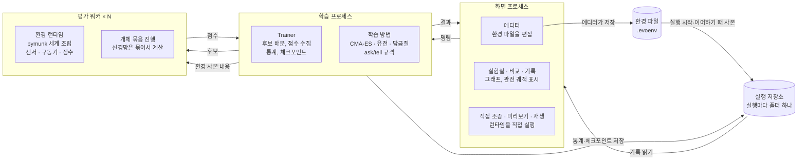

# 진화 실험실 설계 명세서

기준일: 2026-11-06 · 개정: 2026-11-06 구현 전 검토 반영 (맨 끝 "검토 반영 결정" 참고)

## 개요와 목표

진화 실험실의 최종 목표는 사용자가 실험 환경을 직접, 쉽게 설계하고 그 안에서 학습이 해법을 찾아가는 과정을 보는 범용 플랫폼이다. 달 착륙선이나 언덕 넘는 자동차는 내장 예제이면서, 환경 만들기 도구로 똑같이 만들 수 있어야 하는 기준 사례다.

- **만들기**: 물체, 센서, 움직이는 장치, 점수 기준을 조합해 새 실험 환경을 만든다.
- **돌리기**: 고른 학습 방법으로 진화시키고, 세대별 진행을 그래프와 화면으로 본다.
- **비교하기**: 같은 환경에서 학습 방법이나 설정을 바꿔 결과를 나란히 비교한다.

1차 구현은 달 착륙선과 트랙 자동차 두 환경, 그리고 진화 전략과 비교용 두 방법으로 한정한다. 두 환경도 처음부터 환경 만들기 형식으로 정의해서, 그 형식이 실제로 쓸 만한지 1차에서 검증한다.

## 확정된 결정 사항

윈도우 PC에서 도는 파이썬 프로그램으로, 진화 전략(CMA-ES)을 기본 엔진 삼아 여러 문제를 스스로 풀어가는 과정을 보여준다.

| 영역 | 항목 | 결정 |
| --- | --- | --- |
| 방향 | 최종 목표 | 사용자가 실험 환경을 쉽게 직접 만드는 범용 진화 실험실 |
| 방향 | 핵심 구조 | 문제(환경)와 학습 방법을 독립된 두 축으로 두고 조합해서 실행 |
| 플랫폼 | 실행 환경 | 윈도우 PC 데스크톱 프로그램. 웹, 폰 앱은 제외(폰에서는 내보낸 재생 파일을 브라우저로 보기만, v3.1) |
| 플랫폼 | 언어 | 파이썬 |
| 플랫폼 | 화면 도구 | PySide6 (Qt) |
| 플랫폼 | 화면 언어 | 한국어 |
| 플랫폼 | 실행 방식 | 개발 중엔 명령으로 실행. M0부터 마일스톤마다 exe 폴더(zip)를 묶어 자체 점검과 함께 제공. 배포는 exe 폴더(휴대용 zip)와 윈도우 설치 프로그램(v3.1: 사용자별 설치, 관리자 권한 없음, 시작 메뉴·바탕 화면 바로가기, 제거 때 실험 기록 보존). GitHub Actions 윈도우 빌드가 테스트와 묶기를 따로(두 job) 돌리고 묶은 exe의 자체 점검·오류 보고 묶음·치명적 오류 기록(v3.0), 설치·덮어 설치·내려 설치·제거 연기 시험과 exe 내보내기(v3.1)까지 확인. 태그 `v*`를 올리면 설치 파일·휴대용 zip·체크섬을 GitHub 릴리스에 올림(v3.1) |
| 학습 | 기본 방법 | 진화 전략, CMA-ES |
| 학습 | 비교용 방법 | 단순 유전 알고리즘, 담금질 |
| 학습 | 진화 대상 | 몸과 뇌, 환경마다 선택. 몸 수치(1차), 뇌 없이 몸만(v2.0), 부품이 생기고 없어지는 몸 구조(v2.1, 고정 길이 유전자 안의 있음 칸) |
| 학습 | 뇌 | 고정 구조 신경망. 층 수와 뉴런 수만 환경에서 설정 |
| 학습 | 시작 조건 | 환경에 랜덤 범위를 정하고 개체마다 여러 번 시험해 집계. 같은 세대 개체는 같은 시험 조건(공통 시드) |
| 환경 | 만드는 방식 | 1차부터 화면 에디터. 결과는 환경 파일로 저장 |
| 환경 | 에디터 범위 | 물체, 추진기, 센서, 지형, 목표에 관절과 모터까지 |
| 환경 | 세계 종류 | 2D 물리와 격자. 격자는 명세만 두고 구현은 2차 |
| 환경 | 물리 엔진 | pymunk 하나로 통일, 개체는 CPU 코어마다 나눠 병렬 |
| 환경 | 외부 환경 | Gymnasium 등은 쓰지 않고 전부 직접 구현 |
| 환경 | 지형·트랙 | 직접 그리기와 시드 기반 자동 생성 둘 다 |
| 환경 | 점수 | 점수 블록과 가중치가 기본, 고급 사용자는 수식 입력 |
| 환경 | 직접 조종 | 학습 전에 키보드로 직접 조종해보는 기능 포함 |
| 화면 | 관전 | 관전 모드(집단 전체 실시간)와 고속 모드(챔피언만 주기 재생) 전환. 관전 방식은 「학습 먼저」(기본, 학습이 재생을 기다리지 않음)와 「세대마다 다 보기」(v6.0) |
| 화면 | 그래프 | 통계 그래프를 최대한 다양하게. 볼거리가 많도록 |
| 화면 | 경주 | 실행 기록을 한 그래프에 겹쳐 비교(1차). 고른 실행이나 같은 실행의 여러 세대를 같은 코스로 나란히 재생하는 나란히 경주(v1.2) |
| 화면 | 학습 중 개입 | 멈추고 환경 수정 후 이어서 학습 |
| 기록 | 저장 | 자동 저장, 이어하기, 과거 실행 기록 보관 |
| 기록 | 재현 범위 | 비트 단위로 같은 결과는 같은 PC, 같은 빌드에서만 보장. 다른 PC에서는 같은 설정을 여러 시드로 돌린 결과 분포가 비슷한 수준(통계적 재현) |
| 1차 범위 | 환경 | 달 착륙선, 트랙 자동차 |
| 1차 범위 | 이후 환경 | 언덕 넘는 자동차, 글라이더 날개, 미로 찾는 점들, 점프 게임 AI, 자기끼리 두는 오목 |
| 개발 | 구현 주체 | 이 명세서를 Claude Code에 넘겨 구현 |
| 개발 | 진행 방식 | 마일스톤 하나 끝날 때마다 멈추고 사용자 확인 후 다음 단계 |

## 전체 구조

프로그램은 화면 프로세스 하나, 학습 프로세스 하나, 평가 워커 여러 개로 나뉘고, 이들은 환경 파일과 메시지 큐로만 이어진다. 화면은 학습용 물리를 돌리지 않으므로 학습이 무거워도 멈추지 않는다.



직접 조종, 에디터 미리보기, 재생(타임라인, 개체 클릭 검사, 영상 내보내기)은 같은 환경 런타임 코드를 화면 프로세스 안에서 직접 쓴다. 그래서 사람이 몰아본 결과, 다시 본 결과, 학습 중 시험 결과가 같은 규칙을 따른다. 재생은 저장된 유전자와 시험 시드로 다시 시뮬레이션하므로 궤적을 모두 저장하지 않아도 된다.

- **화면 프로세스 (PySide6)**: 에디터, 실험실, 비교, 기록 화면. 물리는 직접 조종, 에디터 미리보기, 재생에서만 직접 돌린다. 재생, 클릭 검사는 백그라운드 스레드(QThread)에서 돌리고 결과만 화면 스레드로 보낸다. 내보내기 대화 상자의 영상·폰 재생 파일(v3.1)은 화면이 다시 시뮬레이션해 둔 재생을 넘겨받은 spawn 자식 프로세스가 그리고 쓴다(Media Foundation의 COM 실수가 화면·학습을 죽이지 않고 화면이 막히지 않게). 경로를 주는 옛 GIF 저장은 화면 프로세스에서 만든다(자식이 첫 진행 메시지 전에 끝나면 그 작업도 화면 프로세스에서 Media Foundation 없이 다시 만든다, 되돌릴 지점 10). 직접 조종은 사람이 보는 속도(실시간)로 한 스텝씩만 돌려 화면을 막지 않는다.
- **학습 프로세스 (Trainer)**: 학습 방법에서 후보를 받아 워커에 나눠주고, 점수를 모아 학습 방법에 돌려준다. 세대 통계 계산과 체크포인트 저장도 맡는다.
- **평가 워커 (물리 코어 수 − 1개, 최소 1개, 설정에서 변경)**: 물리 코어 수를 알 수 없으면 논리 프로세서 수 − 1을 쓴다. 윈도우에서는 워커 우선순위를 낮춰 화면이 끊기지 않게 한다. 학습 프로세스가 보낸 환경 사본 내용으로 물리 세계를 만든다(사용자가 편집 중인 디스크 파일을 직접 읽지 않는다). 받은 후보를 시험해 점수, 점수 블록별 내역, 종료 원인, 필요하면 궤적을 돌려준다. 프로그램 시작 시 한 번 띄워 계속 재사용한다. 창을 닫거나 학습 프로세스가 죽으면 워커도 스스로 끝난다.
- **오류 처리**: 워커 프로세스가 죽으면 새 워커를 띄워 같은 작업을 다시 평가한다(시험 결과는 순수 함수라 결정성이 유지된다). 환경 오류(조립 실패, NaN 등)는 결정적인 오류이므로 학습을 멈춤 상태로 바꾸고 원인을 화면에 보고한다.
- **환경 런타임**: 환경 명세(실행 폴더에 저장된 사본의 내용)를 받아 pymunk 세계, 센서, 구동기, 점수 계산기를 조립한다. 워커, 직접 조종, 미리보기, 재생이 모두 같은 코드를 쓴다.
- **학습 방법**: CMA-ES, 유전 알고리즘, 담금질. 모두 같은 ask/tell 규격이라 서로 바꿔 끼운다.
- **실행 저장소**: 실행마다 폴더 하나. 설정, 시드, 환경 사본, 통계, 체크포인트, 챔피언을 담는다.

| 방향 | 메시지 |
| --- | --- |
| 화면 → 학습 | 시작, 멈춤, 한 세대만 진행, 관전/고속 전환과 관전 방식(v6.0, 없으면 지금 값 유지), 재생 배속, 학습 설정 변경과 환경 교체(둘 다 멈춘 상태에서만) |
| 학습 → 화면 | 세대 통계, 챔피언 유전자와 시드, 관전용 집단 궤적(시험 0번)과 집단 유전자, 시험 0번 시드, 환경 버전, 진행률, 경고와 오류, 세대 관찰 기록(v1.2: 개체 유전자, 몸 수치, 행동 분포, 시험 0번 궤적 칸), 그 세대 전에 학습이 재생을 기다린 시간(v6.0, 저장하지 않음) |
| 학습 → 워커 | 유전자 묶음, 세대 공통 시험 목록(시험 번호별 시드와 트랙 번호), 환경 버전(사본 내용은 바뀔 때만), 학습·검증 구분, 궤적 기록 여부, 쌍마다 관찰 여부(v1.2: 행동, 시험 0번은 위치까지)와 궤적 격자 틀 |
| 워커 → 학습 | 개체별 점수, 점수 블록별 값, 종료 원인, 행동 통계(구동기 실제 출력 평균 크기, 관찰한 쌍의 출력 세기 분포와 지나간 칸), 궤적(요청 시) |

**관전 모드**는 워커가 기록한 궤적을 화면이 재생한다. 세대 N을 재생하는 동안 세대 N+1을 계산한다. 관전 방식이 「세대마다 다 보기」면 재생이 느릴 때 학습이 재생 속도(1~8배속)에 맞춰 기다리고, 「학습 먼저」면 기다리지 않고 화면이 그때까지 끝난 가장 새 세대를 재생한다(v6.0, 아래 「실험실」). 처음 값은 「학습 먼저」다(v6 설계 Q1, 사용자: 설계 권장대로). 학습 결과는 관전 방식과 무관하다. **고속 모드**는 기다리지 않고, 정해진 세대 간격마다 챔피언을 화면 프로세스가 전시 시드로 다시 시뮬레이션해 재생한다. 학습 설정 변경과 환경 교체는 세대 경계에서만 적용된다.

**결정성**: 학습 시험 시드는 (실행 시드, 세대, 시험 번호)에서 `numpy.random.SeedSequence`로 만든다. 개체 번호는 넣지 않는다. 같은 세대 개체들은 같은 조건에서 시험하므로(공통 시드) 순위 잡음이 줄고, 관전 화면에서 집단을 같은 지형·트랙 위에 겹쳐 그릴 수 있다. 워커 수나 처리 순서가 달라도 실행 시드가 같으면 결과가 같아야 한다.

- **관찰 기록(v1.2)**: 워커는 학습 평가에서 구동기 실제 출력(모든 쌍)과 기준 물체 위치(시험 0번)를 읽기만 해서 세고,
  학습기는 세대 끝에 요약해 세대 대표 파일에 함께 쓴다. 학습, 이어하기, 재현, 판정은 관찰 기록을 읽지 않으므로 결과에 영향이
  없다. 관찰 기록도 워커 수, 관전·고속, 이어하기와 무관하게 같다.

- 시험 결과는 (환경 버전, 유전자, 시험 시드)만의 함수다. 워커가 앞서 무엇을 시험했는지, 같은 평가에서 함께 도는 쌍이 몇 개인지(v6.0 평가 창)와 무관하다. 그래서 물리 세계는 시험마다 새로 만든다(성능 요구사항 참고).
- 워커 수는 "몇 개를 동시에 평가하느냐"에만 쓰고 학습 방법에 넘기지 않는다. 개체 수, 이웃 수 같은 값은 실행을 만들 때 숫자로 정해 `run.json`에 저장한다.
- 시드 공간은 넷으로 나누고, 용도 태그를 맨 앞에 넣어 서로 겹치지 않게 한다. 학습 = `SeedSequence([0, 실행 시드, 세대, 시험 번호])`, 검증(챔피언 선정) = `[1, k]`, 비교 평가(비교 그래프와 표) = `[2, k]`, 판정(완료 기준, 학습·선정에 쓰지 않음) = `[3, k]`. 검증·비교·판정 세트는 실행 시드와 무관한 고정 세트라 모든 실행이 같은 세트로 잰다. 트랙 자동차의 학습 트랙 세트는 환경 파일에 적힌 트랙 세트 시드로 만든다. 태그 체계의 버전을 `run.json`에 남긴다.
- **전시 시드**: 타임라인 재생, "1세대 vs 지금" 겹쳐 보기, 챔피언 영상은 실행마다 고정된 전시 시드(검증 세트 0번)로 다시 시뮬레이션해서 세대끼리 같은 조건에서 비교한다. 그 세대의 학습 시드로 보는 것은 선택 사항이다.
- 학습 프로세스 코드는 numpy 전역 난수(`np.random.rand` 등)를 쓰지 않는다. 학습 방법마다 전용 난수 생성기를 두고 체크포인트에 함께 저장한다. 정렬은 동점에서도 순서가 같은 안정 정렬을 쓴다.
- 재현 범위는 같은 PC, 같은 빌드다. `run.json`에 프로그램과 의존성 버전, OS, CPU를 기록하고, 다른 환경에서 열면 "비트 재현 보장 안 됨"을 알린다. 테스트는 정답 해시를 박지 않고 같은 머신에서 두 번 돌려 비교한다.

## 공통 인터페이스

모든 것은 세 가지 규격으로 이어진다. 환경 파일(무엇을 시험하나), 유전자 벡터(무엇이 진화하나), ask/tell(어떻게 개선하나). 이 셋만 지키면 환경과 학습 방법은 서로를 몰라도 된다.

### 환경 파일 (.evoenv)

에디터가 쓰고 런타임이 읽는 JSON 파일이다. pydantic 모델로 검증하고, `version` 필드로 이전 버전 파일을 자동 변환한다. 단위는 SI(미터, 초, 킬로그램, 라디안).

| 구역 | 내용 |
| --- | --- |
| `world` | 종류(`physics2d` 또는 `grid`), 중력, 경계, 시간 간격(기본 1/60초), 최대 시간 |
| `bodies` | 물체. 모양(사각, 원, 다각형, 선 체인), 위치, 각도, 밀도, 마찰, 탄성, 정적/동적, 소속(`agent` 또는 `world`). (v2.0) 세계 물체는 `type: kinematic`(정해진 움직임) + `motion`으로 스스로 움직인다. 움직임은 길(지날 점·속력·가속·출발 시각·한 번/돌기/왕복)이나 흔들기(폭·주기·위상)이고 둘 다 회전 속도를 줄 수 있다. 자세는 시간만의 함수다. 모양마다 `density`(없으면 물체 재질), 날개 모양 `wing`(앞전·시위·붙임각·두께·휨, 늘 올바른 모양). (v2.1) 에이전트 물체의 `exists`(있음): 몸 수치 수식(`p.*`와 상수만)의 값이 0.5보다 크면 그 물체를 만든다. 비우면 늘 있음 |
| `joints` | 관절. 회전(각도 제한과 회전 스프링 선택), 고정, 거리 스프링. 회전 관절에는 모터를 달 수 있음 |
| `actuators` | 움직이는 장치. 추진기(물체, 위치, 방향, 최대 힘, 연료 탱크 id, 최대 출력에서 초당 연료 소모량), 연료 탱크(id, 붙은 물체, 용량. 비면 그 탱크를 쓰는 추진기 출력이 0), 모터(관절, 최대 토크, 최대 속도), 차량 구동기(가속, 조향, 옆미끄럼 마찰. 옆미끄럼 마찰은 출력이 아니라 매개변수). (v2.0) 점프 추진기 `jump`(출력 0.5 이상·땅에 닿음·냉각이 지났으면 뛰는 방향 속도를 점프 속도로 맞춤). 공기역학 `aero`(출력 없음): 물체 테두리 변마다 평판 양력·항력, 칸은 공기 밀도·날개 폭·가로세로비·실속 각도·표면 마찰·받는 모양(모두/날개만) |
| `sensors` | 센서. 레이(시작점, 각도, 길이, 감지 대상), 몸 상태(속도, 각도, 각속도), 목표 상대 위치, 접촉, 관절 각도, 남은 연료, 남은 시간 |
| `regions` | 영역. 목표, 위험, 착륙 패드, 순서 있는 체크포인트 선 |
| `events` | 접촉이나 영역 진입으로 생기는 사건(예: 몸통이 땅에 닿음 = 충돌) |
| `termination` | 종료 조건 목록과 각 종료 원인 이름. 최대 시간, 경계 이탈, 특정 사건, 성공 조건(예: 두 다리가 `pad` 영역 안에서 접촉 + 속력 0.5m/s 미만이 1초 유지), 실패 조건(예: 같은 정착 조건인데 패드 밖) |
| `randomize` | 시험마다 시험 시드로 뽑는 값의 범위. 시작 위치, 속도, 각도, 바람, 중력, 지형 시드 |
| `generators` | 자동 생성기 설정. 지형(높이맵 거칠기, 패드 폭, 패드 없음 선택), 언덕(거칠기, 오르막 정도), 트랙(구간 수, 곡률, 폭, 길이 범위, 학습 트랙 세트 시드와 개수). (v2.0) 장애물 줄 `obstacles`: 움직이는 세계 물체 하나에 장애물을 줄지어 놓고 점점 빠르게 민다. 간격은 초, 공중 장애물 비율, 미는 방향은 어느 쪽이든 됨. 결과로 물체 `<id>`와 값 `gen.<id>.speed`·`.accel`·`.length`를 내놓음 |
| `scoring` | 점수 블록 목록과 가중치, 선택적으로 수식 |
| `genome` | 뇌(입력 센서 순서, 은닉층 크기, 활성화 함수, 출력 구동기 순서)와 진화 대상 몸 수치(경로, 최솟값, 최댓값, 초깃값) |
| `evaluation` | 개체당 시험 횟수(기본 3), 집계 방식(평균 기본, 최솟값, 하위 25%. 하위 25%는 시험 점수를 정렬해 아래쪽 ⌈시험 수 × 0.25⌉개의 평균), 목표 점수. 학습 트랙 세트가 있으면 시험 = 학습 트랙마다 한 번이고 시험 횟수 = 트랙 수(따로 바꿀 수 없음). 시험 횟수와 목표 점수는 환경 파일 값이 기본이고 실행 설정이 덮어쓸 수 있다 |
| `editor` | 에디터 전용 자료(해시에 들어가지 않음). (v2.0) `view = [x0, y0, x1, y1]`: 에디터·직접 조종·실험실·경주가 처음 보여 줄 상자(기본 보기) |

**형식 번호(v2.0)**: 칸·종류·값마다 생긴 형식 번호를 표로 두고, 파일은 그 내용을 담을 수 있는 가장 낮은 형식으로 저장하고 해시한다. 그보다
새 칸은 정의상 기본값이라 글에서 지운다. 그래서 v1 기능만 쓴 파일은 v1.x 프로그램이 쓴 것과 같은 글이고 해시(환경 버전)가 바뀌지 않는다.
새 칸은 늘 다음 형식 번호로 더하고(이미 나간 형식에 칸을 더하면 그 형식 파일들의 해시가 바뀜), 변환은 칸을 더하기만 했으므로 사전 그대로다.
v2.0의 새 칸·종류·값(정해진 움직임, 움직임, 모양별 밀도, 날개 모양, 점프 추진기, 공기역학, 장애물 줄)을 하나라도 쓰면 형식 2다. (v2.1)
`exists`를 쓰면 형식 3이다(변환 2 → 3도 사전 그대로). `exists`를 쓰지 않는 파일은 v2.0이 쓴 것과 같은 글·해시다. 프로그램보다
새 형식의 파일은 「더 새로운 프로그램에서 만들었습니다」로 거부한다(v2.0은 형식 3 파일을 「… (파일 버전 3) …」으로 거부).

M1에서 이 형식을 굳힐 때 함께 정하는 것:

- **id와 참조**: 모든 부품은 id를 가진다. 센서, 사건, 점수 블록, 랜덤 범위, 몸 유전자는 id(와 필드 이름)로 대상을 가리킨다. 생성기는 정해진 id로 결과(예: `terrain`, `pad`, `walls`, `checkpoints`)를 내놓고, 다른 부품은 그 id를 참조한다.
- **수식 칸**: 숫자 칸에는 숫자나 `=`로 시작하는 수식을 쓴다(예: `"=p.leg_len / 2"`). 만들기 단계에 한 번 계산하며, 칸마다 쓸 수 있는 이름이 다르다. 생성기는 `r.*`(랜덤 값)만, 세계 쪽은 `r.*`와 `gen.*`(생성기 결과), 에이전트 쪽은 `p.*`(매개변수)까지 쓴다. 그래서 같은 시험에서는 모든 개체가 같은 세계를 쓴다. 몸 유전자는 `evolve`를 켠 매개변수만 가리킨다.
- **조건 언어**: 사건은 이름 붙은 참·거짓 수식(`when`)과 유지 시간(`hold`)이다. 조건이 처음 참이 된 스텝부터 `hold`초가 지난 스텝에 일어난다. 다른 수식에서는 `<사건>`(일어났나), `<사건>.count`, `<사건>.since`로 쓴다. 내장 사건은 `timeout`, `out_of_bounds`다. 종료는 사건 목록에 결과(성공·실패·중립)와 이름을 붙인 것이고, 같은 스텝에 여러 종료 조건이 겹치면 목록 순서가 우선순위다. 서로를 참조하는 사건은 참조 순서대로 계산하고, 순환은 오류다.
- **접촉 디바운스**: 접촉 센서와 접촉 조건은 최근 0.1초 안에 닿았으면 닿은 것으로 본다(스프링 다리가 튀어서 깜빡이는 것을 막는다).
- **센서 정규화**: 센서마다 `scale`(기본값은 종류별로 정함)을 두고 관측 = 값 ÷ scale을 −5..5로 잘라 넣는다. 각도는 −π..π로 감싼다. 채널 이름은 `<센서 id>` 또는 `<센서 id>.<항목>`(예: `st.vx`, `pad_rel.x`)이고, 뇌 입력·출력 순서는 채널 이름 목록이나 `all`(선언 순서)이다.
- **구동기 범위**: 신경망 출력층은 항상 tanh라 −1..1이다(`genome`의 활성화 함수 설정은 은닉층에만 적용). 0..1 구동기에는 (출력 + 1) ÷ 2로 바꿔 넘긴다.
- **랜덤 범위 대상**: 바람, 초기 속도, 시작 위치 구역 등 랜덤으로 뽑을 필드를 스키마에 둔다.
- **부품 규칙(M1에서 정함)**:
  - 에이전트 물체끼리는 서로 부딪히지 않는다. 그래서 에이전트끼리의 접촉 조건은 오류로 거부하고, 에이전트끼리 잇는 관절의 `collide`는 경고한다.
  - `place_by`의 부모는 자식과 소유(agent/world)가 같은 물체여야 한다.
  - 관절은 한쪽이 움직이는 물체여야 하고, 세계 물체끼리의 관절은 세계 단계로 계산한다(`p.*` 금지).
  - 구동기는 에이전트의 움직이는 물체에만 단다. 거리·목표 대상은 영역이나 움직이는 물체만 된다.
  - 바람 항력은 무게중심에 걸고, 한 스텝을 지수 감쇠로 적분해 항력이 커도 발산하지 않는다.
  - 다각형은 방향과 상관없이 받고, 자기 교차하는 다각형은 거부한다.
  - 숫자 칸은 NaN과 무한대를 받지 않는다. 파일은 UTF-8이어야 한다(아니면 한국어로 안내).
  - 직접 조종 키 이름은 정해진 목록에서 고르고, R·N은 창 제어용이라 쓸 수 없다. (v2.0) Space는 점프 추진기에만 쓸 수 있고, 직접 조종 창의
    Esc는 늘 일시정지다(Space는 그 환경이 Space를 쓰지 않을 때만 일시정지).
- **부품 규칙(v2.0에서 더함)**:
  - 정해진 움직임(kinematic)과 움직임은 세계 물체에만 쓴다. 움직임 칸은 세계 단계 수식이라 같은 시험의 모든 개체가 같은 움직임을 본다.
    런타임은 스텝마다 다음 자세에 정확히 닿는 속도를 주고(위치를 덮어쓰지 않음), 화면은 같은 시간 함수로 그린다(궤적에 담지 않음).
    그래서 움직이는 물체의 속도(몸 상태 센서)는 첫 스텝 전 관측에서 0이다.
  - 장애물 줄의 간격은 앞 장애물과 선수 자리(x = 0)에 닿는 시각의 차(초)다. 미는 방향이 어느 쪽이든 장애물은 바닥 높이 그대로 선수 자리를
    지나고, `x`는 선수 자리에서 장애물이 오는 쪽으로 잰 첫 장애물까지의 거리다(방향 π면 곧 x 위치). 첫 장애물이 에이전트 물체의 시작점에서
    2m보다 가까우면 경고한다.
  - 공기역학은 에이전트의 움직이는 물체의 다각형 모양(사각형·다각형·방사형·날개) 테두리에만 걸린다(원·선 제외). 힘은 압력 중심에 걸고 바람도
    그 점에서 재므로 바람이 없으면 에너지를 만들지 않는다. 한 스텝의 공기힘이 상대 속도보다 크게 속도를 바꾸지 않도록 물체마다 자른다(한
    물체의 공기역학 부품을 모두 모아 한 번). 한 물체에 공기역학을 둘 이상 달면 경고한다.
  - 출력 채널이 없고 진화하는 몸 수치가 있으면 「뇌 없이 몸만 진화합니다」 안내(심각도 「안내」)가 센서·구동기 없음 경고를 대신한다. 이때
    은닉층이 있으면 쓰이지 않는 뇌 유전자가 생기므로 경고한다.
  - 정적·정해진 움직임 물체와 영역의 모양 밀도는 쓰이지 않으므로 경고한다.
- **부품 규칙(v2.1에서 더함)**:
  - `exists`는 에이전트 물체에만, 몸 수치(`p.*`)와 상수로만 쓴다(`r.*`·`gen.*`·시간은 오류). 그래서 몸 구조는 유전자만의 함수이고 시험·세대와
    무관하다. 첫 에이전트 물체(몸통, 뿌리)에는 `exists`를 쓸 수 없다(값과 무관하게 오류, 한 번만 알린다).
  - 이어짐 규칙: `exists` ≤ 0.5인 물체와, 그 물체들을 빼면 관절로 몸통에 이어지지 않게 되는 에이전트 물체가 없는 물체다. 처음부터 몸통과
    이어지지 않은 에이전트 물체는 건드리지 않는다. 없는 물체, 한쪽 끝이 없는 관절과 그 모터, 없는 물체의 추진기·점프 추진기·차량 구동기·공기역학은
    만들지 않는다. 그 출력 채널은 명령·실제 출력이 0(에너지·부드러움·행동 분포 0)이고, 없는 물체·관절에 단 센서는 모든 채널이 0(레이도 0),
    없는 물체와의 접촉은 거짓이다. 연료 탱크와 뇌 입출력 수는 그대로다. 남은 물체의 순서는 선언 순서 그대로다(몸통이 늘 있으므로 첫 에이전트
    물체가 바뀌지 않음).
  - 없어질 수 있는 물체(`exists`가 수식이거나 0.5 이하의 상수인 물체와, 그것들이 모두 꺼지면 이어짐 규칙으로 따라 없어지는 물체)는 사건,
    점수 블록의 대상, 점수 수식, 체크포인트(차량 구동기 물체를 따르는 기본 물체 포함), 목표 센서의 목표, `dist`·`inside`, 수식의 몸 상태 이름에서
    가리킬 수 없다(오류). `contact()`, 접촉 센서, 접촉 시간 블록, 그 물체에 단 몸 상태·레이·목표 센서는 쓸 수 있다(없으면 0·거짓). 검사·런타임·
    화면·에디터가 같은 함수(`spec/structure.py`)로 계산한다.
  - `exists`가 정확히 `=p.<id>` 하나이고 그 몸 수치가 진화하며 범위의 가운데가 0.5(보통 0..1)이면 있음 유전자다. 범위의 가운데가 0.5가 아닌
    것은 있음 유전자가 아니라서 구조 뒤집기(아래 학습 방법)가 켜고 끄지 않고, 검사(「안내」)와 실험실·명령줄이 알린다.

### 환경 런타임

```python
class Episode:
    def __init__(self, spec: EnvSpec, body_params: np.ndarray, trial: Trial): ...  # Trial = 시험 시드 + 트랙 번호(있으면)
    def observe(self) -> np.ndarray            # 센서 값, 정규화된 float32 벡터
    def step(self, action: np.ndarray) -> None # 구동기 출력, 범위 -1..1 또는 0..1
    @property
    def done(self) -> bool
    def result(self) -> EpisodeResult          # 점수, 블록별 값, 종료 원인, 행동 통계
    def snapshot(self) -> FrameState           # 궤적 기록과 화면 그리기용
```

워커는 맡은 개체들의 Episode를 함께 한 스텝씩 진행하고, 신경망 계산은 층마다 묶음 행렬 곱 한 번으로 한다. 결과는 (환경 버전, 몸 수치, Trial)만의 함수다.
(v2.1) 있음 칸을 쓰는 환경에서는 개체마다 만들어지는 물체 수가 다를 수 있다(`Episode.absent`, `absent_joints`, `dead_channels`는 읽기 전용).
센서·출력 채널 수는 개체와 무관하게 같아서 묶음 계산은 그대로다.

### 유전자 벡터

유전자는 float 벡터 하나다. 앞쪽은 몸 수치, 뒤쪽은 뇌 가중치.

- 몸 수치는 유전자에서 -1..1로 다루고 환경 파일의 최솟값~최댓값으로 바꾼다. CMA-ES는 pycma의 경계 처리를 써서 평균이 범위 밖으로 떠내려가지 않게 하고, 다른 방법은 범위를 넘으면 잘라낸다.
- 뇌는 tanh 활성화 MLP. 가중치와 편향을 순서대로 펼쳐 담는다.
- 차원 = 몸 수치 개수 + 뇌 파라미터 수. 환경 구조가 바뀌면 차원이 바뀌고, 이때는 이어하기가 불가능하다.
- (v2.1) 몸 구조 진화는 차원을 바꾸지 않는다. 생길 수 있는 부품을 모두 환경 파일에 적어 두고(최대 틀), 물체마다 있음 몸 수치(0..1, 0.5 넘으면
  있음)로 켜고 끈다. 범위 0..1이면 유전자 공간의 0이 물리 값 0.5라서 유전자의 부호가 곧 구조다.

### 학습 방법 규격 (ask/tell)

```python
class Learner(Protocol):
    def ask(self) -> np.ndarray                  # (개체 수, 차원) 후보
    def tell(self, candidates: np.ndarray, scores: np.ndarray) -> None  # 점수는 높을수록 좋음
    def best(self) -> np.ndarray                 # 학습 방법이 추천하는 해(CMA-ES는 평균, GA는 엘리트, 담금질은 현재해)
    def stats(self) -> dict                      # 시그마, 다양성 등 그래프용
    def state_dict(self) -> dict                 # 체크포인트 저장
    def load_state_dict(self, d: dict) -> None
```

### 점수 블록

최종 점수 = 블록 값 × 가중치의 합. 수식이 있으면 수식이 우선한다.

| 블록 | 값 | 집계 시점 |
| --- | --- | --- |
| 목표까지 거리 | 물체와 목표 영역 사이 거리 | 종료 시, 또는 최소 |
| 진행 거리 | 지정 방향 또는 트랙 중심선을 따라 간 거리 | 종료 시 |
| 생존 시간 | 종료까지 걸린 초 | 종료 시 |
| 사건 발생 | 지정 사건(성공, 충돌 등)이 일어났으면 1 | 종료 시 |
| 종료 속도 | 종료 순간 속력 | 종료 시 |
| 기울기 | 각도의 절댓값 | 종료 시, 또는 평균 |
| 에너지 사용 | 구동기 출력 크기 × 시간 간격의 누적 | 누적 |
| 연료 사용 | 쓴 연료 ÷ 탱크 용량 (0..1) | 누적 |
| 체크포인트 | 순서대로 통과한 수 | 누적 |
| 랩 시간 | 한 바퀴 완주 시간 | 완주 시 |
| 접촉 시간 | 지정 물체가 닿아 있던 시간 | 누적 |
| 부드러움 | 스텝 간 행동 변화량 | 누적 |

파이썬 `eval`은 쓰지 않고 전용 파서 하나로 점수 수식과 사건·종료 조건을 모두 계산한다. 문맥마다 허용하는 구문이 다르다.

| 문맥 | 결과 | 평가 시점 | 쓸 수 있는 것 |
| --- | --- | --- | --- |
| 만들기 단계 숫자 칸 | 숫자 | 시험 시작 때 한 번 | `p.* r.* gen.* pi`, 사칙연산과 거듭제곱, `a if 조건 else b`, 수학 함수 |
| 사건 조건 | 참·거짓 | 매 스텝 | 몸 상태(`hull.speed` 등), 센서 채널, 구동기 출력, 연료, `time`, 사건 값, 비교와 `and or not`, 수학 함수, 질의 함수 `contact(물체, 물체나 tag.<이름>)`, `inside(물체, 영역)`, `dist(물체, 영역이나 물체)` |
| `expr` 점수 블록 | 숫자 | 매 스텝(종료 시 집계) | 사건 조건과 같음. 참은 1 |
| 점수 수식 | 숫자 | 종료 시 한 번 | 위의 모든 것 + 블록 id(가중치 전 값), `success failure neutral` |

수학 함수는 `min max abs sqrt exp log clamp sin cos atan2`다(`sin cos atan2`는 모양 수식용으로 더했다). 0으로 나누면 0, `sqrt`·`log`의 정의역 밖은 잘라내고, `exp`와 거듭제곱에는 상한을 둬서 어떤 입력에도 예외 없이 유한한 값을 낸다. 상태가 필요한 것(유지 시간, 지난 시간, 횟수)은 함수가 아니라 사건의 `hold`와 `<사건>.since`, `<사건>.count`로 쓴다. 수식은 `ast.parse`로 읽고 허용한 구문만 직접 계산한다(`eval`이 아님).

## 학습 방법

기본은 CMA-ES이고, 유전 알고리즘과 담금질은 같은 환경에서 나란히 비교하기 위한 기준선이다. 세 방법 모두 ask/tell 규격을 따르고, 점수는 높을수록 좋다는 방향으로 통일한다.

| 방법 | 구현 | 기본값 | 화면에서 바꿀 수 있는 값 |
| --- | --- | --- | --- |
| CMA-ES | `cma` 라이브러리(pycma) 감싸기. pycma는 최소화이므로 점수 부호를 뒤집어 넘김. 전용 난수 생성기를 넘기고 화면·파일 출력은 끔 | 개체 수 32(워커 수와 무관한 고정값), 초기 시그마 0.5, 차원 1000 초과 시 대각 공분산(sep-CMA) 자동 전환 | 개체 수, 초기 시그마, 정체 시 개체 수를 2배로 늘려 재시작(기본 꺼짐) |
| 유전 알고리즘 | 직접 구현 | 개체 수 64, 엘리트 2, 토너먼트 크기 3, 균등 교차 확률 0.7, 유전자별 돌연변이 확률 0.1, 가우시안 폭 0.1. 엘리트는 매 세대 다시 평가 | 개체 수, 엘리트 수, 교차 확률, 돌연변이 확률과 폭, 폭 감쇠 |
| 담금질 | 직접 구현. 코어를 쓰려고 매 단계 이웃 여러 개를 동시에 평가하고, 그중 최고 이웃에 수락 판정. 현재해는 매 단계 다시 평가 | 이웃 수 8(워커 수와 무관한 고정값), 이웃 폭 0.1, 초기 온도 = 첫 이웃들 점수 표준편차, 단계마다 온도 × 0.995 | 이웃 수, 이웃 폭, 초기 온도, 감쇠율 |

공통 시드에서는 세대마다 시험 조건이 바뀌므로, 지난 세대 점수를 그대로 들고 가는 유전 알고리즘 엘리트와 담금질 현재해는 매 세대 다시 평가한다. 다시 평가한 시험도 누적 시험 횟수에 넣는다.

**초기 유전자**: 몸 수치는 환경 파일의 초깃값, 뇌 가중치는 0. CMA-ES는 이 점을 평균으로 시작한다.

**세대 대표와 챔피언**: 둘을 나눈다.

- **세대 대표**: 매 세대 학습 점수가 가장 높은 개체. 타임라인과 관전 화면 강조에 쓰고 매 세대 저장한다.
- **챔피언**: 잡음 섞인 학습 점수의 최고 개체를 그대로 쓰면 운 좋은 개체가 뽑히므로 검증으로 고른다. 학습 시험이 1,000회 쌓일 때마다(세 방법 모두 같은 주기) 후보를 검증 세트(시드 20개)로 평가한다. 후보는 학습 점수 상위 3개와 `best()`(CMA-ES는 경계 안으로 옮긴 평균 벡터)다. 지금까지 검증 점수가 가장 높은 후보가 챔피언이다.
- 정체 판정과 목표 점수 도달은 검증 점수 기준이다. 검증 시험은 누적 시험 횟수에 넣지 않고 따로 세며, 처리 성능 그래프에 비중을 표시한다(착륙선 기본 설정에서 약 8%).

**공통 실행 설정**: 실행 시드, 개체당 시험 횟수, 종료 조건(최대 세대, 최대 시험 횟수, 최대 시간, 목표 점수 도달, N세대 정체 중 하나 이상).

**공정한 비교**: 방법마다 한 세대의 크기가 다르므로 비교 그래프의 기본 가로축은 누적 시험 횟수다. 경과 시간과 세대로도 바꿀 수 있다. 세로축도 학습 점수의 세대 최고점을 쓰지 않는다(개체가 많은 방법이 운으로 높게 나온다). 챔피언 선정에 쓰는 검증 세트로 다시 재면 선정 편향이 남으므로, 선정에 쓰지 않은 비교 평가 세트(시드 32개)를 따로 둔다. 챔피언이 바뀔 때마다 비교 평가 세트로 잰 값을 기본 선으로 쓰고, 비교 표의 최종 점수와 목표 점수 도달 시점도 이 값으로 정한다. 비교 평가 시험도 누적 시험 횟수와 따로 센다.

**자동 재시작 (v1.1)**: 학습 방법과 상관없이 학습기(Trainer)가 정체를 본다. 지금 학습 방법이 낸 검증 최고점이 그 학습
방법의 학습 시험 P회 동안 오르지 않으면, 세대 끝에 학습 방법만 새로 만든다(처음 상태 또는 챔피언 유전자에서, 새 시드).
챔피언·통계·사건 기록은 그대로 이어지고, 개체 수는 바꾸지 않는다. 판단 입력은 검증 점수와 시험 수뿐이라 워커 수·관전·
멈춤·이어하기·분기·재현 묶음과 무관하게 같은 세대에서 일어난다. 실험(V11)에서 평균 성공률을 낮춰 새 실행 기본은 끔이고,
설정에서 켜면 P = 20,000이 권장값이다(부록 A25).

**예선 (v1.1)**: 실행 처음에 시드만 다른 학습 방법 K개를 차례로 B회씩 짧게 돌리고, 검증 세트 최고점이 가장 높았던 하나만
이어 간다(동점이면 앞 번호). 비교·판정 세트는 선정에 쓰지 않는다. 예선 시험도 누적 시험 횟수에 들어간다. 예선 중에는
자동 재시작과 정체 멈춤을 쉬고 환경 교체를 받지 않는다. 초반 순위가 나중 결과를 예측하지 못해(V11) 기본은 끔이다(부록 A28).

**뇌 없는 환경과 조립 실패 (v2.0)**: 학습 방법과 유전자 배치는 바꾸지 않는다. 출력도 은닉층도 없는 환경(내장 글라이더)은 뇌 파라미터가 0개라
유전자 = 몸 수치이고 같은 ask/tell로 진화한다(은닉층이 남아 있으면 쓰이지 않는 뇌 유전자가 생겨 경고). 처음 몸은 조립되는데 특정 몸 수치로만
조립이 안 되는 시험은 그 쌍만 실패(점수 NaN)로 둔다. 그 개체의 집계 점수도 NaN이 되고, 학습 방법은 지금 규칙대로 그 점수를 그 세대의 유한
최솟값 − 1로 바꿔 받는다. 통계·세대 대표도 같은 값을 쓰고, 검증에서 NaN이 나온 후보는 챔피언이 될 수 없다. 같은 시험에서 처음 몸도 조립되지
않으면 지금처럼 환경 오류로 멈춘다. 몸 유전자가 있는 환경은 학습 시작과 환경 교체 때 처음 몸 수치로 전시 시험 세계를 조립해 보고, 안 되면
시작·교체를 거절한다(부록 A56).

**몸 구조와 구조 뒤집기 (v2.1)**: 몸 구조는 있음 유전자(위 유전자 벡터)로 정해지므로 세 방법 모두 ask/tell 그대로 구조를 진화시킨다. CMA-ES는
분포의 폭이 이미 구조를 바꾼다. 유전 알고리즘·담금질에는 구조 뒤집기 돌연변이를 더한다: 자식(엘리트 제외)·이웃을 다 만든 뒤 그 순서로,
있음 유전자마다 확률 p로 부호를 뒤집어 −0.5 또는 +0.5에 둔다(학습 방법 전용 난수라 이어하기·재현이 같음). 설정 기본값은 0이고(옛 실행·상태에
키가 없으면 0), 있음 유전자가 있는 환경의 새 실행(실험실, 명령줄 `train`, 반복 실행)은 두 방법 모두 0.05다(명령줄 `--structure-flip P`).
p = 0이면 난수를 부르지 않고 학습 방법 상태에 구조 칸을 쓰지 않아 v2.0과 비트 단위로 같다. 확률은 학습 방법의 일부라 학습 중이나 이어 할 때
바꾸지 못한다. 학습 중 있음 수식을 고치면(유전자 배치는 그대로) 뒤집을 유전자가 새 배치를 따르고, 있음 진화를 켜고 끄면 차원이 바뀌어 새
실행이다. 구조 뒤집기가 꺼진 GA·담금질 실행을 구조 환경에서 이어 가면 한 번 알린다(실험실은 그런 설정으로 시작하거나 학습 중 환경을
고칠 때도). 바퀴 고르는 언덕차 6천 회에서 GA(개체 64)는 뒤집기가 없으면 세 시드 중 둘이 처음 몸을 떠나지 못했고(판정 중앙값 33.9m),
0.05에서 세 시드 모두 구조가 바뀌어 187.7m였다. 담금질은 자기 걸음(폭 0.1)으로도 구조가 바뀌어 차이가 작았다(V21, 부록 A62).

**2차 이후 후보**: 강화학습, 새로움 탐색. 몸 구조 진화는 v2.1에서 고정 길이 유전자 안의 있음 칸으로 ask/tell 안에서 구현했다(유전 알고리즘·
담금질은 구조 뒤집기 돌연변이를 더함). 진짜 가변 길이 유전자(구조마다 유전자 길이가 다른 방법)는 같은 예산에서 낮은 결과(설계 측정)로 미루고
별도 규격 초안만 둔다(v6의 자라는 뇌와 함께, 부록 A61). ask/tell 규격 안에 들어오지 않는 방법은 별도 규격을 추가한다.

## 실험별 명세

1차 환경 두 개, v2.0 환경 두 개(점프 게임, 글라이더), v2.1 환경 하나(바퀴 고르는 언덕차)는 내장 예제 환경 파일로 제공하고, 에디터로도 똑같이 다시 만들 수 있어야 한다. 나머지는 구조가 그것들을 수용하는지 확인하는 용도로 요약만 둔다.

### 달 착륙선 (1차)

흔들리는 시작 조건에서 연료를 아끼며 패드 위에 똑바로 내려앉는 조종법을 배운다.

| 항목 | 명세 |
| --- | --- |
| 세계 | `physics2d`, 중력 1.62m/s², 시간 간격 1/60초, 최대 30초 |
| 몸 | 본체 사각형 2×1m(100kg), 다리 2개(0.15×1.2m 막대 + 둥근 발끝, 회전축 + 회전 스프링 강성 600·감쇠 200 + 각도 제한 ±0.35rad. 거리 스프링 하나로는 다리가 넘어지고, 각진 발끝과 약한 감쇠는 패드 위에서 흔들려 착지 판정이 안 남), 아래쪽 주 추진기 350N(추력 대 무게 약 2), 좌우 측면 추진기 40N, 연료 탱크 100(주 추진기 최대 출력에서 초당 5) |
| 지형 | 자동 생성 높이맵 + 평평한 착륙 패드. 패드 위치와 폭은 시드로 결정 |
| 센서 (9) | 패드 기준 상대 위치 x·y, 속도 x·y, 각도, 각속도, 왼다리·오른다리 접촉, 남은 연료 비율 |
| 행동 (3) | 주 추진 0..1, 왼쪽 측면 0..1, 오른쪽 측면 0..1 |
| 뇌 기본 | 9 → 16 → 3, tanh. 파라미터 211개 |
| 진화 대상 기본 | 뇌만. 몸 진화 예시로 다리 길이, 다리 벌림 각도, 측면 추진기 높이를 켜고 끌 수 있음 |
| 랜덤 범위 | 시작 x(패드 기준 ±15m), 시작 높이, 초기 속도, 초기 각도(±0.3rad), 수평 바람, 지형 시드 |
| 시험 | 개체당 시험 5회(검토 실험: 공통 시드 3회 0.61, 5회 0.69, 10회 0.69), 평균 집계 |
| 종료 | 성공: 두 다리가 패드 위에 접촉(디바운스 0.1초), 속력 0.5m/s 미만, 1초 유지 · 패드 밖 착지: 같은 정착 조건인데 두 다리가 다 패드 위는 아님(실패, 성공과 배타적) · 충돌: 본체가 지형에 닿음, 또는 다리가 땅에 닿은 채 속력 2m/s 초과(세게 착지) · 이탈: 경계 밖 · 시간 초과 |
| 점수 기본 | 성공 +100, 충돌 −100, 종료 시 패드까지 거리 −10/m, 종료 속도 −5/(m/s), 기울기 −20/rad, 연료 사용 −20(쓴 연료 ÷ 탱크 용량, 0..1) |
| 완료 기준 | 고정 실행 시드 3개로 학습해, 15분 시점의 챔피언을 판정 세트(시드 100개, 학습·선정에 쓰지 않음)로 한 번 평가한다. 패드 위 착지 성공률의 중앙값이 80% 이상. 판정 결과는 학습과 정지 조건에 쓰지 않는다 |

### 트랙 자동차 (1차)

위에서 내려다보는 트랙을 레이 센서로 보며 벽에 닿지 않고 빨리 도는 운전법을 배우고, 처음 보는 트랙에서도 달린다.

| 항목 | 명세 |
| --- | --- |
| 세계 | `physics2d`, 중력 0(위에서 본 시점), 시간 간격 1/60초, 최대 60초 |
| 몸 | 차체 사각형 + 차량 구동기(앞뒤 가속, 조향, 옆미끄럼 마찰) |
| 트랙 | 닫힌 길의 안쪽·바깥쪽 벽(정적 선 체인), 순서 있는 체크포인트 선. 직접 그리기(중심선 + 폭) 또는 시드로 자동 생성 |
| 센서 (9) | 앞쪽 −90°~+90° 부채꼴 레이 7개의 벽까지 거리, 앞뒤 속도, 옆 미끄럼 속도 |
| 행동 (2) | 가속 −1..1, 조향 −1..1 |
| 뇌 기본 | 9 → 16 → 2, tanh. 파라미터 194개 |
| 진화 대상 기본 | 뇌만. 몸 진화 예시로 레이 각도 간격, 차체 길이 |
| 학습 트랙 | 자동 생성 트랙 여러 개(기본 5개) 세트. 환경 파일의 트랙 세트 시드로 만들고 실행 내내 고정. 모든 개체가 같은 세트로 시험 |
| 시험 | 개체당 시험 = 학습 트랙 5개를 한 번씩(시험 횟수 5). 시험 번호가 곧 트랙 번호 |
| 트랙 크기 | 생성기가 트랙 길이를 차량 최고 속도에 맞춰 제한해서, 잘 달리면 2바퀴가 60초 안에 충분히 들어오게 한다. M4에서 중심선 길이 120~200m, 폭 8m, 체크포인트 24개로 확정(최고 속도 16m/s, 횡가속도 한계 8m/s²의 손 조종기가 새 트랙 25개를 모두 완주, 2바퀴 중앙값 36.8초·최대 44초) |
| 랜덤 범위 | 출발 각도(±0.2rad) |
| 종료 | 벽 충돌, 5초 동안 다음 체크포인트 미통과(정체), 2바퀴 완주, 시간 초과 |
| 점수 기본 | 체크포인트당 +10, 진행 거리 +1/m, 완주 +100, 랩 시간 −1/초, 벽 충돌 −50, 정체 종료 −50, 부드러움 −0.1 |
| 완료 기준 | 고정 실행 시드 3개로 학습해, 30분 시점의 챔피언이 판정용 자동 생성 트랙(판정 시드 공간, 학습·선정에 쓰지 않음) 10개 중 7개 이상 완주. 실행 시드 3개의 중앙값으로 판정 |

### 점프 게임 (v2.0)

다가오는 장애물을 점프로 넘으며 40초 버티는 법을 배운다. 장애물은 점점 빨라지고, 낮게 나는 공중 장애물은 서 있으면 지나가고 뛰면 부딪힌다.
내장 예제 `jump.evoenv`.

| 항목 | 명세 |
| --- | --- |
| 세계 | `physics2d`, 중력 9.81m/s², 시간 간격 1/60초, 최대 40초, 경계 (−20, −5)~(40, 25), 접촉 디바운스 0.1초 |
| 땅 | 정적 사각형 80 × 1m(윗면 y = 0), 태그 `ground`, 마찰 0.8 |
| 몸 | 달리기 선수: 사각형 0.6 × 1.0m, 밀도 50(30kg, 계산), x = 0에 서 있음 |
| 점프 추진기 | 속도 6m/s, 위쪽, 땅 = `tag.ground`, 냉각 0.25초, 키 ↑·W·Space. 최고 높이 1.885m, 키를 누르고 있으면 뛴 스텝에서 다시 뛰는 스텝까지 75스텝(측정. 원형 계획기의 점프 궤적 길이로는 뛰기 직전 자세를 넣어 76) |
| 장애물 줄 | 시드 `=r.oseed`(시험마다 0~10⁹ 정수), 40개, 첫 장애물 x = 20m, 간격 1.0~2.4초, 폭 0.5~1.5m, 땅 장애물 높이 0.4~1.3m, 공중 장애물 35%(바닥 위 1.25~1.5m에 두께 0.4~0.8m), 6m/s에서 초당 0.25m/s씩 빨라짐(40초에 16m/s, 계산), 오른쪽에서 왼쪽으로(방향 π), 마찰 0.5 |
| 센서 (11) | 발 앞 (0.3, −0.4)에서 0~0.8rad 부채꼴 레이 7개(15m, 장애물만 봄), 높이·세로 속도(÷2, ÷5), 땅 접촉, 장애물 속도(장애물 줄 물체의 가로 속도, ÷10) |
| 행동 (1) | 점프 0..1(0.5 이상이면 뜀) |
| 뇌 기본 | 11 → 16 → 1, tanh. 파라미터 209개 |
| 진화 대상 기본 | 뇌만 |
| 랜덤 범위 | 장애물 시드 |
| 시험 | 개체당 5회, 평균 집계 |
| 종료 | 부딪힘: 선수가 장애물에 닿음(실패) · 이탈: 경계 밖(실패) · 시간 초과 = 성공 「끝까지 버팀」 |
| 점수 기본 | 버틴 시간 +1/초, 끝까지 버팀 +10(만점 50) |
| 기본 보기 | (−3, −1)~(22, 6): 선수와 처음 다가오는 장애물들이 보이는 상자 |
| 완료 기준 | 고정 실행 시드 1·2·3으로 학습 시험 12,000회 시점의 챔피언을 판정 세트(시드 100개)로 한 번 평가해, 끝까지(40초) 버틴 비율의 중앙값이 50% 이상. 그리고 장애물 줄 전체를 아는 완전 정보 계획기가 판정 시드의 95% 이상을 풀고(계획과 실제 재생 모두), 안 뜀·늘 뜀은 끝까지 못 버티며, 첫 1초 안에 장애물이 선수와 겹치는 시드가 없다. 결과(V20): 64·69·62%(중앙값 64%), 계획기 99·99%, 안 뜀·늘 뜀 0%, 겹침 0. 1.2만 회 학습은 리눅스 4코어 컨테이너, 워커 3개에서 264.5~301.9초 |

### 글라이더 (v2.0)

높은 곳에서 던진 글라이더가 최대한 멀리 난다. 뇌는 없고 날개 모양과 무게 중심(추 위치)이 몸 수치로 진화한다. 무게 중심이 너무 앞이면
곤두박질, 너무 뒤면 흔들리다 뒤집히는 세로 안정성을 진화가 찾아가는 것이 볼거리다. 내장 예제 `glider.evoenv`.

| 항목 | 명세 |
| --- | --- |
| 세계 | `physics2d`, 중력 9.81m/s², 바람 `=r.wind`, 시간 간격 1/60초, 최대 120초, 경계 (−30, −5)~(1200, 120) |
| 땅 | 정적 사각형 1,230 × 1m, 태그 `ground` |
| 던지기 | 시작 (0, 20m), 각도 ±0.08rad, 수평 속도 9~11m/s |
| 몸 | 물체 하나(재질 밀도 8), 모양 넷: 동체 막대(꼬리 앞전 ~ 1.3m, 두께 0.06m), 주 날개(날개 모양: 앞전 (p.wing_x, 0.06), 시위 p.chord, 붙임각 p.wing_i, 두께 0.04, 휨 p.camber), 꼬리날개(날개 모양: 앞전 (p.tail_x, 0.06), 시위 p.tail_c, 붙임각 p.tail_i, 두께 0.04, 휨 0), 추(반지름 0.07m 원, 모양 밀도 120, x = p.ballast) |
| 공기역학 | 하나: 공기 밀도 1.2, 날개 폭 1m, 가로세로비 6, 실속 0.25rad, 표면 마찰 0.01, 받는 모양 모두(원인 추는 받지 않음) |
| 몸 유전자 (8) | 날개 앞전 x −0.6~1.0(처음 0.3), 시위 0.3~2.4(0.8), 붙임각 −0.15~0.3(0.06), 휨 0~0.08(0.03), 꼬리날개 앞전 x −3.4~−0.6(−1.3), 꼬리날개 시위 0.1~1.2(0.35), 꼬리날개 붙임각 −0.25~0.15(−0.03), 추 x −1.0~1.2(0.5). 범위는 「부품 상자 크기」라서 그보다 큰 날개나 긴 꼬리는 고를 수 없다 |
| 센서·행동·뇌 | 없음(뇌 없는 환경, 유전자 = 몸 수치 8개) |
| 진화 대상 기본 | 몸 수치만 |
| 랜덤 범위 | 던지는 속도, 던지는 각도, 바람(−2~+1m/s, −는 맞바람) |
| 시험 | 개체당 3회, 평균 집계 |
| 종료 | 땅에 닿음 = 「착지」, 이탈, 시간 초과(모두 중립. 성공 판정이 없어 비교 표의 성공률 칸은 「—」, 판정 출력은 성공률 대신 진행 거리) |
| 점수 기본 | 비행 거리(진행 거리 블록, 방향 0) +1/m |
| 기본 보기 | (−4, −2)~(6, 24): 던지는 곳과 몸이 보이는 상자 |
| 완료 기준 | 고정 실행 시드 1·2·3으로 학습 시험 6,000회 시점의 챔피언을 판정 세트(시드 100개)로 한 번 평가해, 비행 거리 중앙값이 190m 이상이고 처음 몸(학습 없음) 판정 중앙값의 1.6배 이상. 결과(V20): 220.2·228.0·227.9m(중앙값 227.9m), 처음 몸 112.8m의 2.02배. 6천 회 학습은 같은 컨테이너, 워커 3개에서 179.9~207.9초 |

### 바퀴 고르는 언덕차 (v2.1)

언덕차와 같은 언덕을 달리되, 바퀴 자리 네 곳 중 어디에 몇 개를 달지와 그 크기, 차체 모양이 함께 진화한다. 모터 힘 총량은 정해져 있어 달린
바퀴가 나눠 쓰므로 「바퀴가 많을수록 좋다」가 아니다. 처음 몸은 뒤 바퀴 하나뿐이라 일부러 서툴고, 바퀴가 생기고 없어지며 몸 구조가 바뀌는
과정이 볼거리다. 내장 예제 `wheels.evoenv`.

| 항목 | 명세 |
| --- | --- |
| 세계·언덕 | 언덕차와 같음: `physics2d`, 중력 9.81m/s², 시간 간격 1/60초, 최대 30초, 경계 (−30, −60)~(460, 200), 언덕 생성기(시드 `=r.hseed`, x −20~420m, 평지 25m, 오르막 0.06, 굴곡 0.5 + 거리 × 0.03, 거칠기 0.6, 마찰 0.9) |
| 시작 | x = 0, 높이 = 있는 바퀴 반지름 중 가장 큰 값 + 0.6m |
| 차체 `chassis`(몸통) | 사다리꼴 다각형 (−반길이, −0.25)·(반길이, −0.25)·(반길이, 앞 높이)·(−반길이, 뒤 높이), 밀도 20, 마찰 0.5 |
| 바퀴 자리 (4) | `wheel1`~`wheel4`: `exists = "=p.wK_on"`, 원(반지름 `p.wK_r`), 자리 (`p.wK_x` × 반길이, −0.25), 밀도 10, 마찰 1.0. 차체와 회전 관절 `j1`~`j4`, 모터 `m1`~`m4`(최대 속도 15rad/s, 키 ←·A / →·D를 함께 씀) |
| 모터 힘 | 총량 600N·m을 있는 바퀴가 똑같이 나눔: `max_torque = "=(600 / max(1, Σ(1 if p.wJ_on > 0.5 else 0))) if p.wK_on > 0.5 else 0"` |
| 몸 유전자 (15) | 차체 반길이 0.7~1.8(처음 1.1), 앞·뒤 높이 0.1~0.9(0.35). 자리마다 있음 0~1(바퀴1 0.75, 나머지 0.25), 위치 −1~1(−1, −0.33, 0.33, 1), 반지름 0.25~1.0(0.5). 있음 유전자 4개(몸 유전자 번호 3·6·9·12, 0부터 셈) |
| 처음 몸 | 바퀴1(뒤) 하나. 직접 조종하면 차체 앞이 땅에 닿아 어떤 키로도 0.33~0.9초에 「뒤집힘」으로 끝난다. 직접 조종 창은 처음 몸에 없는 부품과 그 키가 듣지 않음을 알린다 |
| 센서 (13) | 차체 몸 상태 4(vx ÷5, vy ÷5, 각도 ÷1.5, 각속도 ÷3), 차체 앞끝 (반길이, 0)에서 가운데 −0.9rad·펼침 1.6rad 레이 5개(10m, 땅만), 바퀴마다 접지 4(없는 바퀴는 0) |
| 행동 (4) | 모터 4(−1..1, 없는 바퀴의 출력은 버림) |
| 뇌 기본 | 13 → 16 → 4, tanh. 파라미터 292개, 몸 유전자와 합쳐 307차원 |
| 진화 대상 기본 | 몸 수치(구조 포함)와 뇌 |
| 랜덤 범위 | 언덕 시드 |
| 시험 | 개체당 3회, 평균 집계 |
| 종료 | 끝까지: 차체가 언덕 끝 15m 앞을 지남(성공) · 뒤집힘: 차체가 땅에 닿음(실패) · 정체: 3초 동안 vx < 0.3(실패) · 이탈(실패) · 시간 초과(중립) |
| 점수 기본 | 전진 거리 +1/m, 끝까지 +100, 뒤집힘 −20, 에너지 −0.05(언덕차와 같음) |
| 기본 보기 | (−4, −2)~(10, 5): 차와 없는 바퀴 자리가 보이는 상자 |
| 기준선 파일 | 완료 기준용(내장 예제 아님, `tests/data/v2_structure/`): `wheels_fixed1.evoenv`(있음 진화를 끈 바퀴1 하나), `wheels_fixed2.evoenv`(있음 진화를 끈 바퀴1·4, 앞뒤). 둘 다 303차원 |
| 완료 기준 | 고정 실행 시드 1·2·3으로 학습 시험 6,000회 시점의 챔피언을 판정 세트(시드 100개)로 한 번 평가한 전진 거리 중앙값이, 같은 절차로 학습한 「바퀴 1개 고정」 중앙값의 1.1배 이상이고 「바퀴 2개 고정」 중앙값의 0.95배 이상. 그리고 세 시드 중 둘 이상에서 마지막 챔피언의 구조(있는 바퀴 자리 모음)가 처음(바퀴1)과 다르다. 결과(V21): 구조 진화 255.1·257.3·252.5m(중앙값 255.1m), 1개 고정 216.8·225.4·221.2m(중앙값 221.2m의 1.15배), 2개 고정 259.2·257.9·256.2m(중앙값 257.9m의 0.99배), 챔피언 구조 {1, 4}·{2, 3}·{1, 3}로 세 시드 모두 바뀜. 끝까지 간 차는 없었다(판정 시간 중앙값 30초). 6천 회 학습은 같은 컨테이너, 워커 3개에서 구조 진화 184.8~196.9초 |

### 이후 환경 (2차 이후)

글라이더와 점프 게임은 v2.0에서 구현했다(위 실험별 명세).

| 환경 | 세계 | 진화 대상 | 필요한 부품 | 점수 핵심 | 구조상 확인할 점 |
| --- | --- | --- | --- | --- | --- |
| 언덕 넘는 자동차 | physics2d | 몸 수치(바퀴 반지름, 차체 꼭짓점) | 회전 관절 + 모터 바퀴, 자동 생성 언덕 | 전진 거리 | 1차 에디터로 만들 수 있어야 함(데모 대상) |
| 미로 찾는 점들 | grid 또는 physics2d | 뇌 | 벽 격자, 목표 | 목표까지 거리, 도착 | 새로움 탐색과 비교하기 좋은 환경 |
| 자기끼리 두는 오목 | grid (9×9 판부터) | 뇌(수 평가) + 얕은 수읽기 | 두 에이전트 차례 진행 | 대국 승률 | 에이전트 두 명이 겨루는 구조와 상대 풀 관리가 필요 |

## 화면과 조작

창 하나에 에디터, 실험실, 비교, 기록 네 화면을 탭으로 둔다. 모든 문구는 한국어이고, 문자열은 한 파일에 모아 관리한다. 그래프는 실시간 갱신이 빠른 pyqtgraph로 그린다.

### 에디터

- **배치**: 왼쪽 부품 팔레트, 가운데 캔버스(확대·이동, 격자 맞춤), 오른쪽 속성 패널, 아래쪽 탭(세계 설정, 사건·종료 조건, 점수 블록, 랜덤 범위, 생성기, 평가 설정, 뇌 설정, 구조(v2.1), 매개변수, 검사 결과).
- **도구**: 선택·이동·회전, 사각형, 원, 다각형, 지형 선, 지형 자동 생성, 트랙 그리기(중심선 + 폭), 트랙 자동 생성, 관절(회전, 고정, 스프링), 모터, 추진기, 연료 탱크, 차량 구동기, 센서(레이, 몸 상태, 접촉, 목표 위치, 관절 각도, 남은 연료, 남은 시간), 영역(목표, 위험, 착륙 패드), 체크포인트, 시작 위치.
- **나눠 만들기**: M5a에서 내장 예제 두 개를 처음부터 다시 만드는 데 필요한 것을 모두 만든다. 위 탭 전부, 선택·이동·회전, 사각형·원·다각형, 지형 선과 지형 자동 생성, 트랙 그리기와 자동 생성, 관절(회전, 고정, 스프링. 착륙선 다리에 필요), 추진기, 연료 탱크, 차량 구동기, 센서 전부, 영역, 체크포인트, 시작 위치다. M5b에서는 모터 도구, 언덕 자동 생성, 언덕 넘는 자동차 데모를 만든다.
- **v2.0 도구**: 팔레트 묶음 「움직임과 공기」에 길 그리기(세계 물체를 누르고 지날 점), 장애물 줄, 점프 추진기(누르고 끌어 방향), 날개(앞전에서
  뒷전으로 끌기), 공기역학(물체 누르기, 이미 있으면 그것을 고름). 캔버스 아래 미리보기 시각(슬라이더, ▶, 시험 바꾸기)으로 정해진 움직임 물체를
  그 시각 자리에 그리고, 「보기」 메뉴로 지금 보기를 기본 보기로 저장한다. 두 v2.0 예제를 이 도구만으로 처음부터 다시 만들 수 있다(해시가 같음).
- **v2.1 몸 구조**: 속성 패널의 「있음」 칸과 진화 체크(켜면 몸 수치 `<물체 id>_on`, 0..1, 처음 있음 0.75·처음 없음 0.25). 몸통에서는 잠기고 세계
  물체에서는 숨는다. 아래 탭 「구조」(뇌 설정 다음)는 없어질 수 있는 물체마다 있음 값·진화·처음 상태·함께 사라지는 부품 수를 보이고, 줄을 고르면
  함께 사라지는 부품을 캔버스에 점선으로 강조한다. 개수 몸 수치로 정해지는 줄은 진화가 켜진 채 잠긴다. 「없는 부품도 보기」(기본 켬)를 끄면 처음
  몸에 없는 부품을 그리지 않는다(숨은 부품을 고르면 다시 켬). 없어질 수 있는 물체는 점선 윤곽과 「?」 표시, 처음 몸에 없는 부품은 흐리게 그린다.
  「배열로 늘리기…」(구조 탭 단추, 물체 오른쪽 클릭)는 물체와 함께 사라질 부품·관절·구동기·센서를 N개로 복제한다. 배치는 직선·원·좌우 거울,
  선택으로 사본마다 있음 진화, 또는 개수를 몸 수치 하나(`<이름>_count`, 원본을 1번째로 k번째 부품이 `exists = "=p.<이름>_count > k - 0.5"`)로.
  사본 이름은 끝 번호를 올리고(`wheel1` → `wheel2`, 번호가 없으면 `<id>2`), 그 번호가 이미 있으면 같은 줄기의 가장 큰 번호 다음부터(`wheel5`,
  「바퀴5」) 쓴다. 있음 진화를 켜면 사본 수식 안의 원본 있음 몸 수치를 그 사본의 것으로 바꾼다. 다른 몸 수치(위치·반지름 등)는 원본 것을
  그대로 쓰므로 상태 줄에 알린다. 몸통과 세계 물체는 늘릴 수 없다. 언덕차에서 출발해 「배열로 늘리기」(바퀴 1개 → 4개)와 폼만으로 바퀴 고르는
  언덕차를 다시 만들 수 있다(해시가 같음).
- **진화 대상 표시**: 숫자 속성 옆 체크박스를 켜면 그 값이 몸 유전자가 되고, 최솟값·최댓값을 적는다.
- **실시간 검사**: 센서나 구동기가 없음, 아무 데도 안 붙은 부품, 겹친 물체, 점수 블록 없음, 수식 오류를 아래 탭에 표시하고 해당 부품을 강조한다.
- **기본 기능**: 새로 만들기, 열기, 저장, 다른 이름으로 저장, 되돌리기·다시하기, 복사·붙여넣기, 내장 예제에서 시작하기.

### 직접 조종

에디터에서 바로 실행한다. 구동기마다 키를 지정하고(기본은 방향키와 WASD), 연속 출력은 키를 누르는 동안 1로 본다. 화면에 점수 블록별 값이 실시간으로 뜬다. 끝나면 내 기록을 저장할 수 있고, 실험실 점수 그래프에 "내 최고 기록" 가로선으로 표시된다.

(v2.0) 점프 추진기 키를 누르고 있으면 착지할 때마다 다시 뛰고, 화면에 「점프 준비됨 / 공중」을 보인다. Esc는 늘 일시정지다. 출력이 없는
환경(글라이더)은 조종 없이 지켜보기만 하고 입력 기록을 저장하지 않는다. 기본 보기가 있는 환경에서는 카메라가 그 상자에서 시작하고,
따라갈 물체가 화면 폭의 90%를 넘으면 따라가기 시작해 가는 쪽이 보이도록 그 물체를 폭의 65% 자리로 옮긴다(세로는 넘은 만큼만). 카메라는
따라갈 점만의 함수라 시각을 되돌려도 같다. 실험실의 챔피언 따라가기와 경주 칸도 같은 카메라를 쓴다. 기본 보기가 없는 환경은 지금처럼
에이전트와 목표가 함께 보이게 맞춘다.

(v2.1) 직접 조종은 처음 몸으로 한다. 처음 몸에 없는 부품이 있으면 그 이름과 「그 부품의 키는 듣지 않고, 처음 몸은 서툴 수 있으며 학습하면 몸
구조가 바뀐다」는 안내를 보이고, 없는 부품의 구동기 키는 도움말에서 빼며, 센서 표의 없는 부품 센서에 「(없음)」을 붙인다.

### 실험실

- **배치**: 가운데 시뮬레이션 화면, 오른쪽 제어 패널, 아래쪽 통계 대시보드.
- **제어 패널**: 학습 방법 선택과 설정값, 시작·멈춤·한 세대만, 관전/고속 모드 전환, **관전 방식(학습 먼저: 학습은 재생을 기다리지 않고 화면은 그때까지 끝난 가장 새 세대를 재생 / 세대마다 다 보기: 재생이 끝날 때까지 학습이 기다림, v6.0)**, 재생 배속(1·2·4·8배), 고속 모드 챔피언 재생 간격. 학습 결과는 관전 방식과 무관하다.
- **관전 방식 (v6.0)**: 「보기」 묶음의 관전/고속 줄과 재생 배속 사이 칸이고, 고속이면 흐리게 두며 설정 `lab/pace`에 보기 설정과 함께 저장한다.
  처음 값은 「학습 먼저」이고, 예전 설정이 있는 사용자에게는 바뀐 것을 실험실 상태 글로 한 번 알린다. 「학습 먼저」에서 세션은 재생을
  기다리지 않고, 화면은 기다리는 세대를 하나(가장 새 것)만 두며 건너뛴 세대마다 `played`를 보낸다(통계 줄·관찰 기록은 세대마다 모두
  대시보드로 가고 타임라인으로 다시 볼 수 있음). 새 세대가 기다리면 지금 재생은 세대 대표의 시험 0번 궤적 끝 + 0.5초와 실제 시간
  15초(`SKIP_MAX_VIEW`) 중 이른 때에 끝나고, 기다리는 세대가 없으면 지금처럼 가장 긴 궤적까지 간다. 그 세대의 개체를 눌러 살피는 동안은
  끊지 않고, 다른 세대로 넘어가면 살피기 창·레이·겹침을 닫는다. 몸 유전자가 있는 환경의 다음 장면은 남은 재생이 max(0.8초, 지난 장면
  만들기 시간 × 2) 이하일 때 만든다(새 세대가 올 때마다 만들고 버리지 않게). 학습 세대가 재생 세대보다 앞서면 HUD 끝에 「학습은 N세대까지」.
  「세대마다 다 보기」에서 최근 10세대 동안 기다린 시간이 절반을 넘으면 실행마다 한 번 상태 줄에 「약 n배 느려졌습니다」와 바꾸는 법을
  보인다(고속으로 바꾸면 지움). 타임라인 「다시 보기」·「한 세대만」은 그대로다.
- **관전 화면**: 집단 전체를 반투명하게 겹쳐 그리고(공통 시드라 같은 지형·트랙 위), 상위 10%는 진하게, 챔피언은 강조색과 지나온 궤적으로 표시. 관전용 궤적은 시험 0번만 기록한다. 개체를 클릭하면 화면 프로세스가 그 개체를 다시 시뮬레이션해서 센서 레이와 신경망 활성화를 보여준다.
- **세대 타임라인**: 아래 슬라이더로 아무 세대의 대표나 다시 재생. "1세대 대표와 지금 챔피언 겹쳐 보기" 버튼. 둘 다 전시 시드로 다시 시뮬레이션해서 같은 조건에서 비교한다. 타임라인에서 고른 세대가 「보는 재미」 그래프의 보는 세대다(관전 중 슬라이더가 맨 끝이면 재생 중인 세대를 따라간다). 「세대 넘겨 보기」는 슬라이더를 자동으로 넘겨 전체를 20초 안팎에 보여 준다. 「세대끼리 경주」는 1세대·¼·½·¾·마지막 세대 대표와 지금 챔피언을 나란히 달리게 한다.
- **학습 중 개입**: 멈춘 뒤 에디터로 넘어가 환경을 고치고 이어서 학습한다. 고친 환경은 실행 폴더에 새 버전으로 저장되고, 고치기 전 세대는 그때 환경 버전으로 재생된다. 유전자 차원이 그대로인 수정(중력, 지형, 트랙, 랜덤 범위, 점수 가중치)만 이어하기를 허용하고, 센서나 구동기 추가처럼 차원이 바뀌면 새 실행으로 시작하라고 안내한다. 이어한 지점은 모든 그래프에 세로선으로 표시한다.

### 통계 대시보드

그래프는 타일로 배치하고, 사용자가 켜고 끄고 순서를 바꿀 수 있다. 배치는 사용자별로 저장된다.

| 그래프 | 보여주는 것 | 1차 |
| --- | --- | --- |
| 점수 추이 | 세대별 최고·평균·중앙값·최저, 25~75% 띠, 내 최고 기록 선 | 예 |
| 점수 분포 지도 | 가로 세대 × 세로 점수 구간 히트맵. 집단이 어떻게 위로 이동하는지 | 예 |
| 가로축 전환 | 점수 추이를 세대·누적 시험 횟수·경과 시간 기준으로 | 예 |
| 탐색 폭과 다양성 | CMA-ES 시그마, 유전자 표준편차 평균, 개체 간 평균 거리 | 예 |
| 점수 블록 기여도 | 챔피언과 집단 평균의 블록별 점수를 쌓은 막대 추이 | 예 |
| 종료 원인 비율 | 세대별로 환경 파일 종료 조건 목록의 원인별 비율(예: 성공, 패드 밖 착지, 충돌, 이탈, 정체, 완주, 시간 초과)을 쌓은 영역 | 예 |
| 정체 표시 | N세대 동안 챔피언 검증 점수가 안 오르면 점수 추이에 구간 음영 | 예 |
| 처리 성능 | 세대당 소요 시간, 초당 시뮬레이션 스텝, 워커 사용률 | 예 |
| 유전자 지도 | 집단을 지금까지 모든 세대로 맞춘 PCA 두 축에 찍은 산점도. 세대 대표, 그때 챔피언, 출발점, 앞 세대 잔상, 집단 가운데가 보는 세대까지 지나온 길. 점을 누르면 그 세대로, 두 번 누르면 그 개체를 재생 | v1.2 |
| 몸 수치 추이 | 진화 대상 수치별 집단 평균, 최소~최대 띠, 세대 대표. 모두 보기는 진화 범위 대비 % | v1.2 |
| 뇌 들여다보기 | 재생 중인 개체(관전 중에는 세대 대표), 아니면 보는 세대까지의 챔피언(없으면 그 세대 대표)의 신경망 가중치 그림과 재생 시각의 뉴런 활성화 | v1.2 |
| 궤적 밀도 | 시험 0번에서 집단 기준 물체가 지나간 칸의 히트맵을 그 세대 세계 위에. 세계가 같은 세대끼리 합침 | v1.2 |
| 행동 분포 | 구동기마다 출력 세기 20칸에 머문 시간 비율의 세대별 히트맵(집단 전체 / 세대 대표), 평균 출력, 쓰는 시간 | v1.2 |
| 몸 구조 | 세대마다 몸 구조(있는 부품 모음)별 개체 비율을 쌓은 그림과 보는 세대 챔피언의 몸 | v2.1 |

대시보드는 「학습 그래프」와 「보는 재미」 두 쪽이다. 세대마다 화면에 보이는 타일만, 이벤트 루프 차례마다 하나씩 갱신한다(입력
지연 목표). 세대 하나를 보여 주는 그래프는 실험실 타임라인에서 고른 세대를 따라간다. 관찰 기록이 없는 세대(v1.2 전)는 유전자
지도와 몸 수치를 세대 대표로 대신 그리고 행동·궤적은 비워 둔다.

(v2.0) 정해진 움직임 물체는 관전·재생·경주·GIF에서 그 시각의 자리에 그린다(궤적 밀도 타일은 시간을 모은 그림이라 그리지 않음). 뇌 없는
환경에서는 뇌 들여다보기·행동 분포·개체 클릭 검사가 빈 까닭을 적는다. 종료 원인 비율은 조립 실패한 쌍의 몫을 「조립 실패」로 그린다.
성공 판정이 없는 환경은 비교 표의 성공률 칸이 「—」이고, 판정 출력은 성공률 대신 「성공 판정이 없음」과 진행 거리 중앙값·하위 10%를
내며, 비교 그래프의 성공률에는 그리지 않는다.

(v2.1) 「몸 구조」 타일은 「보는 재미」 쪽 맨 끝이다. 세대 대표 파일의 관찰 기록(개체별 몸 수치)으로 시뮬레이션 없이 개체마다 구조를 셈하고
(그 세대의 환경 버전으로), 관찰 기록이 없는 세대는 세대 대표 하나로 센다. 세대별 비율의 합이 큰 구조 6개와 회색 「기타」를 쌓아 그리고, 색은
구조가 그 6개 안에 있는 동안 그대로다. 범례는 「바퀴 2개」처럼 개수로 쓰고, 같은 개수의 구조가 여럿이면 물체 이름을 붙인다. 200세대까지는
세대마다 한 칸(계단)으로, 넘으면 영역으로 그리고, 세대가 그림 가로 픽셀보다 많으면 이웃 세대를 묶어 평균한다. 보는 세대에 세로선을 긋고,
아래에 보는 세대 챔피언의 몸을 그린다(없는 부품은 점선 윤곽). 없어질 수 있는 부품이 없는 환경은 빈 까닭을 적는다. 개체마다 물체 수가 달라도 관전·재생·경주·GIF는 개체마다 자기 물체를 그리고, 개체 클릭 검사는
없는 부품의 센서 채널을 「c2 (없음)」처럼 보인다. 몸 수치 추이 타일은 있음 몸 수치도 다른 몸 수치처럼 그린다.

### 비교

기록 화면에서 실행을 여러 개 고르면 같은 그래프에 겹쳐 그린다. 같은 설정을 시드만 바꿔 N번 돌리는 "반복 실행" 버튼이 있고, 반복 실행 묶음은 평균 선과 최소~최대 띠로 표시한다. 그래프 아래 표에 최종 점수, 목표 점수 도달까지 시험 횟수, 소요 시간을 나란히 둔다.

**나란히 경주(v1.2)**: 고른 실행 2~6개의 챔피언(마지막 또는 같은 학습 시험 수 시점)을 칸마다 나란히, 같은 시계로 재생한다.
코스는 선정에 쓰지 않은 비교 평가 세트의 k번(코스 1~32)이다. 칸마다 그 유전자를 학습한 환경 버전으로 달리고, 모든 칸의
환경이 같을 때만 점수로 순위를 매기고 한 화면에 겹쳐 볼 수 있다. 「내보내기…」로 MP4·GIF·폰 재생 파일로 저장한다(v3.1, 경주 창의 지금 보기(칸마다 나란히 또는 한 화면에 겹쳐서)를 따름. 그 전에는 GIF만). 실험실의 「세대끼리 경주」도 같은 창을 쓴다.

### 처음 실행 안내와 도움말 (v3.0)

실행 기록이 없는 사용자가 창 앱을 처음 켜면 진짜 화면 위에 따라 하기(7단계)가 뜬다. 「▶ 학습 시작」 단계는 그 단추만 밝게 남기고 나머지를
어둡게 해서 사용자가 실제 단추를 누르게 하고, 내장 「언덕 넘는 자동차」를 실험실 새 실행 기본값(시드 1)으로 단추 두 번 만에 1세대를 보여
준 뒤 재생 배속(4배), 점수 그래프(10세대까지), 「1세대 대표와 지금 챔피언」을 짚는다. 단계는 시간이 아니라 사건(학습 시작, 1세대 재생,
배속, 세대 수, 단추)으로 넘어가고, 말풍선의 학습 결과는 그 PC의 실제 통계로 채운다. 배속이 이미 4배 이상이면 읽을 틈(8초, 어림) 뒤나 배속을
바꾸면 넘어가고, 1세대 전에 사용자가 「학습 끝내기」를 누르면 실패가 아니라 시작 단계로 돌아간다. 어둡게 하지 않는 단계에서 Esc(건너뛰기)·
Enter(다음)는 글·숫자·목록 칸이나 다른 탭(에디터 등)에서 누른 것이면 그 위젯에 간다. 언제든 건너뛰고 「도움말」 메뉴에서 다시 본다. 실행
기록이 있는 예전 사용자에게는 상태 줄 알림 한 번이고, `MainWindow()`만 만드는 자체 점검·명령줄·테스트와 환경 변수 `EVOLAB_NO_TOUR`가 비어
있지 않고 0이 아닐 때는 뜨지 않는다. 실험실은 「진행」·「보기」 묶음을 패널 맨 위에 두고(진행 → 보기 → 환경 → 학습 설정 → 정지 조건 →
학습 안정성, Tab 순서도 같음) 시작 단추는 「▶ 학습 시작」이며, 학습 전에는 캔버스 가운데 시작 안내를 보인다. 대시보드(통계 0·1줄)와 빈 에디터 캔버스에도 빈 상태
안내가 있다. (v6.0) 관전 방식 기본이 「학습 먼저」라 안내 중에도 학습은 재생을 기다리지 않는다. ④단계 말풍선은 「처음 보이는 것이 1세대」이고
학습은 재생과 상관없이 계속되며 화면이 곧 새 세대로 넘어간다고 말하고, 4배는 재생만 빠르게 한다(단계 넘김 규칙과 「4배로 바꾸기」
단추가 나오는 30초는 그대로).

모든 화면에 도움말이 있다. F1은 마우스 아래 부분(대시보드 타일, 에디터 아래 탭, 직접 조종·나란히 경주·반복 실행·오류 보고·내보내기(v3.1) 창)의 도움말을,
Shift+F1 「이건 뭐예요?」는 누른 곳의 설명을 연다. 탭 줄 모서리 「? 도움말」은 지금 탭의 쪽을 연다. 도움말은 프로그램 안 한국어 12쪽(인터넷
없이, 글은 strings.py)이고 화면 이름은 strings.py 상수 자리로 채워 화면과 늘 같다. 쪽 안 링크는 그 단추를 화면에서 짚어 준다(「설치와 제거」 쪽은 v3.1에서 설치·업데이트·제거·설치 없이 쓰기로 바뀜. v6.0에서 「실험실」 쪽 「관전과 고속」 절은 두 관전 방식과 「세대마다 다 보기」 1배가 학습을 늦춘다는 것을, 「문제가 생겼을 때」 쪽 「느릴 때」 절의 첫 문단은 그때 바꾸는 법을 말하고, 「관전」 풍선은 기다림을 「관전 방식」 칸에 맡김). 화면·대시보드
타일·에디터 아래 탭·내장 예제·낱말 풀이(21개)에 쪽이 빠지지 않았는지 테스트가 확인한다. 실험실·비교·기록·직접 조종에는 이름표도 풍선
도움말도 없는 조작 위젯이 없고 실험실 설정 칸은 모두 풍선 도움말이 있다(이미 있는 풍선은 그대로, 에디터 팔레트의 격자 간격 칸은 v3.1에서 풍선을 받음). Qt 기본 단추·대화 상자도 한국어다. 오류 상자는 무엇이 잘못됐는지와 다음에 할 일을
함께 말하고 오류 보고 묶음을 만들게 한다. 학습 프로세스가 보낸 OS 오류(권한, 디스크 가득, 없는 파일)도 한국어 까닭과 다음 할 일로 바꾸고
원문은 「자세히」에 둔다. 기록·나란히 경주·비교 화면이 자체 오류 도우미로 띄우던 8곳(v3.0에서는 그대로였고 그중 약 6곳은 날것 예외
글)도 v3.1에서 같은 오류 상자(`errors.show_error`, 까닭은 `errors.reason`)로 바꿨다(자리 수 0, 늘지 않게 테스트).

## 저장, 기록, 내보내기

실행마다 폴더 하나를 만들고, 그 폴더만 있으면 이어하기, 다시 보기, 재현이 모두 된다. 기본 위치는 `문서\진화실험실\`이고 설정에서 바꿀 수 있다.

```text
문서\진화실험실\
  environments\           사용자 환경 파일 (.evoenv)
  runs\
    2026-11-07_1530_착륙선_CMA-ES\
      run.json            학습 설정(개체 수·이웃 수 등 숫자로), 실행 시드, 시드 태그 버전,
                          프로그램·의존성 버전, OS, CPU, 환경 버전 목록과 적용 세대, 부모 실행(분기한 경우)
      envs\               환경 버전별 사본 (v000.evoenv, v001.evoenv …, 내용 해시 포함)
      stats.csv           세대별 통계 (그래프가 쓰는 값 전부)
      events.jsonl        멈춤, 이어하기, 환경 수정, 설정 변경 기록 (세대 번호 포함)
      checkpoints\        학습 방법 상태 + 난수 상태 (gen_0010.pkl …)
      champions\          세대 대표와 챔피언: 유전자, 집계 점수와 시험별 점수, 쓴 시드, 환경 버전 (gen_0010.npz …).
                          v1.2부터 세대 대표 파일에 그 세대의 관찰 기록(obs_ 키)도 함께 담는다
      exports\            내보낸 영상·폰 재생 파일(v3.1, 내보내기 대화 상자의 기본 폴더), CSV
```

프로그램 설정과 기록은 `%LOCALAPPDATA%\evolab\`에 둔다(`settings.ini`, `paths.ini`, `logs\`). `logs\`에는 오류 기록 `errors.jsonl`(500줄·1MB를
넘으면 최근 400줄·768KB만 남김), 모든 exe 프로세스의 치명적 오류 스택 `faults.log`(화면 시작 때 1MB를 넘으면 끝 256KB만), 창 exe의 표준 오류
`stderr.log`, 자체 점검 기록 `selftest.log`, 화면 프로세스가 도는 동안의 `running-<pid>.flag`(정상 종료에 지우고, 남아 있으면 다음 시작에 「지난번에
갑자기 닫혔습니다」를 한 번 물음)가 있다(v3.0). 환경 변수 `EVOLAB_DATA_DIR`(데이터 폴더)·`EVOLAB_STATE_DIR`(설정·로그 폴더)가 있으면 그 폴더를
쓰고(설정의 `paths.ini`보다 먼저), 학습 프로세스·워커도 물려받는다. 자체 점검의 새 점검과 테스트는 이것으로 사용자 폴더를 건드리지 않는다.

- **세대 번호**: 기록(통계 줄, 세대 대표·챔피언 파일, 체크포인트)의 세대 번호는 '끝낸 세대 수'(1부터)다. 체크포인트 N은 N세대를 끝낸 상태이고, 통계 N번 줄과 같은 시점이다.
- **자동 저장**: 기본 10세대마다, 그리고 멈춤과 종료 때 체크포인트를 저장한다. 평가 중 오류로 세대가 중간에 끊기면 체크포인트를 새로 남기지 않고 마지막 정상 체크포인트에서 이어간다. 최근 5개와 100세대마다 하나씩, 그리고 분기 지점과 환경 수정 지점만 남기고 정리한다.
- **세대 대표와 챔피언**: 매 세대 저장한다. 크기가 작고 재생은 다시 시뮬레이션으로 하므로 타임라인 재생이 가능하다. 저장된 점수와 재생 점수가 같은지 확인할 수 있다.
- **이어하기**: 남아 있는 체크포인트에서 이어간다. 최신 체크포인트가 아니면 새 실행 폴더로 분기하고 `run.json`에 부모 실행과 세대를 적는다. 환경과 설정을 바꾸지 않았을 때 끊김 없이 계속 돌린 경우와 결과가 같아야 한다.
- **기록 화면**: 실행 목록(환경, 방법, 시작 시각, 세대 수, 최고 점수, 메모)과 열기, 이어하기, 복제해서 새 실행, 삭제.
- **관찰 기록(v1.2)**: 세대 대표 파일에 `obs_`로 시작하는 키로 개체 유전자(float16, 세대당 32,768값을 넘으면 몇 세대마다),
  집계 점수, 시험별 결과·종료 원인, 몸 수치, 모든 학습 시험의 구동기 출력 분포(20칸), 시험 0번 궤적 칸을 담는다(이 파일만
  압축). 세대 대표와 함께 쓰고, 자르고, 복사되므로 따로 정리하지 않는다. 화면은 같은 세대 통계 줄과 최고 점수·점수 칸이 맞을
  때만 쓴다. 재현 묶음에는 넣지 않는다(재현하면 같은 내용으로 다시 생긴다). 명령줄 `train --no-observe`로 끌 수 있고, 학습
  결과는 같다.

내보내기는 아래 순서로 만든다.

| 내보내기 | 내용 | 단계 |
| --- | --- | --- |
| 재현 묶음 | `run.json` + 환경 버전 사본 + 세대 번호가 붙은 변경 기록으로 같은 실험을 다시 실행. 같은 PC·같은 빌드에서는 비트 단위로 같고, 다른 PC에서는 통계적으로 재현 | 1차 |
| 통계 CSV | 세대별 통계 전체 | 1차 |
| 챔피언 영상 | 지금 보는 재생(세대 대표, "1세대 vs 지금", 나란히 경주)을 GIF 또는 MP4로. MP4는 윈도우 Media Foundation H.264가 되면 그것, 안 되면 내장 무손실 H.264 쓰기(ffmpeg를 묶지 않음). 30fps, 보통 1280×720·작게 640×360, 기본은 전체가 들어오는 고정 카메라(따라가기는 고르기) | 1차(GIF), v3.1(MP4, 고정 카메라) |
| 폰 재생 파일 | 인터넷 없이 폰 브라우저에서 열리는 HTML 하나: 기록된 궤적과 세계 모양(움직이는 세계 물체는 파일 끝까지 미리 계산), 재생·멈춤·탐색·배속 ½~4배·전체 보기/따라가기, 끝나면 점수 카드(경주면 순위), 스크립트가 안 도는 미리 보기에는 끝 장면 그림. 바깥 요청은 CSP로 막고 환경 파일·유전자는 넣지 않는다. 칸 6개·물체 32개·칸마다 프레임 간격 3,600까지(옛 안은 환경 파일 + 유전자 + 궤적 JSON과 폰 앱, 2차) | v3.1 |
| 오류 보고 묶음 | 프로그램·PC 정보, 최근 오류 기록과 로그 끝부분, 화면 설정, 고르면 지금 실행의 설정·변경 기록·통계 끝부분·마지막 환경 사본·파일 목록과 열린 환경을 담은 zip(5MB 이하). 유전자·체크포인트·직접 조종 기록은 넣지 않고 홈 경로와 사용자·컴퓨터 이름은 가린다. 넣을 파일을 미리 보이고 자동으로 보내지 않는다. 도움말 메뉴, 오류 상자, 안내 실패 카드, `evolab report`, 창을 못 띄운 시작 실패(바탕 화면에)에서 만든다 | v3.0 |

**내보내기 대화 상자 (v3.1)**: 실험실과 나란히 경주 창의 「내보내기…」가 같은 대화 상자를 연다(형식 MP4·GIF·폰 재생 파일, MP4 크기,
카메라, 길이·프레임 수·인코더 줄, 마지막 선택은 `settings.ini [export]`). 「저장…」을 누르면 화면이 가진 재생을 spawn 자식 프로세스에
넘겨 그리고 쓰게 하고 화면은 진행 메시지만 읽는다. 취소하면 5초 안에 끝내고 원래 파일은 그대로 두며, 파일을 바꿔 쓴 뒤에 온 취소는 저장으로
알린다. 자식이 갑자기 끝나도 화면과 학습은 그대로이고 종료 코드 풀이를 보인다(MP4면 GIF로 저장해 보라고 함). 대화 상자는 열 때 작은 자식으로
MP4 인코더를 한 번 시험하고, 그 결과가 Media Foundation이 아니면 내장 쓰기로 만들게 한다. Media Foundation이 쓰는 중에 실패하면 내장
쓰기로 처음부터 다시 만든다. 경로를 주는 옛 GIF 저장(`save_video(path)`, `save_gif(path)`)은 v3.0처럼 화면 프로세스에서 따라가기 카메라로
만든다. 명령줄 `evolab export`는 실행 폴더에서 자기 프로세스로 다시 시뮬레이션해 같은 함수로 쓴다.

## 성능 요구사항

시간 대부분은 시뮬레이션에서 쓰이므로, 성능 작업은 "한 스텝당 파이썬이 하는 일을 줄이고 코어를 다 쓰는 것"에 집중한다. PC 사양을 아직 모르므로 코어 수는 실행 시 감지하고, 기준 PC는 물리 4코어(워커 3개)로 잡는다.

| 목표 | 기준 |
| --- | --- |
| 착륙선 세대 시간 | 개체 32, 시험 5회, 4코어에서 세대당 3초 이내. 모든 시험이 최대 30초를 다 쓰는 최악의 경우는 약 3.2초까지 허용(보통은 먼저 끝남) |
| 착륙선 학습 | 4코어에서 15분 안에 "실험별 명세"의 완료 기준(성공률 80%) 도달. 화면 없는 `evolab train` 또는 고속 모드 기준 |
| 트랙 자동차 학습 | 4코어에서 30분 안에 완료 기준(새 트랙 10개 중 7개 완주) 도달. 측정 기준은 위와 같음 |
| 화면 | 관전 모드에서 개체 256개까지 60fps, 학습 중 창 입력 지연 100ms 이하(v6.0: 관전 방식 「학습 먼저」에서도) |
| 결정성 | 같은 PC·같은 빌드에서, 같은 실행 시드면 워커 수 1개와 N개의 결과가 같음 |
| 관찰 기록 비용 | 착륙선 기본 설정에서 세대 시간 증가 3% 이하(워커 관찰 + 학습기 요약·쓰기). `evolab bench`가 관찰을 켠 단일 코어 수치를 같이 출력 |
| 점프 게임·글라이더 학습 (v2.0) | 완료 기준 예산은 학습 시험 횟수(점프 게임 12,000회, 글라이더 6,000회). 기준 PC 벽시계는 점프 게임 10분, 글라이더 5분 이하가 목표(아직 재지 않음) |
| v1 환경 비용 (v2.0) | v1 환경(착륙선·트랙 자동차·언덕차)의 단일 코어 스텝 비용과 최악 세대 증가 3% 이하 |
| 점프 게임 세대 시간 (v2.0) | 최악 세대(모든 시험이 40초) ≤ 착륙선 최악 세대(모든 시험이 30초) × 1.6, 보통 세대는 보고 |
| v2 부품 비용 (v2.0) | `evolab bench`가 움직이는 물체 수, 공기역학 변 수, 한 스텝 상한 발동 수를 함께 출력 |
| 바퀴 고르는 언덕차 학습 (v2.1) | 완료 기준 예산은 학습 시험 6,000회(구조 진화와 두 고정 구조 기준선 각각). 기준 PC 벽시계는 아직 재지 않음 |
| `exists`를 쓰지 않는 파일의 비용 (v2.1) | 단일 코어 스텝 비용 증가 3% 이하(v2.0 대비) |
| 몸 구조 타일 (v2.1) | 750세대 실행에서 세대가 도착할 때 갱신 + 그리기 10ms 이하(중앙값과 최악 모두, 읽은 기록을 먼저 한 번 그린 뒤 잼), 「보는 재미」를 보면서 v1.2 입력 지연 목표 |
| 처음 실행 안내 (v3.0) | 자체 점검에서 창 → 1세대 재생 60초 이내(클릭 2번), 관전 4배속 자동 진행으로 창 → 10세대 150초 이내. 비전문가가 도움 없이 3분 안에 "1세대 vs 지금"까지. 안내를 켠 관전에서도 입력 지연 100ms 이하 |
| 창 뜨는 시간 (v3.0) | 첫 실행(빈 폴더)에서 창과 환영 카드가 그려질 때까지 v2.1 대비 증가 5% 이하(번갈아 잰 중앙값) |
| MP4 내보내기 (v3.1) | 내장 쓰기 1280×720 고정 카메라에서 내장 예제 챔피언과 경주 4칸이 30초당 20MB 이하, 30초 영상을 30초 안에 만듦(자식 프로세스 포함) |
| 폰 재생 파일 (v3.1) | 한 세계 300KB 이하, 경주 1MB 이하, 폰 화면(390×844)에서 오류·바깥 요청 0 |
| 내보내기 자식 시작 (v3.1) | 윈도우 exe에서 「저장…」 → 첫 진행 메시지 3초 이하 |
| 설치 파일 (v3.1) | 60MB 이하(넘으면 윈도우 CI가 실패) |
| 한 스텝 비용 (v6.0) | 같은 기계에서 얼린 v3.1 구현과 번갈아 잰 비율이 워커 묶음 장면(챔피언 × 검증 시험, 14쌍씩) 환경마다 0.90배 이하·중앙값 0.83배 이하, bench 장면(무작위 유전자 32 × 시험을 한 번에) 환경마다 0.82배 이하·중앙값 0.78배 이하, 명령어 수(cachegrind) 환경마다 0.88배 이하·중앙값 0.83배 이하. 결과는 비트 단위로 같음 |
| 실제 학습·재생 (v6.0) | 점프 게임 12,000회·글라이더 6,000회·착륙선 300세대(워커 3)의 벽시계가 v3.1의 0.88배 이하, 전시 시드 재생 0.95배 이하. 통계(시간 열 빼고)·챔피언·판정 숫자와 재생 바이트는 v3.1과 같음 |
| 평가 창 (v6.0) | 한 평가는 살아 있는 에피소드를 창 크기(기본 12)만큼만 두고 끝난 자리를 다음 쌍으로 바로 채운다. 결과는 창 크기·워커 수와 무관 |
| 워커 메모리 (v6.0) | 300세대 학습 뒤 워커 RSS가 v3.1 대비 +10% 이하 |
| 「학습 먼저」 첫 장면 (v6.0) | 관전 1배에서 학습 시작부터 시험 0번에 성공한 개체가 있는 세대가 재생될 때까지 시드 1·2·3 중앙값 착륙선 90초·점프 게임 60초·트랙 자동차 60초, 언덕차 10세대 60초 이하 |

**구현 원칙**

- 워커 풀은 한 번 띄워 재사용한다. 세대마다 프로세스를 새로 만들지 않는다.
- 워커는 맡은 개체들의 에피소드를 한 스텝씩 함께 진행하고, 신경망 계산은 묶어서 한다. 개체마다 가중치가 다르므로 층마다 (개체 수, 1, 입력) × (개체 수, 입력, 출력) 묶음 행렬 곱 한 번으로 한다(연속 배열로). 학습, 재생, 개체 클릭 검사가 모두 같은 순전파 함수를 쓴다(계산 경로가 다르면 재생 결과가 달라진다). (v6.0) 한 평가에서 살아 있는 에피소드는 평가 창(`EVAL_WINDOW` = 12)만큼만 두고, 끝난 쌍은 그 자리에서 결과·궤적·관찰을 떼고 놓은 뒤 다음 쌍으로 채운다(끝난 줄은 관측·스텝을 받지 않음). 행동은 묶음마다 `tolist()` 한 번 뒤 Episode의 `step_values(list)`로 넘긴다(공개 `step`은 그 껍데기).
- 레이캐스트는 인터페이스 뒤에 두고 pymunk 질의로 구현한다. Numba는 쓰지 않는다(v6 측정: numba + llvmlite 윈도우 휠을 풀면 133.8MB로 배포본의 약 80%,
  함수마다 첫 호출 JIT 367ms, 이득이 큰 곳은 글라이더 공기역학 하나). 두 구현을 조용히 섞어 쓰지 않는다.
- (v2.0) 레이 질의와 정해진 움직임 물체의 위치 읽기·속도 쓰기는 pymunk가 감싸는 C 함수를 바로 부른다(`pymunk._chipmunk_cffi`, 공개 API가
  아님, pymunk 7.3.1). 공개 API는 같은 C 함수를 부른 뒤 결과를 파이썬 객체 여럿으로 감싸는데, 그 감싸기가 점프 게임 스텝 비용의 큰 몫이었다.
  같은 C 함수를 같은 인수로 부르므로 결과는 공개 API 길과 비트 단위로 같고(테스트), 그 모듈이 없는 pymunk 판에서는 공개 API로 돌아간다(느리지만
  결과는 같음). 같은 프로세스에서 번갈아 잰 스텝 비용: 점프 게임 챔피언 −17.4%, 트랙 자동차 무작위 유전자 −17.0%(V20).
- (v6) pymunk의 물체 상태 읽기·힘·속도·모터 쓰기·한 스텝(둘째 스텝부터 `cpSpaceStep`)·레이 질의·정해진 움직임 물체 구동·세계를 만들 때 모양의
  마찰과 충돌 필터 쓰기는 공개 API가 부르는 바로 그 C 함수를 같은 인수로 부른다(결과가 비트 단위로 같고, 그 판의 pymunk에 내부 모듈이나 물체·공간·
  관절·모양의 C 포인터가 없으면 그 자리는 공개 API로 돌아간다). 빠른 길이 실제로 쓰이는지는 처음 몸 Episode의 포인터로 판단하고(`fastpath_in_use`)
  `bench` 줄과 자체 점검 「빠른 계산 길」이 같은 판단을 쓴다. 만든 뒤 물체·모양·관절을 더하거나 빼는 기능(v5 대전 등)은 그 Episode의 `_raw_space`를
  비워 공개 `space.step`으로 돌아가야 한다. 초월 함수는 `math` 모듈만 쓴다: numpy의 `exp`·`asin`·`atan2`·`hypot`·`tan`·`tanh`는 AVX-512 CPU에서
  `math`와 끝 비트가 달라(v6 측정 0.5~20%의 값) 그대로 옮기면 옛 실행이 재현되지 않는다.
- (v6) 결과를 바꾸는 가속(pymunk 반복 수·충돌 여유, numpy로 공기역학 묶기, float32 신경망 등)은 넣지 않는다. 넣어야 하면 형식 번호와 옛 길을 함께 두는
  설계를 따로 한다. 워커는 첫 작업 뒤 GC 추적 객체를 한 번 얼리고(`gc.collect(); gc.freeze()`, 평가마다 얼렸다 풀지 않는다: 지난 평가의 쓰레기까지
  얼려 메모리가 샌다), 화면 프로세스와 `WorkerPool(0)`은 v1.2 규칙 그대로다. 비트 동일은 얼린 v3.1 구현(`tests/oracle/`)과 같은 기계에서 바이트로
  비교해 지키고, 그 사본은 v4 0단계에서 지운다(그 뒤는 C 길 = 공개 API 길 테스트와 시험 자료 실행이 지킴).
- 유전자, 점수, 궤적은 NumPy 배열로 주고받는다. 궤적은 관전 모드나 챔피언 재생 때만 기록하고, 화면 갱신에 충분한 간격(기본 2스텝마다)으로 줄인다.
- 물리 세계는 시험마다 새로 만든다. pymunk는 위치·속도를 되돌려도 관절에 쌓인 충격량과 접촉 캐시가 남아, 재설정 재사용이 결정성을 깬다(검토 실험: 40번 중 1번만 일치). 새로 만드는 비용은 착륙선 에피소드의 약 2~6%다. 트랙 자동차는 벽 600선분을 만드는 데 4~8ms가 들어 짧은 에피소드에서는 비중이 크므로, M4에서 (환경 버전, 트랙 시드)별로 정적 벽만 워커에 캐시하는 방식을 측정한다. 움직이는 부분은 언제나 새로 만들고, 비트 동일성 테스트를 통과한 방식만 쓴다. (v6.0) 모양과 공간은 지금처럼 시험마다 새로 만들되, 언덕·높이 지도 생성기가 만든 점(파이썬 실수 튜플)은 생성기 인수 전부를 바이트로 묶은 열쇠(0.0과 −0.0을 가름)로 프로세스마다 8벌까지 캐시하고 차면 비운다(생성 오류는 캐시하지 않음). 레이 필터는 모양마다 한 번만 쓰고 같은 꼬리표 묶음은 Episode 안에서 나눠 쓴다.
- 학습 프로세스, 워커, 화면 프로세스 모두 BLAS 스레드를 1개로 둔다(코어를 워커끼리 나눠 쓰고, 재생이 학습과 같은 결과를 내야 하므로).
- CMA-ES의 sep-CMA 전환 차원(기본 1000)은 설정값으로 둔다. M2에서 착륙선(211차원)으로 전체 공분산과 대각 공분산을 비교해 기본값 1000을 확정했다(같은 300세대에서 판정 성공률: 시드 11 전체 17%·대각 12%, 시드 12 전체 22%·대각 21%).

**측정 도구**: `evolab bench <환경 파일>` 명령이 단일 코어 초당 스텝, 워커 수별 세대 시간, 신경망 계산 비율을 출력한다. 마일스톤 보고 때마다 이 수치를 붙인다. (v6.0) 단일 코어 줄은 학습과 같은 창 평가로 재고 「창 12」를 적는다(v6.0 전 보고서의 160쌍 한 묶음 값과 바로 비교하지 않음). 새 줄은 「평가 창」(창 4·8·12·16·24를 번갈아 2번 잰 µs/스텝과 가장 빠른 창, 결과는 창과 무관), 「관전 재생 길이」(무작위 유전자 1세대 시험 0번 가장 긴 궤적과 「세대마다 다 보기」 1배의 세대당 최소 시간), 「pymunk C 함수 바로 부르기: 켜짐/꺼짐」이다. 「평가 창」 줄 때문에 한 번 도는 데 약 50% 더 걸린다.

**그래픽카드**: GPU는 쓰지 않는다. v6 측정에서 신경망이 스텝 시간의 2~8%라 GPU가 줄일 수 있는 몫이 그보다 작고(신경망이 공짜여도
1.05배 안팎), 물리(pymunk)는 CPU에서만 돈다. CUDA 꾸러미는 압축으로도 178.8MB이고 GPU 부동소수 결과는 CPU와 달라 재현이 깨진다.

## 프로젝트 구조와 개발 환경

윈도우 10/11, 파이썬 3.12, 패키지 관리는 uv를 쓴다. 패키지 이름은 `evolab`이다.

| 의존성 | 용도 |
| --- | --- |
| PySide6 | 화면 전체 |
| pyqtgraph | 실시간 그래프 |
| numpy | 유전자, 점수, 신경망 계산 |
| pymunk | 2D 물리 |
| cma | CMA-ES |
| pydantic | 환경 파일 검증 |
| pillow | GIF 내보내기, 폰 재생 파일의 끝 장면 64색 PNG(v3.1. MP4는 윈도우 Media Foundation 또는 numpy로 쓴 내장 H.264 쓰기라 v3.1 새 의존성 없음) |
| pytest, pytest-qt | 테스트 |
| psutil | 물리 코어 수 감지, 워커 우선순위 (M2에서 추가) |
| pyinstaller | exe 묶기 (개발용) |
| Inno Setup 6 | 설치 프로그램 (v3.1, CI 빌드 도구, 배포본에 들어가지 않음) |

의존성 버전은 `uv.lock`으로 고정하고, 개발 실행과 exe가 같은 lock을 쓴다. PySide6는 필요한 모듈만 든 `PySide6-Essentials`를 쓴다(배포본 크기).

```text
evolab\
  pyproject.toml
  src\evolab\
    app\          화면. main.py, editor\, lab\, charts\, compare\, records\, play\, strings.py,
                  help\(처음 실행 안내·도움말·연결표·풍선 도움말·빈 상태), report\(오류 보고 묶음), errors.py(오류 문구) (v3.0),
                  export\(GIF 쓰기 video.py, v3.1: 내보내기 대화 상자·자식 프로세스·고정 카메라, 내장 H.264·Media Foundation MP4 쓰기, 폰 재생 파일)
    spec\         환경 파일 모델, 검증, 버전 변환, 몸 구조 계산(structure.py)
    world\
      physics2d\  pymunk 세계 조립, 구동기, 센서, 사건, 공기역학, 정해진 움직임(motion.py)
      grid\       격자 세계 (2차)
    scoring\      점수 블록, 수식 파서
    policy\       신경망, 유전자 ↔ 몸·뇌 변환
    learners\     cmaes.py, ga.py, sa.py, structure.py(구조 뒤집기)
    engine\       Trainer, 워커 풀, 시드 관리, 체크포인트
    generators\   지형, 트랙 자동 생성, 장애물 줄(obstacles.py)
    runs\         실행 폴더 저장·불러오기·내보내기
    cli.py        evolab train / bench / play / selftest / report / export / video-probe 명령
    selftest.py   설치 상태 자체 점검
    diagnostics.py  오류 기록, 치명적 오류 스택(faulthandler), 갑자기 닫힘 표시 (v3.0)
    winapp.py     윈도우 뮤텍스, Qt 없는 메시지 상자, 바탕 화면·문서 폴더 찾기 (v3.0)
  environments\   내장 예제 (lander, track_car, hill_car, jump, glider, wheels .evoenv)
  packaging\      exe 묶기 설정 (evolab.spec, entry.py), exe 파일 버전(version_info.py), 서명 없는 PE 목록(list_unsigned.py),
                  설치 프로그램 만들기(make_installer.py)와 연기 시험(installer_smoke.ps1), MF 표 확인(ci\mf_abi.c) (v3.1)
    installer\    설치 프로그램 틀(evolab.iss.in), 휴대용 zip·체크섬·릴리스 글(release_files.py), 서명(sign.ps1) (v3.1)
  .github\workflows\windows.yml   윈도우 테스트(tests job), exe 묶기와 exe 자체 점검(package job, v3.0부터 따로),
                  설치 파일·연기 시험·휴대용 zip·exe 내보내기(package job, v3.1), 태그 릴리스(release job, v3.1)
  docs\spec.md    이 문서
  docs\signing.md 코드 서명 방법 (v3.1)
  tests\
    oracle\       v3.1 출시판 episode.py·evaluate.py의 바이트 사본(v6.0 비트 동일 증명용, 배포본에 묶지 않음, v4 0단계에서 지움)
```

**실행 명령**

- `uv run evolab` — 프로그램 실행
- `uv run evolab train environments\lander.evoenv --method cmaes --seed 1 --max-time 900` — 화면 없이 학습(실행 폴더는 `문서\진화실험실\runs`)
- `uv run evolab train --resume <실행 폴더> --max-time 1800` — 마지막 체크포인트에서 이어서(정지 조건만 바꿀 수 있음)
- `uv run evolab judge <실행 폴더>` — 챔피언을 판정 시드 100개로 평가(완료 기준)
- `uv run evolab bench environments\lander.evoenv` — 성능 측정(`--workers 3,5,7`이면 워커 수별 세대 시간, v6.0부터 「평가 창」·「관전 재생 길이」·「pymunk C 함수」 줄)
- `uv run pytest` — 테스트 (느린 학습 테스트는 `-m slow`로 따로)
- `uv run evolab selftest` — 설치 상태 점검. 결과는 종료 코드와 로그 파일(`%LOCALAPPDATA%\evolab\logs\selftest.log`)로 남는다
- `uv run evolab selftest --tour full` — 처음 실행 안내를 자동으로 10세대까지(창 → 10세대 150초 이내, CI에서 한 번). 기본 `--tour gen1`은 1세대까지(60초 이내)
- `uv run evolab report [--out zip] [--run 실행 폴더] [--open]` — 오류 보고 묶음(창이 안 뜰 때도, 기본 바탕 화면)
- `uv run evolab export <실행 폴더> --format mp4|gif|html --out 파일 [--generation N] [--what champion|versus] [--size small|medium] [--camera fixed|follow] [--encoder auto|mf|builtin]` — 창 없이 내보내기(v3.1, 기본은 마지막 챔피언·보통 크기·고정 카메라·인코더 자동. 종료 코드 0 성공, 1 실패, 2 확장자가 형식과 다름)
- `uv run evolab video-probe` — 이 PC에서 쓸 MP4 인코더 한 줄(v3.1, 인코더가 없어도 종료 코드 0)
- exe 배포본에는 두 개가 들어 있다. `evolab.exe`(창 모드, 더블클릭용)와 `evolab-cli.exe`(명령줄용: `selftest`, `train`, `bench`처럼 출력과 종료 코드가 필요한 명령)
- 배포 파일(v3.1)은 설치 파일 `evolab-setup-<버전>.exe`, 휴대용 `evolab-<버전>-portable.zip`(안에 「설치 없이 쓰기.txt」), `SHA256SUMS.txt`다. 설치 판은 시작 메뉴 「진화 실험실」(오류 보고 묶음은 「진화 실험실 오류 보고 묶음 만들기」)로 켜고, 제거는 윈도우 설정 → 앱에서 한다. 앱은 새 버전을 인터넷으로 확인하지 않는다

**코드 규칙**: 모든 함수에 타입 힌트. 화면 문구는 `strings.py`에만(테스트로 검사). 물리 값은 SI 단위. numpy 전역 난수 금지(테스트로 검사). 화면 코드는 `world`, `engine`을 직접 부르지 않고 메시지로만 학습 프로세스와 대화한다(직접 조종, 미리보기, 재생은 예외로 런타임을 직접 쓴다). 파일은 항상 UTF-8로 읽고 쓴다(윈도우 기본 인코딩은 cp949).

## 구현 단계와 완료 기준

1차는 M0, M1, M2, M3, M4, M5a, M5b, M6, M7 아홉 단계다. 각 단계가 끝나면 Claude Code는 멈추고 실행 방법, 확인할 항목, 측정 수치를 보고한 뒤 사용자 확인을 기다린다. 마일스톤마다 GitHub Actions가 윈도우에서 테스트하고 exe를 묶어 자체 점검까지 돌린 결과를 함께 낸다. 에디터는 1차 범위지만, 런타임과 학습이 먼저 검증된 뒤(M5a)에 만든다. 에디터가 쓸 환경 파일 형식을 M1에서 먼저 굳히기 위해서다.

1. **M0 뼈대**: uv 프로젝트, 빈 창, 테스트 환경, 폴더 구조, exe 묶기 설정, 자체 점검(`evolab selftest`), 윈도우 CI.
    - 완료: `uv run evolab`으로 한국어 제목의 빈 창이 뜨고, `uv run pytest`가 통과한다. 윈도우 CI에서 묶은 exe가 한글 경로에서 자체 점검을 통과한다.
2. **M1 환경 파일과 물리 런타임 + 착륙선**: 환경 파일 모델과 검증, pymunk 조립기, 추진기·연료 탱크·회전 관절(회전 스프링, 각도 제한)·고정 관절·몸 상태·접촉 센서, 사건, 종료, 랜덤 범위, 점수 블록과 수식·조건 파서, 지형 자동 생성, `lander.evoenv`, 직접 조종 창(입력 기록·재생 포함). 끝나면 실제 처리량을 재서 15분 예산이 몇 에피소드인지 보고한다.
    - 완료: 키보드로 착륙선을 몰아 착륙할 수 있고 점수 블록별 값이 보인다. 같은 시드와 같은 입력 기록으로 두 번 돌리면 결과가 같다(직접 조종 입력을 기록·재생해서 확인).
3. **M2 학습 엔진**: ask/tell 규격과 CMA-ES, 워커 풀, Trainer, 시드 관리, 체크포인트와 이어하기, `evolab train`, `evolab bench`.
    - 완료: 착륙선이 "성능 요구사항"의 학습 목표를 만족한다. 중간에 끊고 이어한 실행이 끊지 않은 실행과 결과가 같다. 워커 1개와 N개의 결과가 같다.
4. **M3 실험실 화면**: 관전/고속 모드, 재생 배속, 세대 타임라인, 1세대 vs 지금 비교, 1차 통계 그래프 전체, 멈춤 → 값 수정 → 이어하기, 기록 화면.
    - 완료: 학습 중에도 창이 끊기지 않는다(입력 지연 100ms 이하). 모든 1차 그래프가 매 세대 갱신된다.
5. **M4 트랙 자동차**: 차량 구동기, 레이캐스트(pymunk 먼저, 필요하면 Numba), 체크포인트 선, 트랙 그리기와 자동 생성, 학습 트랙 세트, `track_car.evoenv`.
    - 완료: "실험별 명세"의 트랙 자동차 완료 기준과 학습 시간 목표를 만족한다.
6. **M5a 에디터 1부**: 캔버스, 부품 팔레트, 속성 패널, 진화 대상 표시, 아래쪽 탭 전부(세계, 사건·종료, 점수 블록과 수식, 랜덤 범위, 생성기, 평가, 뇌 설정, 검사 결과), 내장 예제를 만드는 데 필요한 도구, 되돌리기·다시하기, 복사·붙여넣기, 직접 조종 연결, 멈춘 실험으로 돌아가 이어하기.
    - 완료: 에디터만으로 착륙선과 트랙 자동차를 처음부터 다시 만들어 저장한 파일이 내장 예제와 같은 수준으로 학습된다.
7. **M5b 에디터 2부**: 모터 구동기 런타임과 언덕 생성기(먼저 `hill_car.evoenv`를 손으로 써서 학습되는지 확인), 모터 도구와 언덕 자동 생성 도구.
    - 완료: 에디터로 만든 언덕 넘는 자동차(몸 수치 진화)가 학습되는 데모가 있다.
8. **M6 비교와 내보내기**: 유전 알고리즘, 담금질, 비교 화면, 반복 실행, 재현 묶음, CSV, 챔피언 영상.
    - 완료: 착륙선에서 세 방법을 각각 시드 5개로 돌린 비교 그래프가 나온다. 재현 묶음으로 같은 PC에서 다시 돌린 결과가 원래와 같다.
9. **M7 배포 마무리**: 첫 실행 때 내장 예제를 문서 폴더로 복사, 아이콘, 라이선스 고지. exe 묶기 자체는 M0부터 매번 한다.
    - 완료: 파이썬이 없는 윈도우 PC에서 exe를 더블클릭해 착륙선 학습까지 된다.

**2차 이후**: 격자 세계(미로, 오목), 분할 화면 경주, 2차 표시 그래프, 몸 구조 진화, 글라이더 공기역학, 점프 게임, 폰 뷰어, 강화학습과 새로움 탐색, GPU 가속.

**1차 이후 버전 계획 (2026-11-07, 사용자: "추천하는 순서대로")**: 버전마다 docs/reports/V1x.md에 보고서를 남기고 멈추지 않고
다음 버전으로 간다.

1. **v1.1 학습 안정성**: 정체 시 자동 재시작, 예선(위 "학습 방법"). 실험실 설정 "학습 안정성" 묶음, 대시보드의 학습 방법 교체
   세로선·지금 학습 방법 최고점 선·예선 띠, 명령줄 `--restart/--no-restart/--restart-from/--qualify/--qualify-trials`.
    - 완료: 착륙선 시드 1~14를 같은 시험 예산으로 돌려 판정 성공률(80% 이상) 시드 수가 v1.0보다 늘고, 시드 1·2·3의 15분
      판정 중앙값 80% 이상을 유지한다. 트랙 자동차·언덕차의 1차 완료 기준 결과가 나빠지지 않는다. v1.0 실행의 이어하기·
      재현 묶음이 비트 단위로 그대로다.
    - 결과(V11): 성공 시드 수를 늘리는 기준은 충족하지 못했다. 재시작은 늦게 오르는 시드를 끊어 평균을 낮췄고 예선은 전제가
      성립하지 않아 둘 다 기본 끔(선택 기능)으로 두었다. 나머지 세 기준은 기본값이 v1.0과 같아 그대로 지켜진다.
2. **v1.2 보는 재미**: 2차 그래프(유전자 지도, 몸 수치 추이, 뇌 들여다보기 그림, 궤적 밀도, 행동 분포), 분할 화면 경주
   (여러 실행의 챔피언을 같은 시드로 나란히 재생).
    - 완료: 착륙선·트랙 자동차·언덕차 학습 중(관전·고속) 새 그래프 다섯 개가 매 세대 갱신되고 다시 연 실행에서도 같다. 관찰을 켜고
      끈 학습이 비트 단위로 같고, 워커 1개·N개, 이어하기, 되감기, 분기, 재현 묶음에서 관찰 기록도 같다. v1.0·v1.1 실행의 이어하기·
      재현 묶음이 그대로다. 착륙선 세대 시간 증가 3% 이하, 관전 60fps(개체 256), 「보는 재미」를 보면서도 입력 지연 100ms 이하.
      같은 실행·같은 환경에서 경주 점수 32개 평균이 그 챔피언의 비교 점수와 같다.
3. **v2 새 환경과 몸 구조**: 두 출시로 나눈다(부록 A46). 보고서는 docs/reports/V20.md, V21.md.
    - **v2.0 움직이는 세계와 공기** (구현함): 정해진 움직임 물체(kinematic + 움직임), 장애물 줄 생성기, 점프 추진기, 공기역학 부품(물체마다
      한 스텝 상한), 날개 모양, 모양별 밀도, 뇌 없는 환경, 개체 조립 실패를 그 쌍만의 실패(최하점)로, 환경 파일 형식 2, 내장 예제 점프 게임·
      글라이더, 에디터 도구(길 그리기, 장애물 줄, 점프 추진기, 날개, 공기역학, 미리보기 시각, 기본 보기).
        - 완료: 점프 게임·글라이더의 완료 기준(위 실험별 명세). 공기역학 계수·바람 0 수동성·한 스텝 상한·날개 모양 단순성 테스트. v1 파일의
          해시·글과 v1 결과가 그대로이고 v1.0·v1.1 실행의 열기·이어하기·재현 묶음이 그대로, v1 환경 비용 증가 3% 이하. 두 예제의 결정성(워커 수,
          이어하기, 재현 묶음, 화면 재생 = 워커). 두 예제를 에디터 도구만으로 다시 만들기. 사람이 점프 게임을 키보드로 하고 기록이 「내 최고 기록」
          선이 됨. 움직이는 물체가 모든 화면에서 같은 자리, 관전 개체 256개 60fps. 조립 실패에도 학습이 끝까지 감. 규칙 테스트와 윈도우 CI.
        - 결과(V20): 점프 게임 64·69·62%(중앙값 64%), 글라이더 220.2·228.0·227.9m(처음 몸 112.8m의 2.02배)로 두 예제의 완료 기준을
          충족했다. 점프 게임 최악 세대는 처음에 착륙선의 약 2.0배로 목표 1.6배를 넘었고, 레이 질의와 움직이는 물체 구동을 pymunk C 함수로
          바로 불러(결과 비트 동일) 1.55배로 맞췄다(여유가 적음). 윈도우 CI는 빠른 테스트와 한글 경로 exe 자체 점검을 통과했다.
          사람 시험, 사용자 PC 벽시계, exe의 새 예제 첫 실행 복사는 아직 재지 않았다.
    - **v2.1 몸 구조 진화** (구현함): 에이전트 물체의 있음 칸(환경 파일 형식 3, 몸 수치로만, 이어짐 규칙), 없는 부품은 만들지 않음(센서 0,
      출력 버림, 사건·점수·체크포인트·목표·거리 질의에서는 못 가리킴), 유전 알고리즘·담금질 구조 뒤집기(새 실행 0.05), 대시보드 「몸 구조」
      타일과 클릭 검사 「(없음)」, 에디터 있음 진화 체크·「구조」 탭·「배열로 늘리기」, 내장 예제 바퀴 고르는 언덕차(부록 A60~A64).
        - 완료: 바퀴 고르는 언덕차의 완료 기준(위 실험별 명세: 「바퀴 1개 고정」 × 1.1 이상, 「바퀴 2개 고정」 × 0.95 이상, 세 시드 중 둘 이상
          구조 변화). 구조 계산이 런타임·검사·화면에서 같고, `exists`를 쓰지 않는 파일의 글·해시·결과가 v2.0과 같고 스텝 비용 증가 3% 이하.
          예제의 결정성(워커 수, 이어하기, 재현 묶음). 구조 뒤집기 p = 0이 v2.0 GA·담금질과 비트 동일, p = 0.05에서 구조가 바뀐 시드 둘 이상이고
          판정 중앙값이 p = 0보다 낮지 않음(GA가 낮으면 기본 0). 언덕차에서 「배열로 늘리기」와 폼만으로 예제 다시 만들기(해시 같음). 「몸 구조」
          타일 갱신 + 그리기 10ms 이하, 「보는 재미」를 보면서 v1.2 입력 지연 목표 그대로. v2.0의 호환·결정성·규칙·윈도우 CI 기준 그대로.
        - 결과(V21): 구조 진화 255.1·257.3·252.5m(중앙값 255.1m)로 바퀴 1개 고정 221.2m의 1.15배, 2개 고정 257.9m의 0.99배이고 세 시드
          모두 구조가 바뀌어(바퀴 {1, 4}·{2, 3}·{1, 3}) 충족했다. 구조 뒤집기는 GA에서 판정 중앙값 33.9 → 187.7m(구조가 바뀐 시드 1 → 3)로
          충족했다. 담금질은 구조가 세 시드 모두 바뀌었지만 시드 1·2·3 판정 중앙값이 253.0 → 249.0m(−1.6%)로 글자 그대로는 못 맞췄다. 시드
          9개로는 238.6 → 249.0m이고 9개 중 7개에서 나아, 되돌릴 지점(GA 기준)을 쓰지 않고 두 방법 모두 0.05로 두었다. 타일 갱신 + 그리기는
          중앙값·최악 모두 10ms 이하다(읽은 기록을 먼저 한 번 그린 뒤 도착을 잰 새 절차. 옛 절차의 최악 13.6~16.4ms에는 기록 전체의 첫
          그리기 9.5~12.4ms가 섞임). 「보는 재미」 쪽 아래로 내려 750세대 실행을 열 때는 v1.2 입력 지연 목표를 넘는다. v2.0도 그 자리에서
          넘었고(「몸 수치 추이」 타일 그리기, 배경 세계 만들기) v3.0에서 고쳤다(V30, 부록 A79). 처음 몸이 일부러 서툴러 직접 조종은 약
          0.4초에 뒤집히고, 안내만 더했다. 윈도우 CI(914d23c)는 빠른 테스트와 한글 경로 exe 자체 점검을 통과했다. 사람 시험과 사용자 PC 벽시계는 아직 재지 않았다.

**v2 이후 버전 계획 (2026-11-07, 사용자: "알아서 버전 3 4 5 이런식으로 계속 업데이트 해")**: 순서는 큰 기능(v2) 뒤에 실제로 쓰기
편하게 다듬고(v3), 그다음 학습 방식(v4)과 세계(v5)를 넓힌다. 버전마다 docs/reports/V3.md 같은 보고서를 남기고, 각 버전 설계에서
범위와 완료 기준을 측정으로 확정해 이 목록을 고친다.

4. **v3 쓰기 편하게**: 두 출시로 나눈다(부록 A65). 새 실행 의존성은 없다. 보고서는 docs/reports/V30.md, V31.md.
    - **v3.0 처음 만나기** (구현함): 처음 실행 안내(내장 언덕차로 단추 두 번 만에 1세대, 10세대에 「1세대 대표와 지금 챔피언」까지), 화면마다
      도움말(도움말 창 12쪽, F1·Shift+F1, 탭 모서리 단추, 풍선 도움말, 빈 상태), 실험실 첫 화면(「진행」·「보기」를 패널 맨 위로, 「▶ 학습
      시작」), Qt 한국어, 다음 할 일을 말하는 오류 문구, 오류 기록(faulthandler 포함)과 오류 보고 묶음(`evolab report`), 데이터·상태 폴더 환경
      변수, 「보는 재미」 지연 수리, 버전 3.0.0, CI 두 job(부록 A65~A79).
        - 완료: 자체 점검이 리눅스와 윈도우 두 exe에서 창 → 1세대 재생 60초 안·클릭 2번, 자동 진행으로 창 → 10세대 150초 안. 비전문가 3명
          이상이 도움 없이 3분 안에 1세대를 보고 "1세대 vs 지금"까지 감. 언덕차 기본 설정 10세대 평균이 1세대의 2.5배 이상(멈춘 차 20% 이하).
          모든 화면·타일·에디터 아래 탭·내장 예제에 도움말과 F1, 풍선 도움말 빠짐 없음, 날것 예외 글 상자 0곳, exe 자식 프로세스의 치명적 오류
          스택이 기록에 남음, 오류 보고 묶음에 체크포인트·사용자 이름 없음. 창 뜨는 시간 증가 5% 이하, 안내를 켠 관전 입력 지연 100ms 이하,
          배포본 증가 1MB 이하, 새 실행 의존성 0.
        - 결과(V30): 리눅스 자체 점검(한글 경로, 빈 폴더)에서 창 → 1세대 재생 2.9·3.3·3.0초(클릭 2번), 자동 진행으로 창 → 10세대 69.8·69.7·
          69.8초이고 평균은 43.9 → 228.8(5.21배)이며, T30에서 멈춘 차는 52.1% → 3.1%다. 같은 설정의 화면 측정(M12)에서 점프 게임은
          10세대 평균이 1.34배라 안내 예제는 언덕차 그대로다. 풍선 도움말은 실험실·비교·기록·직접 조종에서 맨 위젯 0개, 실험실 설정
          칸 31/31이다. 예외 글을 바로 넣는 상자는 16곳 → 0곳이지만, 기록·나란히 경주·비교 화면의 자체 오류 도우미 8곳은 설계가 v3.0에서
          고치지 않기로 한 파일이라 다음 할 일·묶음 단추 없이 글이 그대로다(그중 날것 예외 글은 약 6곳, 늘지 않게 테스트, v3.1에서
          고쳤다(V31)). 창 뜨는 시간은 첫 측정에서 +5.5%(5라운드)·+6.0%(30라운드)로 넘었다. 오류 보고 모듈을 늦게 불러오고 앱 전체 필터를 첫 그리기 뒤에
          달아(측정 고침 보고의 셈으로 같은 프로세스에서 약 7ms) 다시 잰 값은 +4.5%·+0.2%로 목표 안이지만, 이 차이는 대부분 기준선(914d23c가
          미리 채워진 진짜 폴더로 돌았음)을 바로잡은 것과 잡음이고 5라운드 값은 약 ±3% 흔들려 여유가 적다. 안내를 켠 4배속 관전의 입력 지연
          최악은 35~36ms다. 오류 보고 묶음은 가장 큰 실제 실행(105MB)과 가득 찬 로그로 35.7KB·0.42~0.44초다. 배포본 증가는 컴파일한 모듈로
          +0.43MB(계산)다. 「보는 재미」 지연은 750세대 실행 열기와 1배 학습의 모든 줄, 8배 학습의 가운데·아래 줄에서 v1.2 목표를 맞췄다
          (914d23c는 열 때 아래 줄에서 넘음). 8배 학습의 위 줄은 고친 뒤 19번 중 1번이 112ms(p99는 충족)라 v6 속도 작업으로 넘긴다
          (914d23c는 같은 자리 172ms). 사람 시험(P1~P3)은 아직 재지 않았다. 윈도우 CI는 e5b65f7에서 윈도우에서만 난 테스트 실패 4개(남은 삭제 폴더를 같은 시계 틱이라
          건너뜀, 긴 데이터 폴더 경로가 주 창 최소 너비가 됨, 테스트 준비 코드 둘)를 고친 411d90f에서 두 job 모두 통과했다: 두 exe와 uv run
          자체 점검의 창 → 1세대 재생 8.0~8.1초(클릭 2번), `--tour full` 창 → 10세대 107.6초, Qt 한국어, 오류 보고 묶음, 자식 충돌 기록,
          배포본 169MB(914d23c 168MB).
    - **v3.1 나누기와 설치** (구현함): 윈도우 설치 프로그램(사용자별·관리자 권한 없음, 시작 메뉴 두 개·바탕 화면 바로 가기, 덮어 설치·내려
      설치 확인·실행 중 확인, 제거 때 실험 기록 보존), 휴대용 zip(「설치 없이 쓰기.txt」)·SHA256SUMS·태그 릴리스 job, exe 파일 버전 3.1.0.0,
      코드 서명 방법 문서(인증서가 없어 방법만)와 서명 없는 PE 목록, 내보내기 대화 상자(MP4·GIF·폰 재생 파일, 따로 프로세스, 고정 카메라),
      내장 무손실 H.264 쓰기와 윈도우 Media Foundation 쓰기, 폰 재생 파일(인터넷 없이 열리는 HTML 하나), `evolab export`·`video-probe`, 자체
      점검 「내보내기」, 기록·나란히 경주·비교 화면의 자체 오류 도우미 8곳을 오류 상자로, 버전 3.1.0(부록 A80~A90). `.evoenv` 파일 연결은
      미뤘다.
        - 완료: 윈도우 CI에서 설치 파일 60MB 이하, 사용자별 설치·덮어 설치·내려 설치 거절·실행 중 제거 거절·제거(실험 기록 남음) 연기 시험
          통과, exe 파일 버전 3.1.0.0, MF 표가 SDK 헤더와 같음, exe로 만든 내장 MP4가 원본과 같고(프레임 수, 소스로 만든 파일과 SHA-256)
          30초당 20MB 이하·30초 영상을 30초 안에, 폰 재생 파일 300KB 이하(경주 1MB 이하)·바깥 요청 0·헤드리스 Edge에서 재생기가 뜸, exe
          내보내기 자식 시작 3초 이하, 사람이 표준 계정 설치·MP4 재생·폰 재생을 확인. 새 실행 의존성 0, 배포본 증가 1MB 이하.
        - 결과(V31): 리눅스에서 내장 쓰기 1280×720 고정 카메라 MP4는 여섯 내장 예제 챔피언이 30초당 6.29~17.92MB(점프 게임 17.92,
          착륙선 17.51), 경주 4칸이 5.17·8.68MB이고, 자식 프로세스를 넣어 30초당 5.36~7.83초(경주 4칸 15.5~16.5초)에 만들며, 여덟 파일
          모두 테스트 복호기와 ffmpeg로 복호한 프레임이 원본 그림과 같다. 폰 재생 파일은 챔피언과 「1세대 vs 지금」 60,693~181,248B, 경주
          212,230~333,937B이고 헤드리스 크롬(390×844, 화소 비율 3)에서 16개 모두 콘솔 오류·바깥 요청 0, 프레임 간격 중앙값 16.7ms다. 내보내기
          자식의 첫 진행 메시지는 0.30~0.43초(리눅스로 묶은 exe 0.50~0.59초)이고, 배포본 증가는 리눅스 묶음으로 +329,506B, 새 실행 의존성은
          0이다. 기준 밖으로 잰 「1세대 vs 지금」 점프 게임 MP4는 30초당 21.01MB로 20MB를 넘고(실험실은 지금 보는 재생을 내보내고 안내도
          「1세대 대표와 지금 챔피언」으로 끝남), 경주 6칸은 30초당 27.0초가 걸려 여유가 적다. 검토의 실제 문제 15건 중 14건을 고쳤고, 폰 파일
          프레임 상한(칸마다 프레임 수라 에디터가 받는 긴 재생은 거절될 수 있음)은 설명만 바로잡았다. 윈도우 CI는 a96e3bd에서 CI·테스트 쪽
          실패 셋(러너 git의 core.autocrlf로 폰 재생기 틀이 CRLF로 꺼내짐, 연기 시험이 WScript.Shell로 한글 경로 바로 가기를 못 읽음, 헤드리스
          Edge를 기다리지 않음)을 고친 fb1e288에서 두 job 모두 통과했다: 설치 파일 48.0~48.1MB(기준 60MB), 연기 시험 확인 58개 통과, MF 표 = SDK
          헤더, exe 내장 MP4 = 소스(128프레임·SHA-256), Edge 156에서 재생기가 뜸, 서명 단계 건너뜀(서명 없는 PE 136개 중 25개), exe 파일 버전
          3.1.0.0, 배포본 169MB, exe 자식 첫 메시지 0.36~0.66초, 테스트 `2589 passed`. 태그를 아직 올리지 않아 릴리스 job은 돌지 않았고,
          Media Foundation은 CI 러너에서 영상 하나(267,396B)를 만들었을 뿐 재생은 확인하지 않았으며(P5), 사람 시험 P4~P7은 아직 재지 않았다. 내장 H.264 쓰기를
          배포해도 되는지(특허, 설계 Q4)는 사용자에게 물었다(V31, 지금은 켬).
5. **v4 새로움 탐색과 미로**: 미로 환경(위에서 본 세계), 행동 특징(끝 위치 등) 기록 보관소와 새로움 점수로 고르는 학습 방식, 점수와
   새로움을 섞는 비율, 대시보드 「행동 지도」. 막다른 길이 있는 미로에서 점수만 쓰는 학습과 비교한다.
6. **v5 대전**: 한 세계에 개체 둘(밀어내기, 공 넣기 같은 물리 대전), 지난 챔피언들로 만든 상대 모음과 스스로 대전, 대전 순위(엘로)
   그래프, 사람이 직접 상대하기.
7. **v6 속도와 자라는 뇌**: 두 출시로 나눈다(부록 A91). 보고서는 docs/reports/V60.md, V61.md.
    - **v6.0 빠르게** (구현함): 시간 대부분은 물리 계산이나 접촉이 아니라 스텝마다 도는 파이썬 일이라(표본 프로파일: pymunk 한 스텝 2~16%,
      레이 센서 20~28% 중 대부분 C 질의, 접촉 콜백 0.1~2.7%, 신경망 2~8%, 나머지 파이썬), 결과를 비트 단위로 바꾸지 않는 방법(pymunk의 같은 C
      함수를 감싸기 없이, 같은 식을 같은 순서로, 살아 있는 에피소드 수를 캐시에 맞춘 평가 창, 워커 시작 때 GC 얼림, 생성한 지형 점의 작은 캐시)만으로
      줄였다. 결과·형식은 v3과 같다. 관전에 「학습 먼저」(학습은 재생을 기다리지 않고 화면은 가장 새 세대를 보여 줌)를 더해 기본으로 두었고 「세대마다
      다 보기」를 고를 수 있다. bench 「평가 창」·「관전 재생 길이」·「pymunk C 함수」 줄, 자체 점검 「빠른 계산 길」, v3.0에서 넘어온 「보는 재미」 8배
      학습 위 줄 지연(뇌 추적 재생이 화면이 바쁠 때 스텝 사이에 양보, 부록 A79), 버전 6.0.0(부록 A91~A105). 새 실행 의존성은 없다.
        - 완료: 얼린 v3.1 구현(오라클)과 결과 바이트 동일(빠른 테스트 T0~T24가 리눅스·윈도우 CI에서, 느린 S1·S2, 실제 학습·완료 기준 재현의 통계·
          챔피언·판정 숫자), 한 스텝 비용 환경마다 0.90배 이하·중앙값 0.83배 이하(워커 묶음 장면. bench 장면 0.82·0.78, 명령어 수 0.88·0.83), 실제 학습
          0.88배 이하, 재생 0.95배 이하, 학습 중 입력 지연 100ms 이하(「학습 먼저」에서도), 300세대 뒤 워커 메모리 +10% 이하, 「학습 먼저」 1배 첫 성공
          장면(위 성능 요구사항 표), exe 자체 점검 「빠른 계산 길」, 사용자 PC 측정(H1·H2).
        - 결과(V60): 얼린 v3.1 구현과의 바이트 비교가 내장 예제 6개의 평가·조립 실패·기록·관찰·재생·직접 조종·사람 기록 길에서 같고, 실제 학습
          16번(점프 게임 12,000회·글라이더 6,000회·착륙선 300세대를 v3, v6, v6, v3 순서로, 착륙선 15분·트랙 30분 재현)의 통계(시간 열 빼고)·챔피언과
          판정 숫자(착륙선 15분 98%, 트랙 30분 10/10, 점프 게임 64%, 글라이더 220.178m)가 v3.1과 같다. 실제 학습 벽시계는 점프 게임 0.729·글라이더
          0.667·착륙선 0.728배(착륙선 15분 재현 0.733, 트랙 30분 0.762), 재생은 0.784~0.852배(바이트 같음), 300세대 뒤 워커 RSS는 v3.1 대비 −1.8~+1.8%다.
          한 스텝 비용은 처음 잰 값에서 바퀴 고르는 언덕차 bench 장면이 0.823으로 0.82를 넘어(세계 만들기가 그 장면의 약 40%) 지형 점 캐시와 마찰·필터
          C 쓰기를 더했고, 다시 잰 값은 워커 묶음 장면 최대 0.816·중앙값 0.761, bench 장면 최대 0.759·중앙값 0.692, 명령어 수 최대 0.809·중앙값 0.787이다.
          「학습 먼저」 1배 첫 성공 장면 중앙값은 착륙선 70.9·점프 게임 16.2·트랙 30.2초, 언덕차 10세대 32.4초이고(15초 상한 유지), 세 관전 방식의
          학습 결과가 바이트 같다. 입력 지연은 v1.2 방법으로 v6 68번 중 1번(1배 「보는 재미」 「학습 먼저」)이 129ms로 100ms를 넘었다(나머지 68ms 이하,
          같은 칸을 그 뒤 39번 다시 재서 재현되지 않았고 원인은 못 찾음, v3.1은 같은 방법 32번 최대 89ms). 1배 관전에서 학습이 60초에 4세대 대 64~74세대로
          앞서고 결과가 같아 기본은 「학습 먼저」로 두었다(상수 하나로 되돌림, 부록 A101). v3.0에서 넘어온 8배 「보는 재미」 지연은 v6 32번(위 줄 24·가운데·아래 8) 모두 100ms 아래(p99 27ms
          이하)다. 검토의 실제 문제 11건(서로 다른 10건)을 모두 고쳤다. 윈도우 CI(1e59b26): 결과를 기다리는 중. 사람 측정 H1~H3은 아직 재지 않았다.
    - **v6.1 자라는 뇌** (다음): 연결과 뉴런이 늘어나는 가변 길이 유전자(v2 설계 4.15 초안). 범위와 완료 기준은 v6.1을 낼 때 이 줄에 적는다.
8. **v7 보드게임·카드게임** (2026-11-09, 사용자: "나중에는 오목 바둑 장기 체스 요트 포커 블랙잭 이런 보드게임류도 가능하게"):
   물리 세계가 아닌 차례대로 두는 게임을 새 환경 종류로 더한다. 규칙은 프로그램에 든 규칙 엔진이 맡고(합법 수, 끝 판정), 환경 파일은 게임
   종류와 규칙 선택지(판 크기, 렌주 규칙, 덤, 덱 수 등)·점수·뇌 입출력만 고른다. 카드와 주사위는 시험 시드로 섞어 지금처럼 결정적이다.
   예상 학습 방식과 수준(어림, v7 설계에서 측정으로 확정):
    - **블랙잭·요트**(혼자 하는 확률 게임): 지금 학습 방식 그대로 맞는다. 블랙잭은 알려진 「기본 전략」과 비교할 수 있어 진화가 그것을
      다시 찾는지 보여 주기 좋다. 요트는 어떤 주사위를 남기고 어느 칸에 적을지를 배운다.
    - **오목·체스·장기**(둘이 두는 완전 정보 게임): v5의 스스로 대전·상대 모음·엘로를 쓴다. 신경망이 수를 바로 고르는 방식은 약하므로,
      진화가 「판 평가 함수」(기물 값, 자리 점수 등)를 찾고 몇 수 앞을 읽는 탐색(알파-베타)과 함께 두는 방식을 기본으로 검토한다.
      진화한 기물 값을 보여 주는 화면이 비프로그래머에게 볼거리다.
    - **바둑**: 19×19는 이 방식으로 강해지기 어렵다. 7×7·9×9 판부터 시작한다.
    - **포커**: 상대 패가 숨은 게임이라 가장 어렵다. 둘이 하는 리밋 홀덤이나 더 작은 변형부터 하고, 스스로 대전과 고정 상대 봇으로 잰다.
   사람이 직접 상대하기, 기보·핸드 재생, 대국 순위 그래프를 함께 둔다. 나눌 출시(예: 혼자 하는 확률 게임 → 둘이 두는 판 게임 →
   포커)와 완료 기준은 v7 설계에서 정한다. v5 설계는 대전·상대 모음·엘로를 물리 대전에만 묶지 않고 차례 게임도 쓸 수 있게 만든다.

**순서 바꿈 (2026-11-08, 사용자: "v3 다음 v6를 먼저 구현해")**: 구현 순서는 v2.0 → v2.1 → v3 → **v6** → v4 → v5다. 번호는 그대로
두고 순서만 바꾼다(보고서 이름도 V6x.md: v6.0은 V60.md). v6 설계는 v2.1 구현과 함께 진행하고, v3이 끝나면 v6 구현을 시작한다.
v7(보드게임·카드게임)은 v5 뒤에 한다(v5의 스스로 대전 위에 짓는다). 프로그램 버전은 v6.0 6.0.0, v6.1 6.1.0, v4 6.2.0, v5 6.3.0에 이어 v7은 7.0.0부터다(v6 설계 Q2, 사용자: 설계 권장대로, 부록 A105).

## 테스트 계획

테스트는 빠른 테스트(매번), 느린 학습 테스트(마일스톤마다), 성능 측정(마일스톤마다), 윈도우 CI(푸시할 때마다) 네 층이다. 마일스톤 보고 전에 네 층을 모두 돌린다.

| 층 | 대상 | 내용 |
| --- | --- | --- |
| 빠른 | 환경 파일 | 예제 파일 로드, 잘못된 파일 거부와 오류 메시지, 이전 버전 변환 |
| 빠른 | 물리 부품 | 알려진 배치에서 레이 거리, 추진기 힘 방향, 접촉 감지, 종료 조건 |
| 빠른 | 점수 | 블록별 계산, 가중치 합, 수식 파서의 허용 함수와 금지 구문 거부 |
| 빠른 | 유전자 | 몸 수치 범위 변환과 잘라내기, 뇌 가중치 펼치기·되돌리기 |
| 빠른 | 학습 방법 | 구면 함수와 로젠브록 함수에서 정해진 시험 횟수 안에 수렴, ask/tell 상태 저장·복원 |
| 빠른 | 결정성 | 같은 시드 두 번, 워커 1개와 4개, 저장 후 이어하기가 모두 같은 점수. 같은 (유전자, 시드)를 새 워커와 다른 시험을 먼저 20개 돌린 워커에서 평가해도 결과 전체가 같음. 같은 세대 개체가 같은 시험 조건을 받음. 화면 재생 점수와 워커 점수가 비트 단위로 같음. 학습·검증·비교·판정 시드가 겹치지 않음. 정답 해시를 박지 않고 같은 머신에서 비교 |
| 빠른 | 코드 규칙 | strings.py 밖의 한글 문자열 금지, numpy 전역 난수 금지 |
| 빠른 | 관찰 기록 | 관찰 켬·끔 결과 비트 동일, 표본 수 = 스텝, 워커 수·관전·이어하기·되감기·분기·재현에서 기록 동일, 잘못된 기록 건너뛰기, 요약 실패에도 학습 계속, v1.0·v1.1 실제 실행 자료 |
| 빠른 | 보는 재미 | 대시보드 쪽·갱신 펌프, 새 그래프 갱신, 보는 세대, 옛 실행 대체 표시, 뇌 실시간 추적이 사용자 재생을 지우지 않음, 경주 계획과 점수 고리, 종료 중 배경 작업 대기 |
| 빠른 | 환경 파일 형식 (v2.0) | v1 파일의 해시·저장 글이 v1.2와 바이트 단위로 같음, 가장 낮은 형식으로 저장, 모든 모델 칸 = v1 칸 + 등록한 칸, 새 형식 거부 |
| 빠른 | v2 부품 | 움직임 = 시간 함수, 장애물 줄 결정성과 어느 방향에서나 바닥 높이로 선수 자리를 지남, 점프 규칙(코요테 시간, 정수 스텝 냉각), 공기역학 계수·바람 0 수동성·물체마다 한 스텝 상한, 날개 모양 단순성(무작위 20만 개), 모양별 밀도, 조립 실패, C 함수 길 = 공개 API 길, v1 결과가 v1.2 기준 자료와 같음(같은 플랫폼) |
| 빠른 | 내장 게임 | 완전 정보 계획기가 판정 시드 95% 이상을 풂, 안 뜀·늘 뜀은 못 버팀, 장애물이 선수와 겹쳐 생기지 않음, 글라이더 처음 몸 비행 거리 |
| 빠른 | v2 화면 | 움직이는 물체가 관전·재생·경주·GIF·직접 조종·에디터에서 같은 자리, Space 점프·Esc 일시정지, 뇌 없는 환경 빈 상태, 성공 판정 없는 환경 「—」, 에디터 도구만으로 두 예제 다시 만들기(해시 같음), 새 칸 이름·도움말 빠짐 없음 |
| 빠른 | 몸 구조 (v2.1) | 이어짐 규칙, `present`·없어질 수 있는 물체가 검사·런타임과 같음(무작위 몸 2,000개에서 실제로 만든 물체·관절·채널까지), 형식 3과 v2.0의 거부 글, 검사 규칙, 없는 부품의 죽은 채널·센서 0·접촉 거짓, 없는 부품을 지운 파일과 비트 동일, `exists`를 쓰지 않는 파일의 글·해시와 결과가 v2.0과 같음(결과는 같은 플랫폼), 예제의 워커 수·이어하기·재현 묶음 |
| 빠른 | 구조 뒤집기 (v2.1) | p = 0이면 난수를 부르지 않고 v2.0 GA·담금질과 상태 피클까지 비트 동일(v2.0 커밋 코드를 그 자리에서 꺼내 비교, CI는 전체 기록을 받음), p = 0.05 이어하기 비트 동일, 상태 키, 새 실행 기본값, 학습 중 있음 수식 고치기, 명령줄 |
| 빠른 | v2.1 화면 | 언덕차에서 「배열로 늘리기」와 폼만으로 바퀴 고르는 언덕차(해시 같음), 있음 진화 체크·구조 탭·없는 부품 보기, 「몸 구조」 비율 = 직접 계산과 빈 상태, 클릭 검사 「(없음)」, 구조가 다른 개체들의 관전·경주·GIF, 직접 조종 안내 |
| 빠른 | 처음 실행 안내 (v3.0) | 1세대까지 클릭 2번, 구멍 클릭 통과·어두운 곳 막힘, 밝은 단계에서 글·숫자 칸과 에디터의 키는 그 위젯에, 진짜 상태 무변경(환경 파일 해시, 바뀐 설정 키), 사건으로 넘어감(가짜 학습 클라이언트, 주입한 시계), 1세대 전 학습 끝내기와 실패 카드 글, 읽을 글 200자·말풍선 120자 이하, 패널 순서·다섯 창 크기에서 시작 단추 보임·Tab 순서, 빈 상태 셋 |
| 빠른 | 도움말 (v3.0) | 연결표가 진짜 창에서 풀림, 모든 화면·타일·아래 탭·내장 예제·낱말에 쪽, 자리가 strings.py로 풀림, 「」 규칙, 링크, F1 문맥(타일 자체 위 포함)·Shift+F1, 모달 상자가 닫혀도 도움말 창이 남음, 풍선 감사(맨 위젯 0, 설정 칸 100%), strings.py 이름 겹침 없음, 버전 하나, 데이터·상태 폴더 환경 변수 |
| 빠른 | 오류·진단 (v3.0) | 날것 예외 상자 금지(AST)와 화면 자체 오류 도우미 자리 수가 늘지 않음, OS 오류 풀이(학습 프로세스 글 포함), 잡히지 않은 예외 기록·상자 횟수, 자식 프로세스 치명적 오류 스택, 종료 코드 풀이, 갑자기 닫힘 표시, 보고 묶음의 미리 보기 = zip 목록, 가림(밑줄 옆 이름, 두 번 이스케이프된 경로)·제외·5MB, `evolab report`, 시작 실패 묶음, Qt 한국어 단추, 도움말 메뉴, 자체 점검 새 점검(임시 폴더만) |
| 빠른 | 「보는 재미」 지연 (v3.0) | 새 그리기(곡선 층, 빠른 격자선)가 옛 그림과 같은 픽셀, 750세대 실행을 쪽 위·가운데·아래에서 열 때 이벤트 루프 틈(느슨한 문턱), 재생·세계 스레드가 Episode를 화면 스레드에 남기지 않음 |
| 빠른 | 내보내기 작업 (v3.1) | `job_from_replays`·`job_from_race`·`job_from_run`의 칸·크기·fps·순위, 실험실 규칙과 같은 재생, pickle·spawn 왕복(움직이는 세계 물체 포함), Qt를 부르지 않음 |
| 빠른 | 설치 프로그램 (v3.1) | 생성 `.iss`의 BOM·CRLF·고정 AppId·필수 지시어·쓰인 메시지가 모두 정의됨·한글은 메시지·주석·이름 줄에만·남은 `@` 자리 없음, 버전이 pyproject·`__version__`과 같음, 내려 설치 판단 = 파이썬 모형, exe 파일 버전 파일, 서명 없는 PE 세기, 휴대용 zip·SHA256SUMS, PowerShell 스크립트(BOM·CRLF, pwsh가 있으면 구문), 워크플로 구조(PyYAML이 있으면, 없으면 글 검사) |
| 빠른 | MP4 (v3.1) | 내장 쓰기 왕복: 따로 쓴 테스트 복호기 결과 = 쓴 YUV(640×360 자르기·1280×720, 모든 블록·바뀐 블록 없음, QImage 입력, 같은 입력 같은 바이트), 레벨 표, 색 변환, 취소 뒤 임시 파일 없음, ffmpeg가 있으면 ffmpeg 복호 = 쓴 YUV, MP4 상자(co64 포함), 인코더 고르기의 모든 갈래, MF 실패(ctypes 접근 위반 포함) 뒤 내장 쓰기로 다시, 가짜 COM 객체로 MF 호출 순서·인수·Release, MF 표 모양(W6이면 SDK 출력과 같음) |
| 빠른 | 내보내기 연결 (v3.1) | 고정 카메라 상자가 모든 궤적 점·영역을 담고 바뀐 블록이 적음, 칸·크기·프레임 수, 옛 경로 GIF = v3.0 코드 사본의 프레임, 자식 프로세스의 세 형식·늘어나는 진행·5초 안 취소·죽음(형식별 글)·시작 실패 때 같은 프로세스, 늦은 취소는 저장, 대화 상자의 칸·인코더 줄·시험 결과를 자식에 넘김·200MB 물음·창 높이, 실험실·경주에서 대화 상자, `evolab export` 종료 코드 0·1·2와 창 없이, `video-probe`, 자체 점검 「내보내기」가 임시 폴더만 씀 |
| 빠른 | 폰 재생 파일 (v3.1) | 궤적 왕복 1mm·1e-4rad(내장 예제 여섯), 추진기·출력, 겹친 칸의 색, 움직이는 세계 물체 = 파일 끝까지 `pose_at`, 없는 부품 뺌, 칸마다 세계와 그리는 것이 같은 세계만 합침, 순위, CSP·바깥 요청 없음·적대적 이름, 끝 장면 그림, 너무 긴 재생 거절, 크기(언덕차 챔피언·착륙선 1세대 vs 지금 300KB 이하, 경주 6칸 1MB 이하), 크롬이 있으면 오프라인 재생·재생기 자세 = 궤적·순위 카드 |
| 빠른 | 빠른 계산 (v6.0) | 얼린 v3.1 구현(`tests/oracle/`, 파일 sha256과 출처 확인)과 평가·조립 실패·처음 몸 실패·기록·관찰(코드 0·1·2)·재생(추적 없음·뇌·전부)·직접 조종(NaN·±무한대 행동 포함)·사람 기록 재생이 내장 예제 6개(무작위 유전자, 챔피언 픽스처)와 모든 부품이 든 테스트 세계에서 바이트 같음. C 길 = 공개 API 길(스텝마다 모든 물체, 일부 포인터만 없는 섞인 길 포함), 고정한 pymunk에서 빠른 길 켜짐, `cpSpaceStep` 전제(공간의 파이썬 목록이 늘 빔), 특수화한 몸 상태 값·센서·사건 순서·레이 필터·공기역학 힘·접촉 맞음 = 옛 것. 평가 창 1·3·12·64와 쌍 순서·워커 0·1·3·창 2·12에서 결과 같음, 끝난 줄은 observe·step 없음, 살아 있는 Episode ≤ 창, 창 값이 워커의 평가에 감, 워커 GC 얼림은 첫 작업 뒤 한 번·결과 같음, 지형 캐시 세계 = 새로 만든 세계 = 오라클(0.0과 −0.0 구분, 생성 오류는 캐시 안 함). bench 새 줄과 꺼짐 글, 자체 점검 「빠른 계산 길」(통과·꺼짐·결과가 다르면 실패, CI에서는 꺼짐도 실패) |
| 빠른 | 관전 방식 (v6.0) | 세션: 「학습 먼저」는 `played` 없이 나아가고 「세대마다 다 보기」는 기다림, `mode` 명령의 `pace`(없으면 유지·모르는 값 무시), `waited`. 세 방식(「학습 먼저」·「세대마다」·고속)의 통계(시간 열 빼고)·챔피언·세대 대표·체크포인트(벽시계 값 빼고)가 바이트 같음. 실험실(가짜 세션): 대기열 하나·버린 세대마다 `played`, 재생 끝 규칙, 보이는 세대마다 장면 하나, 살피는 개체가 있으면 끊지 않음·늦은 살피기 결과는 버림, HUD, 기다림 알림(실행마다 한 번, 고속이면 지움), 기본값·`lab/pace`·예전 사용자 알림, 고속이면 칸이 흐림. 「보는 재미」 지연: 재생 양보 자리에서 결과 바이트 같음, 뇌 추적만 스텝 사이에 양보, 배경 일 한 번에 하나, 펌프 멈춤 |
| 느림 | v6 동일 (v6.0) | S1: 점프 게임 시드 1 2,400회·트랙 자동차 10세대를 v6 워커 3개와 오라클 평가기(`--workers 0`)로 돌린 `stats.csv`(시간 열 빼고)·모든 챔피언 npz가 같음. S2: v2.0 점프 게임·글라이더 완료 기준이 같은 숫자. 8배 위 줄 학습 중 입력 지연(느슨한 문턱, 「세대마다」·「학습 먼저」), 워커 30작업 GC 얼림 |
| 느림 | 안내 예제 (v3.0) | 언덕차 기본 설정 10세대 평균이 1세대의 2.5배 이상·멈춤 20% 이하, 자동 진행 창 → 10세대 150초 이하 |
| 느림 | 「보는 재미」 지연 (v3.0) | 750세대 실행 열기의 v1.2 입력 지연 목표(엄격, 쪽 위·가운데·아래 모든 줄) |
| 느림 | MF 표 (v3.1) | mingw-w64 헤더로 만든 `mf_abi.c`를 wine으로 돌린 출력 = `mf_win` 표(도구가 있을 때) |
| 느림 | 점프 게임·글라이더·바퀴 고르는 언덕차 학습 | 고정 실행 시드 3개로 완료 기준의 판정 절차대로 확인(바퀴 고르는 언덕차는 두 고정 구조 기준선과 함께). 750세대 「몸 구조」 타일 갱신 비용 |
| CI | 윈도우 | GitHub Actions 윈도우에서 빠른 테스트, exe 묶기, 한글 경로에서 두 exe의 자체 점검. (v3.0) 테스트와 묶기 두 job(묶기는 테스트에 기대지 않음), exe 자체 점검의 안내 시간·Qt 한국어·도움말, `selftest --tour full`, exe로 오류 보고 묶음(사용자 이름을 심어 가림 확인)과 자식 프로세스 치명적 오류 스택, 상태 폴더 로그를 늘 올림. (v3.1) tests job의 워크플로 구조 테스트(그 단계에만 PyYAML), exe 파일 버전 3.1.0.0, 서명 없는 PE 목록, 비밀 값이 없으면 서명 단계 건너뜀(W11), 설치 파일 둘 컴파일·60MB 이하(W4), 설치 연기 시험(덮어 설치·설치본 자체 점검·내려 설치 거절·실행 중 제거 거절·제거 뒤 자료 남음, W5), 휴대용 zip·SHA256SUMS, MF 표 = SDK 헤더(W6), MF 설치 시도(정보만, W8), exe 내보내기와 같은 실행을 소스로 만든 MP4의 프레임 수·SHA-256 비교(W7), 헤드리스 Edge로 폰 파일(W9), 태그 `v*`면 release job(W10). (v6.0) tests job이 새 빠른 테스트(오라클 비교, 윈도우 pymunk 휠에서 빠른 길 켜짐, W1)를 돌리고, exe 자체 점검에 「빠른 계산 길」(묶음 안에 `pymunk._chipmunk_cffi`, CI에서는 꺼짐도 실패, W2), exe `bench --workers 3,5,7` 줄 형식(W4, 값은 참고) |
| 빠른 | 화면 | pytest-qt로 창 열기, 탭 전환, 에디터에서 부품 추가 → 저장 → 다시 열기가 같은 파일 |
| 느림 | 착륙선 학습 | 고정 실행 시드 3개로 학습해 완료 기준의 판정 절차대로 확인 |
| 느림 | 트랙 자동차 학습 | 고정 실행 시드 3개로 학습해 완료 기준의 판정 절차대로 확인 |
| 측정 | 성능 | `evolab bench` 수치를 기록하고 이전 마일스톤보다 20% 이상 느려지면 보고에 표시 |

## 남은 결정과 작업 지침

아래 항목 가운데 체크하지 않은 것은 아직 정하지 않았다. 정해지는 대로 이 문서를 고치고, 정하기 전에는 문서의 기본값으로 진행한다. 체크한 항목은 2026-11-06에 권장안대로 정했다.

- [x] PC 사양: 물리 4코어, 논리 프로세서 8개, 그래픽카드 MX450(노트북). 성능 목표의 4코어 기준과 같으므로 그대로 둔다. 워커는 물리 코어 − 1 = 3개. GPU는 1차에 쓰지 않는다(물리 계산이 대부분이고 신경망이 작음). 노트북이므로 장시간 학습은 전원 연결과 '최고 성능' 전원 모드를 권한다. 워커 수 기본은 물리 코어 − 1. v6.0에서 사용자 PC로 `bench --workers 3,5,7`을 재서 논리 코어를 쓰는 쪽이 세대 시간 15% 이상 짧고 입력 지연 100ms 이하면 바꾼다(결과는 워커 수와 무관, 아직 재지 않음)
- [ ] 착륙선 완료 기준을 M2에서 못 맞추면 조정할 손잡이: 시작 x 범위 ±15m → ±8m, 시간 15분 → 30분, 목표 80% → 70%, 또는 랜덤 범위를 점점 넓히기. 고르기 전에 측정값과 함께 묻는다
- [x] "2차"로 둔 그래프는 1차로 당기지 않는다. 여유가 있으면 "행동 분포"만 M6에
- [x] 점수 가중치는 M1·M4 직접 조종 후 조정할 수 있다. 바꾸면 보고에 값과 이유를 적는다
- [x] 내보내기 순서는 그대로(재현 묶음, CSV, 영상 1차 / 폰 뷰어 2차). 폰 뷰어는 v3.1에서 폰 재생 파일(HTML 하나)로 바꿨다(부록 A89)
- [x] 프로그램 이름 "진화 실험실", 패키지 이름 `evolab`, 확장자 `.evoenv` 그대로

### Claude Code 작업 지침

1. 이 문서가 기준이다. 명세와 다르게 구현해야 할 이유가 생기면, 구현하기 전에 이유와 대안을 사용자에게 묻는다.
2. 마일스톤은 하나씩 진행한다. 끝나면 멈추고 다음을 보고한다: 바뀐 것, 실행 명령, 사용자가 직접 확인할 항목 3~5개, 테스트 결과, `evolab bench` 수치, 윈도우 CI 실행 링크와 결과, exe 내려받을 곳과 자체 점검 결과.
3. 수치는 실제로 측정한 값만 보고한다. 완료 기준을 못 맞추면 맞춘 것처럼 쓰지 말고, 측정값과 원인 후보를 적는다.
4. 점수 가중치와 학습 설정은 이 문서의 기본값으로 시작한다. 바꾸면 보고에 바꾼 값과 이유를 적는다.
5. 결정성(같은 시드, 같은 결과)을 깨는 변경은 하지 않는다.
6. Gymnasium 같은 외부 실험 환경 라이브러리는 쓰지 않는다.
7. 화면 문구는 모두 한국어로, `strings.py`에만 둔다.

## 검토 반영 결정 (2026-11-06)

구현 전 검토(다섯 관점, 리눅스 4코어 클라우드 컨테이너에서 실험으로 확인)에서 나온 권장안을 사용자가 모두 받아들였다("전부 추천대로"). 아래 표는 그중 큰 결정이고, 본문은 이 결정과 아래 원칙에 맞춰 고쳤다.

| # | 항목 | 결정 | 이유 (검토 측정값) |
| --- | --- | --- | --- |
| 1 | 시험 시드 | (실행 시드, 세대, 시험 번호). 같은 세대 개체는 같은 조건. 유전 알고리즘 엘리트·담금질 현재해는 매 세대 다시 평가. 착륙선 시험 5회 | 간이 모델에서 같은 예산으로 학습했을 때 패드 위 성공률: 공통 시드 5회 0.69, 개체별 시드 5회 0.41. 3회 평균 점수와 실제 실력의 순위 상관은 개체별 시드 −0.004, 공통 시드 0.094로 둘 다 낮아서, 근거는 순위 상관이 아니라 학습 결과다 |
| 2 | 개체 수 | 워커 수와 무관한 고정값(CMA-ES 32, 담금질 이웃 8), `run.json`에 저장 | 워커 수가 알고리즘 입력이면 "워커 1개와 N개 결과가 같음"이 원리상 불가능 |
| 3 | 착륙선 점수 | 성공은 패드 위만, 다리 접촉 보상 제거, 패드 밖 착지는 실패로 종료, 접촉 디바운스 0.1초, 연료 사용 = 쓴 연료 ÷ 탱크 용량 × −20 | 원래 점수로 학습한 간이 모델에서 성공 22개 중 14개가 패드 밖. 최대 추력 1초 단위의 −0.3은 에피소드당 −1~−1.5라 영향이 거의 없었음 |
| 4 | 트랙 자동차 | 진행 거리 +1/m, 정체 종료 −50, 시험 = 학습 트랙 5개 한 번씩, 트랙 길이를 최고 속도에 맞춤 | 원래 점수에서는 "가만히 있기"(0점)가 "달리다 충돌"(평균 −30)보다 높아 시드 10개 중 5개가 그 상태로 굳음 |
| 5 | Numba | 필수에서 선택으로. pymunk 레이캐스트로 먼저 하고 30분 목표를 못 맞추면 추가. **v6.0에서 바꿈**: 쓰지 않음(의존성 표에서 지움, 부록 A104) | 이득은 트랙 자동차 한 스텝 51.7µs → 27.1µs(약 1.9배)인데 exe 크기와 배포 위험이 큼 |
| 6 | exe | M0부터 매 마일스톤 묶고 자체 점검 | 묶인 exe에서만 생기는 문제(중첩 spawn, 표준 출력 없음, 한글 경로)를 일찍 잡기 위해 |
| 7 | 에디터 | M5를 M5a(내장 예제 재현에 필요한 것, 관절 포함)와 M5b(모터, 언덕 생성기, 언덕차)로 나눔. 사건·종료, 세계, 생성기, 평가 탭과 연료 도구 추가 | 원래 도구·탭 목록으로는 내장 예제를 다시 만들 수 없고, M5가 다른 단계보다 훨씬 큼 |
| 8 | 재생 | 화면 프로세스가 런타임으로 다시 시뮬레이션하는 예외에 재생(타임라인, 개체 클릭, 영상)을 추가 | 챔피언 파일에는 유전자와 점수만 있으므로 재생하려면 다시 시뮬레이션해야 함 |
| 9 | 재현 범위 | 비트 동일은 같은 PC·같은 빌드. 다른 PC는 통계적 재현 | CPU에 따라 numpy 계산 경로(OpenBLAS 커널, SIMD)가 달라 결과 비트가 달라짐 |
| 10 | 착륙선 세게 착지 | 다리가 땅에 닿은 채 속력 2m/s 초과면 충돌 (M1 뒤 결정) | 다리가 충격을 다 받아 추진 없이 9~12m/s로 떨어져도 성공이었음(시드 200개 중 7%). 규칙 뒤 0%, 손 조종기 결과는 같음 |
| 11 | 착륙선 최대 시간 | 20초 → 30초 (M1 뒤 결정) | 손 조종기 실패가 거의 전부 시간 초과. 성공률 20초 54%, 30초 94% (시드 200개) |

같이 받아들인 구현 원칙(본문에 반영됨):

- 물리 세계는 시험마다 새로 만든다(재설정 재사용은 40번 중 1번만 비트 일치).
- pycma에는 전용 난수 생성기를 넘기고 출력을 끈다(전역 난수로는 1000차원에서 이어하기가 12세대부터 어긋남). 학습 프로세스 코드에서 numpy 전역 난수 금지.
- 시드 공간을 학습·검증·비교 평가·판정 넷으로 태그를 붙여 나누고, 재생은 전시 시드로 한다.
- 챔피언은 검증 세트로 다시 평가해서 고르고, 비교 그래프와 표는 선정에 쓰지 않은 비교 평가 세트로 잰다.
- 완료 판정은 고정 실행 시드 3개의 중앙값으로, 정해진 시점의 챔피언을 판정 세트로 한 번 잰다.
- 워커 수는 물리 코어 − 1(설정 가능). 워커가 죽으면 다시 평가하고, 환경 오류는 학습을 멈추고 보고한다. 부모가 죽으면 워커도 끝난다.
- 워커는 디스크의 사용자 파일이 아니라 실행 폴더의 환경 사본 내용을 받는다. 학습 중 환경을 고치면 버전별 사본을 남기고, 과거 체크포인트에서 이어가면 새 실행(가지)으로 만든다.
- 신경망 순전파는 학습·재생·클릭 검사가 같은 함수를 쓰고, 모든 프로세스에서 BLAS 스레드 1개.
- 의존성은 `uv.lock`으로 고정하고 CI도 잠금이 어긋나면 실패. PySide6는 Essentials만. 파일은 UTF-8.
- sep-CMA 전환 차원은 설정값으로 두고 M2에서 측정해 기본값 확정.

## 자율 진행 중 결정 (2026-11-06, 사용자 부재)

사용자가 "며칠 검증 못 하니 알아서 최종까지 진행, 필요한 것 전부 승인"을 맡겼다. 원래는 구현 전에 물었어야 할
결정을 아래처럼 권장안으로 정하고 진행했다. 근거 수치는 docs/reports/의 마일스톤 보고에 있다. 바꾸고 싶은 항목은
번호로 알려 주면 된다.

| # | 항목 | 결정 | 근거 |
| --- | --- | --- | --- |
| A1 | 마일스톤마다 멈추고 보고 | 멈추지 않고 진행, 보고서는 docs/reports/Mx.md로 남김 | 사용자 지시 |
| A2 | sep-CMA 전환 차원 | 1000 그대로(211·194차원은 전체 공분산) | 위 본문(성능 요구사항) |
| A3 | 착륙선 개체 수 | 32 그대로 | 시험 7만 회 예산에서 개체 64가 시드 11·12·13에서 91%·16%·15%, 개체 32는 17%·93%·100%. 개체 수가 아니라 시드에 따라 갈림 |
| A4 | 착륙선 시드 편차 | 기본값을 바꾸지 않고 보고에 적음 | 고정 시드 1·2·3 중앙값 94%로 완료 기준 만족. 다른 시드 6개 중 1개(시드 11)는 15분에 17% |
| A5 | 윈도우 파이프 | 워커·학습 프로세스·화면 사이 모든 보내기를 스레드로, 상대가 죽으면 파이프를 닫음 | 윈도우 CI에서 죽은 상대에게 쓰다 멈춤(Queue 보내기 스레드, connection.py:293) |
| A6 | 관전 궤적 | 시험 0번만 2스텝마다 float32(개체 32 × 30초 ≈ 1MB/세대), 화면은 받는 스레드로 | 명세 기본값. 화면 스레드에서 받으면 70~110ms 멈춤 |
| A7 | 학습 중 바꿀 수 있는 설정 | 정지 조건, 시험 횟수, 집계, 검증 주기, 체크포인트 주기 | 학습 방법·시드·개체 수·시그마를 바꾸면 다른 실험 |
| A8 | 학습 중 환경 교체 | 유전자 배치·점수 블록 목록·종료 조건 목록이 같을 때만 | 통계 열이 실행 내내 같아야 함(명세: 차원이 바뀌면 새 실행) |
| A9 | 통계 열 추가 | distance, contrib_mean_*, contrib_rep_*, scores, worker_utilization, compare_score, compare_success, compare_evaluations | 대시보드·비교 그래프가 stats.csv만으로 그려지게(명세: 그래프가 쓰는 값 전부) |
| A10 | 차량 구동기 | 자전거 모형: 가속 = throttle × max_accel, 구름 저항 drag(최고 속도 = max_accel/drag), 옆미끄럼 lateral_grip, 조향 = 앞뒤 속도 × tan(steer × max_steer)/wheelbase, 횡가속도 한계 max_lateral_accel | 한계가 없으면 어떤 속도에서도 마음대로 꺾여 감속을 배울 필요가 없음 |
| A11 | 트랙 자동차 수치 | max_accel 8, drag 0.5(최고 16m/s), max_steer 0.5, 횡가속도 8m/s², 레이 7개 180° 40m, 정체 5초, 2바퀴 완주 | 손 조종기 측정(위 본문) |
| A12 | 트랙 생성기 모양 | 꼭짓점 섭동 다각형의 모서리를 원호로 깎음(직선 + 원호) | 매끈한 스플라인은 둥근 덩어리만 나옴 |
| A13 | 학습 외 트랙 | 학습 = 트랙 세트(set_seed) 번호, 검증·비교·판정 = 시험 시드로 새 트랙 | 처음 보는 트랙에서의 실력을 고르고 잼 |
| A14 | 정적 벽 캐시 | 쓰지 않음(v6.0도 모양·공간은 시험마다 새로 만들고, 언덕·높이 지도 생성기가 만든 점만 캐시함, A97) | 세계 만들기 5.9ms/에피소드, 학습된 챔피언 에피소드의 5.4%(무작위 개체는 43%지만 짧음). 학습이 이미 목표를 넉넉히 넘고 재사용은 결정성 위험 |
| A15 | 랩 시간 블록 | 끝낸 바퀴들의 평균 시간(끝낸 바퀴 없으면 0) | 명세 "한 바퀴 완주 시간" |
| A16 | 언덕 생성기 | hills: 평지 뒤 오르막(slope) + 거리에 따라 커지는 굴곡(amplitude + growth·거리) | 명세 "언덕(거칠기, 오르막 정도)" |
| A17 | 언덕차 | 바퀴 반지름 2개·차체 길이·앞뒤 높이를 몸 유전자로, 모터 토크 300 | 바퀴가 클수록 멀리 가지만 끝까지 밟으면 뒤집힘(측정) |
| A18 | 모터 부호 | +출력 = b 물체가 a에 대해 반시계 | 관절 각도와 같은 방향 |
| A19 | 챔피언 영상 | GIF(Pillow 의존성 추가), MP4는 만들지 않음. **v3.1에서 바꿈**: MP4도 만든다(윈도우 Media Foundation 또는 내장 무손실 H.264 쓰기, ffmpeg를 묶지 않음, 부록 A88) | 명세 "GIF 또는 MP4". MP4는 ffmpeg가 필요해 배포본이 커짐. v3.1은 새 의존성 없이 MP4를 씀(설계 D55, V31) |
| A20 | 재현 묶음 | zip(run.json, 환경 버전, events.jsonl, stats.csv) + `evolab reproduce`가 다시 돌리고 통계를 비교 | 명세 내보내기 |
| A21 | 유전 알고리즘 개체 수 | 방법을 GA로 고르면 기본 64(CMA-ES 32) | 명세 표 |
| A22 | M6 비교 예산 | 실행마다 학습 시험 3만 회(세 방법 × 시드 5개)로 그린 뒤, 이어하기로 7만 회까지 늘려 보고 | 공정한 비교의 기본 가로축이 누적 시험 횟수. 3만 회에서는 세 방법 모두 오르는 중이었음 |
| A23 | 라이선스 고지 | 빌드 때 의존성 라이선스 파일을 모아 licenses 폴더 + 정보 창. PySide6(Qt)는 LGPLv3 전문 동봉 | 배포 조건 |
| A24 | 환경 파일 형식 추가 | Vehicle(wheelbase, drag, max_lateral_accel), Checkpoints.body, TrackGen(friction, wall_radius), HillGen, 체크포인트 수식 이름 <id>.count/.laps/.since/.progress | M4·M5b 런타임에 필요 |
| A25 | 자동 재시작 기준 | 지금 학습 방법의 검증 최고점이 그 학습 방법의 학습 시험 P회 동안 오르지 않으면 세대 끝에 새 학습 방법으로 바꿈. 새 실행 기본은 끔, 켤 때 권장 P = 20,000(V11: 착륙선 14시드 12만 회 평균 판정 82.5% → 처음 상태 74.1%·챔피언 76.8%) | 기존 실행 통계로 계산하면 1차 완료 기준 실행(착륙선 1·2·3, 트랙 1·2·3, 언덕 1·2)은 창 안에서 한 번도 걸리지 않고, 갇힌 착륙선 시드는 5만~6만 회에서 걸림. 전역 챔피언 기준은 새 학습 방법이 옛 챔피언을 넘기 전에 다시 재시작되어 쓰지 않음 |
| A26 | 새로 시작할 곳·개체 수 | 기본 처음 상태(새 시드), 선택: 챔피언에서·번갈아(탐색 폭은 처음 값). 개체 수 그대로, IPOP은 CMA-ES 선택 기능으로 따로 둠 | M2에서 개체 64·시그마 1.0이 낫지 않았고, "시드를 바꿔 다시"가 가장 잘 들었음 |
| A27 | 학습 방법 시드 | 처음 학습 방법 [4, 실행 시드](v1.0과 같음), n번째로 만든 학습 방법 [4, 실행 시드, n]. 단어를 명시적으로 나눔 | SeedSequence가 끝의 0 단어를 무시하는 성질은 단어 4개 이하에서만 성립 |
| A28 | 예선 | 출전자 K개를 차례로, 출전마다 학습 시험 B회, 출전 마지막 세대는 늘 검증, 검증 최고점(동점이면 앞 번호)으로 하나만 이어 감. 비교·판정 세트는 쓰지 않음. 예선 중 재시작 없음, 정체 멈춤 쉼, 환경 교체 거부. 기본 끔, 켤 때 권장 3 × 12,000(V11: 처음 학습 방법의 8천·1만 2천·1만 6천 회 검증 최고점과 9만 회 판정의 순위 상관 0.05·0.09·0.36으로 기준 0.5 미달) | 초반 순위가 최종 결과를 얼마나 예측하는지(순위 상관)를 실험으로 확인한 뒤 켬 |
| A29 | 검증 주기 | 학습 방법별 학습 시험 기준(처음 학습 방법은 v1.0과 같음) | 출전자마다 검증 횟수가 같고, 새 학습 방법을 1세대 만에 검증하지 않음 |
| A30 | 기본값과 이전 실행 | 설정 클래스 기본값은 끔, 새 실행(실험실, 명령줄 train, 반복 실행)만 권장값. 저장된 설정에 키가 없으면 끔 | 이전 run.json·체크포인트·재현 묶음이 v1.0과 비트 단위로 같게 |
| A31 | 학습 중 변경 | A7에 정체 판단 시험 수(켜기·끄기 포함)와 새로 시작할 곳을 더함. 켜면 그 뒤 첫 검증부터 다시 셈, 환경 버전이 바뀌어도 다시 셈. 예선 설정은 새 실행에서만 | 통계 없이도 이어하기·재현이 같음. 환경을 어렵게 바꾼 직후 엉뚱한 재시작을 막음 |
| A32 | 저장 형식 | 체크포인트 형식 2(형식 1도 읽음). 통계 열 7개(learner, learner_trials, learner_best, learner_stall, restarts, qualifying, switch). 재현 묶음은 원래 열 머리로 재현하고 엄격 비교. 재시작·예선은 사건 기록에 쓰지 않음 | 이어 갈 때 사건이 중복되지 않음. v1.0 묶음이 "같음" |
| A33 | 새 그래프 자료의 자리 | 세대 대표 npz의 `obs_` 키(관찰 기록). stats.csv 열·체크포인트 형식 2·run.json·실행 폴더 형식·재현 묶음은 그대로 | 학습·이어하기·재현·판정이 세대 대표 파일을 읽지 않아 결정성과 이전 실행 호환을 건드리지 않는다. 자르기·분기·삭제가 이미 이 파일을 다루고 옛 프로그램이 이어 가도 낡은 기록이 남지 않는다. 관찰 기록이 든 세대 대표만 압축해 착륙선 초반 세대 30.4KB → 18.7KB, 쓰기 +1ms·읽기 +0.2ms(V12 측정) |
| A34 | 학습 중 기록할 것 | 개체 유전자(float16, ±65504로 자름, 세대당 32,768값 넘으면 몇 세대마다), 집계 점수, 시험별 결과·종료 원인, 몸 수치(float64), 모든 학습 시험의 구동기 실제 출력 20칸 분포(집단·세대 대표)와 개체별 평균, 시험 0번 기준 물체 위치(4스텝마다 격자 칸). PCA·몸 수치 통계·뇌 그림·활성화·경주는 화면이 계산 | 행동·궤적을 재생으로 다시 만들면 750세대에 약 64분(계산). 나머지는 정확한 대표·챔피언 파일이나 관찰 기록에서 나온다 |
| A35 | 워커 관찰 | 평가 루프에서 스텝 뒤 상태를 읽기만 하는 관찰기. 행동은 모든 쌍, 위치는 시험 0번. 검증·비교·재생·직접 조종에는 없음 | 관찰 켬·끔 비트 동일(착륙선 320쌍·트랙 40쌍·언덕차 24쌍). 착륙선 0.468µs/스텝 ≈ 스텝의 1.1%(측정값으로 계산) |
| A36 | 궤적 격자 틀 | 학습기가 세대마다 시험 0번 세계(세계 소유 물체 + 영역)의 범위를 긴 변의 40%(최소 5m) 넓혀 경계로 자르고 긴 변 128칸 정사각. 세계 열쇠(환경 버전 + 세계 모양 해시). 합치기는 열쇠와 틀이 같은 세대만 | 개체와 무관. 트랙 0.80m·착륙선 1.09m 칸, 1.9~6.0ms/세대(측정). 경계 전체면 트랙 칸이 3.9m |
| A37 | 평가기 규격과 끄기 | `observes`가 참인 평가기만 관찰 인자를 받는다. 화면에는 끄는 설정이 없고 명령줄 `train --no-observe`만(설정·run.json에 넣지 않음) | 테스트용 가짜 평가기를 고치지 않는다. 설정 키가 늘면 run.json·체크포인트·묶음이 바뀐다 |
| A38 | 일관성과 실패 | 화면은 같은 세대 통계 줄이 있고 최고 점수·점수 칸·대표 점수가 맞을 때만 관찰을 쓴다. 요약·격자 틀 계산이 실패하면 관찰 없이(틀만 실패면 궤적만 빼고) 세대 대표를 쓰고, 막는 상자 대신 상태 글 끝줄(명령줄은 오류 출력 한 줄)로 한 번 알린다. 요약 실패가 틀 실패 알림을 대신함 | 파생 자료 때문에 학습이 멈추지 않는다 |
| A39 | 대시보드 쪽과 갱신 | 「학습 그래프 \| 보는 재미」 두 쪽. 화면에 보이는 타일만 이벤트 루프 차례마다 하나씩 갱신. 기록을 배경에서 읽는 동안 「보는 재미」 타일은 0.3초마다만(다 읽으면 바로). 화면 스레드가 무거운 일(펌프 한 단계, 기록 묶음 넣기, 실행 열기)을 하는 동안과 그 뒤 30ms는 화면 프로세스의 배경 작업이 쉼(최대 0.25초). 실험실을 띄운 뒤 그때까지의 객체를 순환 GC에서 뺌(gc.freeze) | 지금 6타일도 이벤트 루프 틈 최대 74~93ms, 하나씩 하면 42~56ms(측정). 배경 읽기와 GIL을 다투면 몇 ms짜리 그림이 30~60ms, 전체 GC 한 번 45~71ms였고, 고친 뒤 750세대 열기 틈 최대 137 → 30~58ms(측정, V12) |
| A40 | 보는 세대 | 실험실 타임라인 하나가 정하고, 「세대 넘겨 보기」가 clamp(기록 세대 ÷ 20, 2, 15)세대/초로 넘김. 관전 중 슬라이더가 맨 끝이면 「보는 재미」는 재생 중인 세대를 따라감(사용자가 고른 세대가 우선) | 손잡이가 하나면 헷갈리지 않는다 |
| A41 | 유전자 지도 축 | 지금까지 모든 세대 PCA 두 축(256차원 이하 누적 공분산, 넘으면 표본 무작위 PCA `default_rng(0)`). 첫 세대와 기록 세대가 두 배가 될 때마다, 단추로 다시 맞춤. 부호는 앞 축 쪽. 실행을 여는 동안은 임시 맞춤 한 번, 읽기가 끝나면 모든 세대로 한 번 맞춘 뒤 두 배 규칙. 최근 64세대(64MiB 이하)는 화면 메모리의 float64로 점을 정확히 재생 | 세대마다 축이 바뀌면 움직임을 못 읽는다. 750세대 PCA 141ms(측정) |
| A42 | 뇌 그림 | 연결선은 유전자마다 한 번(층마다 센 것 200개까지), 프레임마다 뉴런만. 색 범위는 층마다(relu는 그 재생의 최댓값). 관전 중에는 세대 대표를 시험 0번으로 따로 가볍게 추적 재생(`trace="brain"`, 사용자 재생과 따로 셈, 보일 때만). 재생이 없으면 보는 세대까지의 챔피언, 그때 챔피언이 없으면 보는 세대 대표의 멈춘 그림 | 캐시 프레임 0.17ms, 안 하면 17.8ms(측정, 9-16-3) |
| A43 | 나란히 경주 | `RaceDialog`(연 화면의 창이 주인). 실행 2~6개 또는 세대끼리. 코스 = 비교 평가 세트 k번. 칸마다 자기 학습 환경, 환경이 모두 같을 때만 순위·겹쳐 보기. 챔피언 = 마지막 또는 같은 학습 시험 수 시점. 순위 = 점수(같으면 공동). 60fps, 느리면 30fps. GIF는 프레임마다 바로 써서 메모리를 쌓지 않음(6칸 60초 최대 121MB, 측정) | 공정 비교 원칙(명세 비교 절). 4칸 프레임 중앙값 9~10ms(측정). 점수 32개 평균 = 비교 점수(테스트) |
| A44 | 이전 실행 | 관찰 기록이 없는 세대는 유전자 지도·몸 수치를 세대 대표로, 행동·궤적은 비움. 뇌·경주는 그대로 | 세대 대표 파일은 v1.0부터 매 세대 있다 |
| A45 | v1.1 테스트 자료 | v1.1 프로그램으로 만든 작은 착륙선 실행(자동 재시작 1번, 체크포인트 형식 2, 재현 묶음)을 `tests/data/v11_run_restart`로 | v1.1 실행의 열기·이어하기·재현을 실제 파일로 확인 |
| A46 | v2 나눔 | v2.0 점프 게임 + 글라이더(형식 2), v2.1 몸 구조(형식 3). 출시마다 그 출시의 칸과 런타임을 함께 낸다 | 부품이 서로 독립. 몸 구조는 에디터·학습 방법 작업이 가장 크고 v1.2 학습기 파일을 건드림. 런타임 없는 칸을 내면 옛 출시가 그 파일을 받아들이고 다음 출시에서 결과가 달라짐 |
| A47 | 형식 번호와 정규 형식 | 칸·종류·값마다 생긴 형식(`FIELD_SINCE`·`KIND_SINCE`·`VALUE_SINCE`). 파일은 담을 수 있는 가장 낮은 형식으로 저장·해시하고, 변환(1 → 2)은 사전 그대로. v1 모델 칸 목록과 v1.2가 쓴 저장 글·해시를 테스트 자료로 얼려 등록 빠짐을 막음 | 칸만 더하면 착륙선 해시가 바뀌어 재생 대조·내 기록·경주가 깨짐(설계 측정). 정식 코드에서 디스크의 `.evoenv` 중 두 판 모두 읽는 1,727개(내용 43가지)의 해시·저장 글이 v1.2와 모두 같고, v1 예제와 v1.0·v1.1 테스트 실행의 환경을 에디터로 열어 그대로 저장한 파일이 v1.2와 바이트 단위로 같음(V20) |
| A48 | 움직이는 물체 | 세계 kinematic + 움직임(길: 한 번·돌기·왕복, 흔들기), 순간 이동 방식 없음. 스텝마다 다음 자세에 닿는 속도를 줌(회전하지 않는 물체는 각속도를 쓰지 않음), 자세는 시간만의 함수라 궤적에 넣지 않고 화면이 같은 함수로 그림. 위치 읽기·속도 쓰기는 pymunk C 함수를 바로 부름(본문 구현 원칙). 에디터 이름은 「움직임 종류」(고정·움직임·정해진 움직임)와 「움직임」(길·흔들기) | 위치 오차 x 0·y 1.5e-33m, 위에 올라탄 상자가 실려 감(설계 측정). 순간 이동은 상자가 떨어지고 레이 모양 캐시가 한 스텝 늦음. 처음 구현은 두 칸이 모두 「움직임」, 값은 「경로」인데 도구는 「길」이라 검사 글을 따라 고칠 칸을 찾기 어려웠음(검토). 첫 스텝 전 관측의 속도 0은 이 규칙의 결과라 그대로 둠 |
| A49 | 장애물 줄 | 움직이는 물체 하나에 사각형 모양으로, 간격은 초(앞 장애물과 선수 자리 x = 0에 닿는 시각 차), 점점 빨라짐, 공중 장애물 비율, 장애물 속도는 그 물체의 몸 상태 센서로. 미는 방향은 어느 쪽이든 되고 `x`는 선수 자리에서 장애물이 오는 쪽으로 잰 거리(방향 π면 곧 x 위치). 멈추는 줄은 멈추기 전에 선수 자리에 못 닿는 장애물을 만들지 않음(첫 장애물은 늘 만듦). 시작 검사는 에이전트 물체마다의 시작점으로 | 미터 간격이면 손 조종기 0/30, 초 간격 84/100(설계 측정). 물체 하나라 장애물끼리 흘러 붙지 않음. 처음 구현은 방향 π에서만 맞아 방향 0이면 장애물 6개 중 1개만 선수에게 왔고, 선수 물체 위치를 옮기면 시작 검사가 놓쳤음(검토). 방향 π는 예전 계산 그대로라 내장 예제 결과가 같음 |
| A50 | 점프 추진기 | 출력 0.5 이상·땅 접촉(디바운스)·냉각(정수 스텝)이면 뛰는 방향 속도를 점프 속도로(이미 더 빠르면 속도는 그대로 두고 뛴 스텝으로 셈). Space는 점프에만, Esc는 늘 일시정지 | 질량과 무관하고 높이 ≈ 속도²/2g(6m/s에서 최고 1.885m, 뛴 스텝에서 다시 뛰는 스텝까지 75스텝, 측정. 원형 계획기의 점프 궤적 길이로는 76). 추진기 + 다시 채우는 탱크는 처음 출력 0.5 = 반쯤 밂이라 토끼뜀 국소 최적(env 시드 1이 1만 회까지 0%, 설계 측정). 직접 조종에서 키 → 점프 124번 모두 2틱(1틱 16ms) 안, 최대 30.1ms(V20) |
| A51 | 점프 게임 | env 게임 틀 + 점프 구동기(6m/s) + 장애물 줄 간격 1.0~2.4초·초당 0.25씩 빨라짐·공중 장애물 35%·땅 장애물 0.4~1.3m, 센서 11, 뇌 11→16→1, 40초 버티면 성공. 기본 보기 (−3, −1)~(22, 6) | env 값 그대로면 한 줄 규칙 100%, 학습 4천 회에 100%로 너무 쉽고, 더 어려운 판은 1.2만 회 48%(설계 측정). 정식 코드에서 학습 1.2만 회 64·69·62%(중앙값 64%), 완전 정보 계획기 99/100(재생 99), 안 뜀·늘 뜀 0%, 장애물을 정확히 아는 한 줄 규칙 최고 95%(τ 0.6초)(V20). 설계의 기본 보기 (−4, −1, 16, 6)는 첫 장애물(x = 20m)이 0초에 안 보여 넓힘(해시 그대로) |
| A52 | 공기역학 | 테두리 변마다 평판(붙은 흐름 양력 + 실속 수직 힘 + 유도·마찰 항력), 압력 중심 1/4→1/2에서 힘을 걸고 바람도 거기서 잼, 받는 모양 모두/날개만. 한 스텝 상한은 물체마다: 그 물체의 모든 공기역학 부품의 힘을 모아 한 번 자르고 발동을 (물체, 스텝)으로 셈. 한 물체에 공기역학이 둘이면 경고, 에디터 도구는 있는 것을 고름 | 마름모 판 CLmax 0.76(12°), L/D 13.2(6°)로 정식 코드 계수가 설계와 같음. 가운데서 재면 무작위 몸 200개 중 18개 폭주(설계 측정), 같은 점이면 바람 0에서 NaN·폭주·에너지 증가 0/200. 상한: 내장 글라이더 처음 몸(111,307스텝)과 6천 회 챔피언 셋(판정 100, 각 339,411~343,757스텝)에서 발동 0, 극단 값(폭 30·공기 밀도 10·재질 밀도 0.5)에서 3,600스텝 유한(V20). 처음 구현은 부품마다 잘라 같은 극단 값에서 부품 셋이면 16스텝 만에 1.24×10⁴m/s로 폭주했음(검토) |
| A53 | 날개 모양·모양별 밀도 | `wing` 모양(앞전·시위·붙임각·두께·휨, 늘 단순 다각형), 모양마다 밀도. 정적·정해진 움직임 물체와 영역의 모양 밀도는 경고. 공기역학이 없는 물체의 날개는 에디터가 면적 대신 시위만 보임 | 자유 꼭짓점 날개는 2,000개 중 1개 꼬여 학습이 멈춤(evo). 무작위 날개 20만 개 꼬임 0(테스트). 작은 무거운 추로 무게 중심을 옮겨도 항력이 늘지 않음. 공기역학이 없으면 날개가 양력을 만들지 않는데 폭 1m 면적을 보였음(검토) |
| A54 | 글라이더 | env 글라이더(20m에서 던짐, 동체·주 날개·꼬리날개·추, 몸 수치 8, 뇌 없음)를 날개 모양으로, 진화 범위를 넓히고(시위 ~2.4, 꼬리 앞전 ~−3.4) 최대 120초. 범위는 「부품 상자 크기」 제약 | 정식 코드 6천 회 판정 중앙값 220.2·228.0·227.9m(처음 몸 112.8m의 2.02배, 설계 원형과 같은 값)(V20). 몸 전체 양항비 8.2 → 11.5(설계 측정). 꼬리 팔은 넓혀도 범위 끝에 붙음(크기의 구조 비용이 질량뿐, 정식 코드 챔피언 꼬리 앞전 −3.399·−3.368·−3.399). 60초면 비행 시간 중앙값 56~59초로 제한에 걸림 |
| A55 | 뇌 없는 환경 | 출력이 없고 몸 수치가 진화하면 「뇌 없이 몸만 진화」 안내(새 심각도 「안내」)가 센서·구동기 없음 경고를 대신함. 은닉층이 남아 있으면 경고(유전자 배치는 바꾸지 않음). 화면은 뇌·행동 타일과 클릭 검사에 빈 까닭을 적고, 직접 조종은 지켜보기만(입력 기록 저장 없음) | 지금 경고가 일부러 만든 환경을 틀린 것처럼 보이게 함. 기본 은닉층 16을 두면 글라이더 유전자가 8 → 24차원(검토). 배치를 바꾸면 그런 환경의 기존 실행이 이어지지 않음. 지켜보기만 한 기록이 「내 최고 기록」으로 그려졌음(검토) |
| A56 | 개체 조립 실패 | 처음 몸은 되는데 특정 몸 수치로만 조립이 안 되면 그 쌍만 실패(점수 NaN → 학습 방법이 유한 최솟값 − 1로, 검증에서 NaN이면 챔피언 불가), 학습은 계속. 같은 시험에서 처음 몸도 안 되면 예전처럼 환경 오류로 멈춤. 몸 유전자가 있는 환경은 학습 시작과 환경 교체 때 처음 몸 수치로 전시 시험 세계를 조립해 보고 안 되면 거절(「처음 몸 수치로는 몸을 만들 수 없습니다」). 판정 평균, 챔피언 비교 점수, 판정 진행 거리는 조립된 쌍만으로(모두 실패면 NaN). 종료 원인 그래프는 모자라는 몫을 「조립 실패」로 | 한 개체 때문에 학습 전체가 멈췄음(evo: 2세대에 멈춤). 실패가 없으면 v1 통계와 비트 동일(v1.2 코드와 실행 15가지 비교 모두 같음). 꼬일 수 있는 날개 글라이더 6천 회: 실패 쌍 0.94~2.33%, 세 시드 모두 끝까지, 챔피언은 판정 100에서 실패 0(V20). 비교 점수를 그냥 평균하면 시험에 따라 실패하는 챔피언에서 NaN이 되어 비교 화면이 앞 챔피언 값을 보였음(검토) |
| A57 | 성공 판정 없는 환경과 기본 보기 | 비교 표의 성공률 칸에 「—」, 판정 출력은 성공률 대신 「성공 판정이 없음」과 진행 거리 중앙값·하위 10%, 비교 그래프의 성공률에는 그리지 않음. 에디터 기본 보기(`editor.view`, 해시 밖)가 있으면 직접 조종·실험실·경주도 처음 카메라로 쓰고, 따라가는 카메라는 화면 폭 90%를 넘으면 따라가기 시작해 물체를 65% 자리로 옮김(기본 보기가 없으면 예전처럼 에이전트와 목표가 함께 보이게) | 글라이더 판정이 「성공 0%」로 나왔음. 「전체 보기」로는 1.2m 선수가 거의 안 보였음(user 그림). 넘은 만큼만 따라가면 글라이더가 폭의 90%에 붙어 앞이 3.1m만 보였고, 65%에서 11.0m(892px 캔버스, 검토·고침 측정) |
| A58 | 내장 예제 순서 | `paths.builtin_envs()` 하나(착륙선, 트랙 자동차, 언덕차, 점프 게임, 글라이더, 그 밖 이름순)를 에디터·실험실·반복 실행·자체 점검이 씀. 첫 실행 복사는 지금처럼 없는 파일만 | 에디터는 고정 튜플, 실험실은 이름순으로 따로 놀았음 |
| A59 | v2 완료 기준 단위 | 학습 시험 횟수 + 고정 시드 1·2·3 + 판정 100 + 보고서의 실제 경과 시간 | 시험 횟수는 기계·부하와 무관하게 결정적. 정식 코드 측정 때 이 컨테이너가 설계 측정 때보다 느려(착륙선 챔피언 스텝 26.2~27.7 → 33.9~35.0µs) 벽시계는 길었지만 판정 결과는 원형과 같았음(V20) |
| A60 | 몸 구조 | 최대 틀 + 에이전트 물체의 `exists`(몸 수치와 상수만, 0.5 넘으면 있음, 첫 에이전트 물체 금지, 형식 3). 몸통에서 관절로 끊기는 물체도 없음(이어짐 규칙, 처음부터 안 이어진 물체는 그대로). 없는 부품의 센서는 0(레이 포함), 출력 채널은 명령·실제 출력 0, 접촉은 거짓. 없어질 수 있는 물체는 사건·점수 블록·점수 수식·체크포인트·목표 센서의 목표·`dist`·`inside`에서 못 씀(접촉, 접촉 시간 블록, 거기 단 센서는 됨). 없는 물체는 공간·궤적·장면에서 빼고(개체마다 물체 수가 다름) 남은 물체는 선언 순서. 런타임·검사·화면·에디터가 `spec/structure.py` 하나로 계산 | ask/tell·저장·v1.2 그래프가 그대로. 구조 = 유전자의 순수 함수라 화면이 시뮬레이션 없이 셈(개체 32명 한 세대 0.82ms, 0단계 측정). 없는 부품을 지운 파일과 자세·관측·점수가 비트 동일(테스트). `exists`를 쓰지 않는 파일은 v2.0과 글·해시·결과가 같고 스텝 명령어 수는 +0.06~0.76%(V21) |
| A61 | 가변 길이 유전자 | 미룸(별도 규격 초안만, v6 자라는 뇌와 함께 다시 봄) | 같은 예산에서 NEAT 비슷한 방법이 CMA-ES 자리 방식보다 낮고(검증 176.8·153.5 대 245.0·246.8, 설계 측정) 부품이 늘어난 채 돌아오지 않았음(evo) |
| A62 | 구조 뒤집기 | GA·담금질에 있음 유전자(`exists`가 정확히 `=p.<id>`, 범위 가운데가 0.5인 진화 몸 수치) 뒤집기 확률. 자식(엘리트 제외)·이웃을 만든 뒤 유전자마다 확률 p로 −0.5 또는 +0.5에. 설정 기본 0(옛 실행·상태), 있음 유전자가 있는 환경의 새 실행(실험실·명령줄·반복 실행)은 GA·담금질 모두 0.05. 0이면 난수를 부르지 않고 상태에 키를 쓰지 않음. 이어 할 때는 못 바꿈. 학습 중 있음 수식을 고치면 뒤집을 유전자가 새 배치를 따름. 범위 가운데가 0.5가 아닌 있음 몸 수치는 뒤집지 않고 「안내」(검사·실험실·명령줄) | GA 폭 0.1은 구조를 거의 안 바꿈: 바퀴 고르는 언덕차 6천 회(GA 개체 64) p = 0에서 세 시드 중 둘이 처음 몸 그대로(판정 중앙값 33.9m), p = 0.05에서 셋 다 바뀌고 187.7m. 담금질은 자기 걸음으로도 구조가 바뀌어 시드 1·2·3에서 253.0 → 249.0m(−1.6%)로 「낮지 않음」을 글자 그대로는 못 맞췄으나 시드 9개로는 238.6 → 249.0m, 9개 중 7개에서 나았음. 되돌릴 지점(기본 0)은 GA 기준이고 상수 하나라 0.05 유지(V21). p = 0이면 v2.0 GA·담금질과 상태 피클까지 비트 동일. 범위 가운데가 0.5가 아니면 부호를 뒤집어도 구조가 바뀌지 않을 수 있음(검토) |
| A63 | 몸 구조 그래프 | 세대마다 구조별 개체 비율(관찰 기록의 몸 수치에서 셈, 세대별 비율 합이 큰 6개 + 기타, 색은 구조마다 유지, 200세대 넘으면 영역, 그림 폭보다 많으면 평균) + 보는 세대 챔피언의 몸(없는 부품은 점선). 클릭 검사는 없는 부품의 센서에 「(없음)」 | 새 기록 없이 구조 변화를 보여 줌. 750세대 실행에서 세대 도착 때 갱신 + 그리기 중앙값 5.2~6.9ms·최악 6.9~8.5ms(쌓은 영역을 한 덩어리로 그린 뒤, 새 측정 절차: 읽은 기록을 먼저 한 번 그린 뒤 도착을 잼. 옛 절차 최악 13.6~16.4ms에는 기록 전체의 첫 그리기 9.5~12.4ms가 섞임, V21). 자리 순서로 색을 주면 같은 구조의 색이 세대마다 바뀌었음(검토) |
| A64 | 바퀴 고르는 언덕차와 완료 기준 | 언덕차 + 바퀴 자리 4(자리마다 있음·위치·반지름), 모터 힘 600N·m을 있는 바퀴가 나눔, 처음 몸 바퀴 1개(뒤), 기본 보기 (−4, −2)~(10, 5)(해시 밖), 내장 예제 순서(A58)에서 글라이더 다음. 완료 기준은 같은 절차의 「바퀴 1개 고정」 중앙값 × 1.1 이상, 「바퀴 2개 고정」 × 0.95 이상, 세 시드 중 둘 이상 구조 변화. 처음 몸의 직접 조종은 안내만(놀 수 있는 몸을 줄지는 사람 시험 뒤에) | 처음 몸과 비교하면 구조 진화의 값이 안 보임. 정식 코드 6천 회: 구조 진화 255.1·257.3·252.5m, 1개 고정 216.8·225.4·221.2m, 2개 고정 259.2·257.9·256.2m(설계 원형과 같은 값), 챔피언 구조 {1, 4}·{2, 3}·{1, 3}. 시드 1은 10세대쯤 바퀴 3~4개가 다수였다가 63세대에 {1, 4}가 32명 모두(V21). 처음 몸은 어떤 키로도 0.33~0.9초에 뒤집힘(검토). 기본 보기가 없으면 에디터가 440m 언덕 전체를 보여 차가 몇 픽셀이었음(검토) |
| A65 | v3 나눔 | v3.0 처음 만나기(안내·도움말·Qt 한국어·실험실 첫 화면·오류 문구·오류 기록·묶음·데이터·상태 폴더 환경 변수·「보는 재미」 지연 수리·버전·CI 두 job)를 먼저 내고, v3.1 나누기와 설치(설치 프로그램·배포 파일·서명 문서·MP4·폰 재생 파일·명령줄 내보내기)는 다음 출시. 새 실행 의존성 없음. 둘 다 v2.1 뒤 | v3.0은 리눅스 테스트로 거의 다 지키고, v3.1은 윈도우 CI 반복이 필요함. v3.0의 `uv.lock`·`pyproject.toml` 차이는 evolab 버전 줄뿐(V30) |
| A66 | 버전 | 3.0.0부터 출시마다 올림(v3.1 = 3.1.0). 정본 pyproject, `__version__` 같은 값(테스트). v3.0 0단계에서 올림 | M0부터 0.0.1이라 오류 보고가 빌드를 가르지 못했음. 일찍 올려 v1.x·v2.x 실행을 열면 「다른 PC나 다른 버전」 알림이 뜨는 것(맞는 동작)을 0단계에서 확인함. v3.1부터 exe 파일 버전(3.1.0.0)·설치 프로그램 버전도 같은 값(A80·A84) |
| A67 | 처음 실행 안내 방식 | 진짜 화면 위 코치 오버레이. 환영 카드는 화면을 어둡게 하고, 「▶ 학습 시작」 단계는 어둡게 한 위에 대상 둘레에만 구멍(`setMask`, 구멍으로 진짜 클릭), 나머지 단계는 말풍선과 대상 둘레 주황 고리만. 7단계, 1세대까지 클릭 2번, 끝은 「1세대 대표와 지금 챔피언」. 100ms마다 대상과 조건을 다시 읽고, 대상이 숨으면 다시 준비하고 세 번 놓치면 가운데 말풍선과 「실험실 탭으로 돌아가기」. 어둡게 하지 않는 단계의 Esc·Enter는 글·숫자·목록 칸과 다른 탭에서 누른 것이면 그 위젯에 감, ⑦의 Esc는 `done`. 창이 그려지기 전에 시작하면(`run_gui`의 환영 카드) 앱 키 필터는 오버레이가 처음 그려진 뒤에 닮 | 원형: 구멍 클릭으로 학습 시작·어두운 곳 막힘(설계 측정). 정식 코드 그리기(1280×800, 어두운 단계 + 말풍선) 중앙값 0.97~1.06ms, 앱 키 필터 0.90µs/이벤트, 안내를 켠 4배속 관전 입력 지연 최악 35~36ms(끈 채 30~37ms)(V30). 처음 구현은 밝은 단계에서도 모든 Esc·Enter를 먹어, 시드 칸 Enter가 단계를 넘기고 에디터 캔버스 Esc가 안내를 「건너뜀」으로 끝냈음(검토). 따로 만든 마법사는 실제 단추 자리를 못 가르침 |
| A68 | 안내 예제와 넘김 | 내장 언덕 넘는 자동차(`TOUR_ENV = "hill_car"`), 실험실 새 실행 기본값(CMA-ES, 개체 32, 시드 1, 시험 수는 환경 파일 값), `TOUR_GOAL` 10. 단계는 사건으로(학습 시작, 1세대 재생, 배속 ≥ 4, 10세대, 단추), 말풍선 숫자는 그 PC의 실제 평균 점수(목표 세대 평균이 1세대의 1.2배보다 작으면 「아직…」 글). 배속이 이미 4배 이상이면 ④는 읽을 틈 8초(어림) 뒤나 배속을 바꾸면 넘어감. 1세대 전에 사용자가 「학습 끝내기」를 누르면 실패 카드 대신 ②로. 실패 카드의 까닭은 OS 오류를 한국어로 바꾸고 홈 폴더를 ~로, 까닭이 없으면 정해진 문장 | 정식 코드 10세대 평균 43.9 → 228.8(5.21배), 멈춘 차 52.1% → 3.1%, 누름 → 10세대 69.9초(관전 4배속, 워커 3). 같은 방법으로 점프 게임은 1세대 재생이 1.41~1.45초로 빠르지만 10세대 평균이 1.34배이고, 2.5배는 13세대(64.6~64.7초)에 처음 닿고 15세대부터 유지되며(27세대 2.37배 제외) 14세대까지 부딪힘이 88~100%라 언덕차 그대로(Q1, V30). 착륙선은 50세대에도 착지 5% 이하(설계 측정). 비트 동일은 같은 PC·같은 빌드만이라 숫자를 약속하지 않음. 배속이 4배인 채 안내를 다시 보면 ④가 넘어가지 않았고, 「학습 끝내기」가 「시작하지 못했습니다」 카드를 띄웠으며, 실패 카드가 학습 프로세스의 영어 OS 오류와 전체 경로를 보였음(검토) |
| A69 | 안내 시작 조건 | 창 앱을 켤 때(`run_gui()`가 창을 띄운 뒤)만, 설정 `onboarding/state`가 없고 실행 기록이 없으면 환영 카드. 실행 기록이 있으면 상태 줄 알림 한 번(`offered`). 이어서 = ② 학습 시작 단계부터. 자체 점검·명령줄·테스트(`MainWindow()`만 만듦)와 환경 변수 `EVOLAB_NO_TOUR`(비어 있지 않고 0이 아님)에는 없음. 자체 점검의 자동 모드는 `onboarding/*`를 쓰지 않음 | 귀찮게 하지 않음. 자체 점검이 창을 만들므로 생성자에서 띄우면 CI가 멈춤 |
| A70 | 실험실 첫 화면 | 「진행」·「보기」를 패널 맨 위로(진행 → 보기 → 환경 → 학습 설정 → 정지 조건 → 학습 안정성, 묶음을 화면 순서로 붙여 Tab 순서도 같음), `LAB_START`를 그 자리에서 「▶ 학습 시작」으로, 학습 전 캔버스 가운데 시작 안내(단추는 진짜 「▶ 학습 시작」을 누름, 「처음이라면 따라 하기로 시작」은 안내를 끝낸 뒤 숨김, 안내 카드 위 클릭은 캔버스로). 빈 상태는 실험실 캔버스·대시보드(통계 0·1줄)·에디터 캔버스 셋 | 옛 순서는 다섯 창 크기 모두에서 시작·멈춤·배속이 스크롤 아래였음. 바꾸면 모두 보이고 여섯 창 크기에서 남는 높이 137~322px(글꼴 +0), 128~314px(+1), 107~293px(+2)(V30). 「새로 시작」은 「정체하면 새로 시작」 칸과 헷갈림. 묶음 자리만 옮기면 Tab이 설정 칸 약 18개를 지난 뒤에야 시작 단추에 닿았음(검토) |
| A71 | 도움말 형식 | strings.py `HELP_PAGES`(Qt Markdown, QTextBrowser) 12쪽: 처음 시작·실험실·그래프 읽기·에디터·직접 조종·비교와 반복 실행·나란히 경주·기록과 내보내기·내장 예제·문제가 생겼을 때·낱말 풀이·설치와 제거(v3.0판은 zip 설명). 우리 화면 이름은 `{{상수}}` 자리로만, 「」 안은 자리만, 자리 뒤에 조사 없이. 낱말 풀이 21개(설계 20개 + 「몸 구조」). 찾기는 Markdown 표시와 링크 주소를 뺀 글에서 부분 일치. strings.py에 같은 이름을 두 번 쓰지 않음(테스트, 바꾸는 상수는 그 자리에서) | 명세 규칙 7을 그대로 지킴. 쪽 그리기 중앙값 1.65ms·최대 11.45ms(첫 그리기), 창 안 쪽 바꾸기 중앙값 1.35ms, 찾기 중앙값 54µs(캐시를 넣기 전), 처음 열기 16.6ms(V30) |
| A72 | 화면 도움말 연결 | F1 = 마우스 아래 위젯의 화면·타일·아래 탭(탭 제목 위면 그 탭, 대시보드 안 타일 밖이면 「그래프 읽기」, 도움말 창 안에서는 없음), Shift+F1 「이건 뭐예요?」, 탭 모서리 「? 도움말」, `evolab://help·show·tour·report·data·logs` 링크(그 밖의 주소는 열지 않음). 위젯은 연결표(74개 키)로 찾고 화면 파일은 고치지 않음. F1 필터는 메뉴 단축키보다 먼저 키를 받고, 앱 전체 필터는 주 창이 처음 그려진 한 차례 뒤에 닮(그려지지 않으면 1초 뒤, 그 전에는 메뉴 단축키). 도움말 창은 주 창이 주인이고, 모달 상자가 열려 있으면 그 상자로 옮겼다가 상자가 숨거나 닫히면 주 창으로 돌아옴. 화면·타일·탭·예제·낱말마다 도움말이 있는지 테스트 | v2·v2.1이 고치는 화면 파일과 겹치지 않음. 타일 위 F1 → 도움말 중앙값 25.3ms, 두 필터의 이벤트당 비용 +1.71µs(4배속 관전 710이벤트/초면 한 코어의 약 0.12%, 계산). 빈 앱 전체 필터 셋을 창 만들기 전에 달면 914d23c에서도 `MainWindow()`가 267ms 늘었음(V30). 「궤적 밀도」 타일 자체 위의 F1이 TypeError를 냈고(타일의 `window` 속성이 `QWidget.window()`를 가림), 오류 상자에서 F1을 누른 뒤 상자를 닫으면 도움말 창도 사라졌음(검토) |
| A73 | 풍선 도움말과 빈 상태 | `HELP_TIPS`(52개, v6.0에서 「관전 방식」 칸 `lab.pace`를 더해 53개)를 연결표로 바깥에서 붙임(이미 있는 풍선은 그대로, 따로 뜨는 창은 처음 보일 때). 「0이면」이라고 쓰던 풍선 8개는 그 칸이 가장 낮은 값에서 보이는 글(환경 파일 값·없음·자동·끔)을 씀. 기준: 실험실·비교·기록·직접 조종에서 이름표도 풍선도 없는 위젯 0, 실험실 설정 칸 100%. 에디터는 기준 밖 | 정식 코드: 실험실 58/61(맨 위젯 0), 비교 10/10, 기록 9/9, 직접 조종 4/4, 설정 칸 31/31. `HELP_TIPS`를 빼면 실험실 33/61(맨 위젯 1)·비교 6/10·기록 7/9·설정 칸 5/31. 에디터는 58/70에 맨 위젯 1(팔레트의 수 칸, v3.1)(V30). v3.1에서 그 칸(격자 간격)에 풍선 `EDC_SNAP_STEP_TIP`을 붙임(다시 재지 않음, V31) |
| A74 | Qt 한국어 | qtbase_ko 번역기를 앱 시작 때(Qt 번역 폴더, 없으면 PySide6 꾸러미 안). 못 찾으면 `qt` 기록 한 줄을 남기고 영어로 계속. 자체 점검 「Qt 한국어 번역」은 다섯 표준 단추 글에 한글이 있는지 봄 | 표준 단추가 영어였음. 번역 파일은 이미 배포본에 있고 넣는 비용 0.1ms(설계 측정). 리눅스에서 묶은 시험 exe에서도 한국어(V30) |
| A75 | 오류 문구 | `errors.show_error`: 무엇이 잘못됐는지 + 「다음에 할 일」 + [확인] [오류 보고 묶음 만들기…] + 자세히(원문·traceback). 막지 않는 상자(자기 창에만 모달, 그 창이 닫히거나 숨으면 함께 닫힘), 보인 것은 `shown` 기록. OS 오류(권한, 디스크 가득, 없는 파일)·우리 예외·한국어 예외 글을 나눠 풂. 학습 프로세스가 보낸 OS 오류 글도 글 안의 원문(없으면 traceback)에서 다시 풀어 같은 까닭·다음 할 일로. AST 테스트가 `app/` 안 `QMessageBox.*`에 예외 글을 넣는 것을 막음. 기록·나란히 경주·비교 화면의 자체 `show_error(text)` 도우미 8곳은 설계가 v3.0에서 고치지 않기로 한 파일이라 다음 할 일·묶음 단추 없이 글이 그대로(그중 날것 예외 글 약 6곳, v3.1), 자리 수가 늘지 않게 테스트(`RAW_WRAPPER_BASELINE`). v3.1에서 도우미 몸통을 `errors.show_error`로, 까닭을 `errors.reason`으로 바꿔 8곳(기록 5·경주 1·반복 실행 1·비교 1) → 0곳(V31) | 예외 글을 바로 넣는 상자 16곳(실험실 6·에디터 4·주 창 3·직접 조종 3) → 0곳, 실험실은 변수 경로와 학습 프로세스 글까지 9곳(`show_error` 호출 10개)을 바꿈(V30). 학습 시작 실패가 「[Errno 17] File exists: '…/runs'」와 맞지 않는 다음 할 일로 보였고, 도우미 8곳은 AST 규칙이 보지 못했음(검토) |
| A76 | 오류 기록 | `errors.jsonl`(500줄·1MB를 넘으면 최근 400줄·768KB를 남겨 다시 씀), 모든 exe 프로세스의 faulthandler → `faults.log`(화면 시작 때 1MB 넘으면 끝 256KB), 학습 프로세스 traceback을 화면이 `training`으로, 결과 없이 끝나면 종료 코드 풀이와 `lost`. 잡히지 않은 예외는 막지 않는 상자(한 실행 3번까지, 그 뒤 상태 줄), `__del__` 예외는 기록만. `running-<pid>.flag`에 프로세스 시작 시각(재사용된 pid도 앎). 명령줄은 기록 + 한 줄(CI 환경 변수가 있으면 traceback도), `selftest`·`play`는 명령줄 훅을 쓰지 않음. 기록은 훅을 단 프로세스나 `EVOLAB_STATE_DIR`가 있을 때만 | 학습 traceback이 버려졌고, spawn 자식 예외는 훅을 거치지 않으며, 자식 세그폴트는 faulthandler로만 남음(설계 측정). 개발 실행의 자식 세그폴트: 종료 코드 −11, `faults.log`에 머리와 함수 이름. `record()` 중앙값 0.085ms(상한 근처 0.62ms), 진입점 추가 비용 1.56ms(V30). 자체 점검 중 Qt 슬롯 예외가 traceback 없이 한 줄만 남고 그 기록이 든 임시 폴더가 지워졌음(검토) |
| A77 | 오류 보고 묶음 | report.txt·manifest·오류 기록 최근 200줄·로그 끝 256KB씩·설정, 고르면 지금 실행(run.json, 변경 기록 끝 200줄, 통계 머리 + 끝 50줄, 마지막 환경 사본, 파일 목록 5,000줄까지)과 열린 환경 글. 체크포인트·세대 대표·챔피언·직접 조종 기록·다른 실행·영상·화면 그림·환경 변수, 2MB 넘는 JSON·설정·환경 글은 뺌. 홈 경로(구분자 둘, JSON 이스케이프 두 단계)·사용자 이름(2자 이상, 영숫자 경계라 밑줄 옆도, 한글 이름은 조사가 붙어도)·컴퓨터 이름을 가림. 5MB 상한(오래된 로그부터). 미리 보기, 자동 전송 없음. 도움말 메뉴·오류 상자·안내 실패 카드·갑자기 닫힘 질문·`evolab report`·창을 못 띄운 시작 실패(바탕 화면)에서 | 가장 큰 실제 실행(105,312,737B, 893파일, 750세대) + 가득 찬 로그(errors.jsonl 상한, faults.log 5MB, stderr.log 50MB)로 zip 35,678B, 명령 0.42~0.44초(파이썬 시작 포함), 같은 프로세스 172~187ms, 홈 경로·사용자 이름 0(V30). 창이 안 뜰 때도 만들 수 있어야 함. 밑줄로 붙은 이름(`hong_자료`)과 `str(OSError)`를 JSON에 넣어 두 번 이스케이프된 윈도우 경로가 가려지지 않았음(검토) |
| A78 | CI | `tests`(job 60분, 테스트 단계 40분)와 `package`(60분, v3.1에서 설치 파일·연기 시험·MF 표·exe 내보내기·Edge 단계를 더해 120분(어림))를 병렬로, package는 tests에 기대지 않음. package: uv 자체 점검, `selftest --tour full`, exe 묶기, 한글 경로, 두 exe 자체 점검(안내 1세대 시간·Qt 한국어·도움말), 학습·판정·재현, `evolab-cli.exe report`(사용자 이름을 심은 실행 폴더·오류 기록·stderr 줄을 넣고 zip의 모든 글에서 이름이 없는지), 자식 세그폴트가 `faults.log`에 남는지(`EVOLAB_SELFTEST_CRASH=1`), 상태 폴더 로그를 늘 올림. 자체 점검의 새 점검과 테스트는 `EVOLAB_DATA_DIR`·`EVOLAB_STATE_DIR` 임시 폴더만 씀(환경 변수가 `paths.ini`보다 먼저) | v1.2 CI에서 테스트 하나 실패로 배포본 확인이 모두 건너뛰었음. 빠른 테스트가 2,330개(리눅스 1,265초)라 25분 단계는 빠듯함. 러너 경로에는 사용자 이름이 거의 없어 가림 확인이 약했고, 실패하면 상태 폴더 로그가 남지 않았음(검토). v3.1 CI(fb1e288): package job 약 8분(a96e3bd 약 11분), 테스트 단계 1506.91초(a96e3bd 1356.46초). 러너 git이 core.autocrlf=true라 바이트를 보는 글 파일(폰 재생기 틀, 내장 환경)은 `.gitattributes`로 LF(V31) |
| A79 | 「보는 재미」 지연 | v2.1에서 넘던 750세대 실행 아래 줄 열기를 고침: 「몸 수치 추이」 곡선 31개를 그림 항목 둘로(같은 픽셀), 반투명 격자선을 1픽셀 사각 채우기로(같은 픽셀), 주 창을 다시 그리는 동안 배경 작업 쉼, 화면 프로세스의 GIL 넘김 간격 1ms, 첫 구조 세기 벡터화, 재생·세계 만들기 스레드가 끝날 때 화면이 한가해지면 그 스레드에서 `gc.collect()`(pymunk 공간이 화면 스레드에서 풀리지 않게). 8배속 학습 중 쪽 위 줄의 드문 첫 그리기 틈은 914d23c부터 있던 것으로 받아들이고 v6 속도 작업(뇌 추적 재생을 화면 프로세스 밖으로, 또는 협조 양보)에서 다룸. **v6.0에서 고침**: 뇌 추적 재생이 화면이 바쁠 때 스텝 사이에 양보하고 배경 일을 한 번에 하나씩(A102) | v1.2 목표 최악 틈 < 100ms, p99 < 50ms. 측정 단계 코드(쪽 위·가운데·아래, 3번씩): 열기 최악 43~62ms·p99 23~28ms(914d23c 아래 줄 94~133ms·p99 42~57ms), 1배 학습 36~65ms, 8배 가운데·아래 36~72ms. 8배 위 줄은 고친 뒤 19번 중 1번 112ms(나머지 46~92ms, p99 23~29ms), 914d23c는 같은 자리 172ms. 고치기 전 계측 13번 중 4번에 화면 스레드 GC 멈춤 21.7~195.8ms, 고친 뒤 22번 모두 8ms 이하. 남은 원인은 2세대가 올 때 뇌 추적 재생·장면 만들기(바퀴 Episode 32개)·PCA가 GIL을 다투어 유전자 지도 타일의 첫 그리기(따로 재면 9~16ms)가 61~171ms로 늘어나는 것(V30). v6.0 고친 뒤 같은 방법: 위 줄 v6 24번 36~69ms·p99 21~27ms, 가운데·아래 줄 8번 35~89ms, 100ms 넘은 판 0(v3.1 16번 42~96ms, V60) |
| A80 | 설치 프로그램 | Inno Setup 6(러너에 있는 것, 없으면 `choco install innosetup`, ISCC는 Inno Setup 7 폴더도 찾음). 사용자별(`PrivilegesRequired=lowest`, `{autopf}\진화 실험실` = `%LOCALAPPDATA%\Programs\진화 실험실`, 관리자 없음, 모든 사용자 설치는 명령줄 `/ALLUSERS`만), 윈도우 10 1809 이상 x64. 공식 Korean.isl + strings.py 문구(`[CustomMessages]`는 `INST_*` 7개 + `DATA_DIR_NAME`, 이름 줄은 `APP_NAME`, 게시자는 `INST_PUBLISHER`): `packaging/make_installer.py`가 ASCII 틀 `packaging/installer/evolab.iss.in`의 `@이름@` 자리를 채워 UTF-8 BOM·CRLF로 쓰고, pyproject와 `__version__`이 다르면 실패. 시작 메뉴 「진화 실험실」·「진화 실험실 오류 보고 묶음 만들기」(`evolab.exe report --open`), 바탕 화면(기본 켬), 설치 끝에 실행. `.evoenv` 파일 연결·`evolab open`은 넣지 않음(미룸, 설계 Q7) | 러너에 NSIS 없음, MSIX는 서명 필수, WiX는 제거 때 묻기 어려움. 설치기 로더는 늘 asInvoker라 매니페스트로는 증명할 수 없음(설계). 생성 `.iss` 7,082B·176줄, 만들기 처음 3.5ms·중앙값 0.17ms(V31). Korean.isl은 Inno 바뀐 기록으로 6.3.0부터 공식(설계는 6.5.0+). W4(CI): Inno Setup 6 폴더의 ISCC로 컴파일, lzma2/ultra64 52초(a96e3bd)·34초(fb1e288), 설치 파일 48,046,457B(a96e3bd)·48,055,048B(fb1e288)(V31) |
| A81 | 덮어 설치·실행 중 | 고정 AppId `{133D1A60-B1E2-4B1D-9352-37DB65C86C97}`(테스트), 같은 폴더(`UsePreviousAppDir`, 폴더 화면은 첫 설치만), 복사 전 `[InstallDelete]`로 `{app}\_internal`을 지움, 설치된 것보다 예전 판이면 확인(기본 아니요, 조용한 설치는 거절하고 설치 기록에 「Downgrade refused.」), 화면 프로세스의 뮤텍스 `evolab-app-running`(`AppMutex`)으로 닫으라고 하고 남은 학습 프로세스·워커는 `CloseApplications` | 옛 DLL 섞임·두 벌 설치·반쯤 바뀐 설치를 막음(설계). 뮤텍스는 v3.0부터 있어 v3.0 zip을 쓰던 PC도 감지. 조용한 모드의 뮤텍스 동작은 CI W5에서 확인: 실행 중 조용한 제거는 닫으라는 상자를 「취소」로 받아 종료 코드 1이고 프로그램이 남음(`-RunningUninstall strict` 통과, 되돌릴 지점 7은 쓰지 않음, V31) |
| A82 | 제거 | 데이터 폴더(환경 파일, 실행 기록, 직접 조종 기록)는 어떤 경우에도 지우지 않음. 설정·로그 폴더 `%LOCALAPPDATA%\evolab`는 「지울까요?」(기본 아니요): 예면 `settings.ini`·`settings.ini.lock`·`paths.ini`·`logs\`만 지우고 폴더는 비었을 때만 지움(설계의 폴더 통째 지우기 대신). 조용한 제거·모든 사용자 제거는 묻지 않고 남김. 끝에 데이터 폴더 기본 위치 안내 | 데이터 폴더는 설정에서 아무 폴더나 고를 수 있고 학습 기록은 되돌릴 수 없음(설계). 설정 폴더 안에 둔 데이터 폴더도 지우지 않게(V31). 옮긴 데이터 폴더를 끝 안내에 보이자는 검토 의견은 설계 2.10대로이고 글이 「기본:」 위치라고 밝혀 바꾸지 않음. `paths.ini`는 BOM 없는 UTF-8이라 Inno `GetIniString`으로 읽으면 한글 경로가 깨짐(검증) |
| A83 | 설치 확인 | CI 연기 시험 `packaging/installer_smoke.ps1`(CI 밖에서는 `-Force` 없이 돌지 않음): 옛 판(같은 배포본, `--version-override 2.99.0 --fast`) 조용히 설치 → 표시 파일·사용자 자료·설정 심기 → 이번 판 덮어 설치(옛 파일 없음, 자료·설정 그대로, 제거 정보가 HKCU에 하나·HKLM 없음, 설치 위치, exe 파일 버전·제품 이름, 바로 가기 대상·인수·작업 폴더(`Shell.Application`으로 읽음), 오류 보고 바로 가기 명령) → 설치본 두 exe 자체 점검(임시 데이터·상태 폴더) → 내려 설치 거절(종료 코드 ≠ 0, 버전 그대로, 설치 기록) → 뮤텍스가 생긴 뒤 실행 중 조용한 제거(파일 남음) → 닫고 제거(1초마다 120초까지, 프로그램·제거 정보·바로 가기 없음, 자료·설정 남음). 단계마다 시간 | 사람이 매번 확인하기 어려움. 고정 5초 대기는 제거 프로그램이 임시 사본으로 다시 떠서 경쟁 조건(설계). 두 설치 파일이 같은 파일을 담아 exe 버전으로는 내려 설치를 가르지 못해 설치 기록을 봄(V31). WScript.Shell `CreateShortcut`은 경로를 시스템 코드 페이지로 바꿔 한글 경로에서 빈 바로 가기를 돌려줌(a96e3bd CI에서 바로 가기 확인 4개 실패, 설치 파일은 맞음). 결과(W5, fb1e288): 확인 58개 모두 통과, 단계 시간 6.2·4.2·26.6·0.2·1.2·1.7초(V31) |
| A84 | 배포 파일 | 설치 파일 `evolab-setup-<버전>.exe`(lzma2/ultra64 solid, 60,000,000B를 넘으면 CI 실패), 휴대용 `evolab-<버전>-portable.zip`(맨 위 `evolab-<버전>/`, 안에 차단 해제 안내 「설치 없이 쓰기.txt」, UTF-8 BOM·CRLF), `SHA256SUMS.txt`(LF, `sha256sum -c`). 태그 `v*`면 `release` job이 tests·package 성공 뒤 GitHub 릴리스에(태그와 버전이 다르면 실패, 다시 돌리면 덮어씀). 받을 곳은 CI artifact와 태그 릴리스(설계 Q2 기본). 두 exe에 파일 버전 3.1.0.0·제품 이름 「진화 실험실」(`packaging/version_info.py`, 텍스트 파일로 PyInstaller에 넘김). 앱은 새 버전을 인터넷으로 확인하지 않음 | 같은 배포본 xz −9 46.4MB(zip 79.1MB, 설계 측정). 리눅스 묶음(253,437,351B, 495파일)으로 만든 휴대용 zip 145,991,977B·16.3초(V31, 윈도우 판 아님). 네트워크를 쓰지 않는 프로그램. 태그를 아직 올리지 않아 release job(W10)은 돌지 않음(CI 두 실행 모두 skipped). CI: 두 exe 파일 버전 3.1.0.0, 휴대용 zip 79,581,331B(a96e3bd)·79,581,242B(fb1e288), `SHA256SUMS.txt` 181B, 배포본 169MB(MiB)(V31) |
| A85 | 코드 서명 | 방법만 문서로(`docs/signing.md`: 왜, 무엇을(우리 exe 2개 + 서명 없는 PE + 설치 파일·제거 프로그램), 어떻게(OV·EV·클라우드 서명, 하드웨어·클라우드 HSM, `signtool sign /fd SHA256 /tr … /td SHA256`, 서명 순서, Inno `SignTool=`·`SignedUninstaller=yes`, `signtool verify /pa`)). `packaging/list_unsigned.py`가 PE 머리에 인증서 표가 없는 파일을 셈, 서명은 `packaging/installer/sign.ps1`. CI 서명 단계는 비밀 값이 있을 때만(job env에는 참·거짓 `SIGN_ENABLED`만, 비밀 값은 서명·설치 파일 단계에만), 없으면 건너뜀 | 인증서가 없음(설계 Q5). 설계 때 CI 배포본은 PE 136개 중 25개가 서명 없음(설계 측정). v3.1 CI(W11, 두 실행): PE 136개 중 서명 없음 25개(66.7MB), 비밀 값이 없어 서명 단계 skipped(V31) |
| A86 | 내보내기 | 실험실 「내보내기…」(옛 「영상 저장…」 자리)와 경주 창 「내보내기…」의 한 대화 상자: 형식(MP4·GIF·폰 재생 파일), MP4 크기(작게 640×360·보통 1280×720), 카메라(고정·따라가기, 폰 파일은 숨김), 길이·프레임 수·인코더 줄, 경주는 경주 창의 지금 보기(칸마다 또는 겹쳐서)를 따름, 마지막 선택은 `settings.ini [export]`, 처음 폰 파일 뒤 「폰으로 옮기는 법」(다시 보지 않기). 그리기·쓰기는 spawn 자식 프로세스(`export_main`)가 화면에서 받은 재생(pickle)으로 하고 화면은 15ms마다 진행만 읽음. 취소는 5초 뒤 끝냄. 「done」 없이 끝나면 종료 코드 풀이(MP4면 「GIF로 저장해 보세요」를 붙임), 첫 진행 메시지 전에 죽으면 같은 프로세스에서 MF 없이 다시(되돌릴 지점 10). 인코더 시험 결과가 MF가 아니면 자식에 `builtin`을 넘김. 파일 이름을 바꾼 뒤 온 취소는 저장으로 알림. 실패 상자는 까닭만, traceback은 `errors.jsonl`(`export`). 경로를 주는 옛 GIF 저장은 그대로. v3.0에서 남은 화면 자체 오류 도우미 8곳도 `errors.show_error`·`errors.reason`으로(자리 수 0) | COM 실수가 화면·학습을 죽이지 않고 화면이 막히지 않음(설계). 자식 첫 진행 메시지 0.30~0.43초(리눅스 소스)·0.50~0.59초(리눅스로 묶은 exe), 자식이 쓴 MP4 = 같은 프로세스가 쓴 MP4(SHA-256), 재생 pickle 6.7~49.0KB(V31). 대화 상자가 시험 결과를 넘기지 않아 MF 시험이 멈추거나 죽는 PC에서 MP4를 못 만들었고, GIF·폰 파일 자식이 죽어도 GIF를 권했으며, 폰 파일을 바꿔 쓴 뒤 온 취소를 「취소」로 알렸음(검토) |
| A87 | 영상 카메라 | MP4·GIF 기본 고정(대화 상자): 첫 칸 환경의 기본 보기, 없으면 모든 칸 궤적의 물체 위치(모양 반지름만큼)와 영역을 담는 상자 + 8%, 짧은 변 8m 이상, 기존 `set_scene(view=)`로. 따라가기는 고르기(v3.0 GIF와 같은 그림). 내장 쓰기·따라가기는 2초 몫을 써 본 크기로 예상해 200MB를 넘으면 한 번 물음. 경로를 주는 옛 GIF 저장은 따라가기 그대로 | 무손실 쓰기의 크기는 카메라가 정함: 언덕차 무작위 몸 30.5초 1280×720 고정 4.13MB·따라가기 62.3MB, 이웃 프레임에서 바뀐 16×16 블록 중앙값 고정 0.43%·따라가기 11.2%, 트랙 챔피언 720p 따라가기 30초당 126.07MB(28.8초 파일 120.88MB)(V31) |
| A88 | MP4 | 윈도우 Media Foundation H.264(`MF_ENABLED`, 64×64 두 장 시험이 통과하면, 프로세스마다 한 번)를 먼저, 아니면 내장 무손실 H.264 쓰기(`BUILTIN_ENABLED`). 내장: Constrained Baseline·CAVLC, 첫 프레임은 모든 16×16 블록 I_PCM, 그 뒤 바뀐 블록만 I_PCM·나머지 P_Skip, 디블로킹 끔, BT.709 제한 범위(정수 변환이라 PC마다 같은 바이트), 16의 배수가 아니면 자르기, 레벨은 닫을 때, VUI·`colr`·`pasp`, 1초마다 청크. MF: RGB32 입력(거절되면 NV12), H.264 640×360 1Mbps·1280×720 2Mbps, 키프레임 2초(거절되면 설정 없이). 쓰는 중 MF가 실패하면(ctypes 접근 위반·인수 오류도 MF 실패로 셈) 내장 쓰기로 처음부터 다시 하고 `EXP_MF_FALLBACK`. 임시 파일 `<이름 줄기>.tmp.mp4`(챔피언.tmp.mp4) 뒤 이름 바꿈. MF 표(vtable·GUID·상수)는 CI가 SDK 헤더로 컴파일한 `packaging/ci/mf_abi.c`(`/Zc:preprocessor`) 출력과 비교. 30fps, 기본 1280×720, 소리 없음, 경주는 칸 격자로 나눠 짝수로 내림(3·5·6칸 보통은 1278×720). A19를 바꿈. 내장 쓰기를 배포해도 되는지(AVC 특허)는 사용자 질문(설계 Q4, 지금은 켬) | ffmpeg 후보는 +69~105MB에 GPL 코덱(설계). 내장 쓰기 1280×720 고정 카메라 30초당 내장 예제 챔피언 여섯 6.29~17.92MB(점프 게임 17.92, 착륙선 17.51)·경주 4칸 5.17·8.68MB, 자식 포함 만들기 30초당 5.36~7.83초(경주 4칸 15.5~16.5초), 여덟 파일 모두 테스트 복호기·ffmpeg의 복호 = 원본 그림(프레임마다 SHA-256), Constrained Baseline·bt709·레벨 3.1~3.2. 모든 블록이 바뀌는 최악 720p 프레임 쓰기 24.3ms(V31). 「1세대 vs 지금」 점프 게임은 30초당 21.01MB(기준 밖, V31). MF는 CI 러너에서만 「1세대 vs 지금」 작게 MP4 하나(267,396B·154프레임)를 만들었고 복호·재생은 확인하지 않음(P5). MSVC 기본 전처리기에서 GUID 매크로가 깨져 W6이 실패했을 것(검토). CI(두 실행): W6 SDK 표 = `mf_win` 표(`/Zc:preprocessor`, `20 passed`), W7 exe 내장 MP4 = 소스(128프레임, SHA-256 같음)(V31) |
| A89 | 폰 재생 파일 | HTML 하나(자료 JSON 형식 1 + 캔버스 재생기 + 스크립트가 없을 때 끝 장면 그림(64색 PNG, 그림을 넘기지 않으면 자료로 그린 SVG)과 `<noscript>` 안내), CSP로 바깥 요청 차단, 궤적은 1mm·1e-4rad 정수 base64, 출력 0..100. 배치 `overlay`(첫 칸 세계)와 `lanes`(칸마다 세계, 그리는 것이 모두 같은 칸만 한 세계로 합침). 움직이는 세계 물체는 파이썬(내보내기 자식, 명령줄은 그 프로세스)이 프레임 간격으로 파일 끝(가장 긴 칸 + 0.5초)까지 `pose_at`으로 미리 계산(JS로 옮기지 않음). 카메라는 경주 칸 따라가기, 한 세계는 전체 보기(주자가 8px보다 작으면 따라가기)이고 대화 상자의 카메라는 쓰지 않음. 화소 비율 상한 2, 끝에서 멈추고 점수 카드(순위가 있으면 겹친 경주도), 문구는 strings.py `PHONE_TEXT`, 시험용 `window.EVOLAB_PLAYER`(검토 뒤 읽기 전용 `pose`·`mover`를 더함). 상한 칸 6·물체 32·칸마다 프레임 간격 3,600(3,601프레임, 넘으면 `PHONE_TOO_BIG`). 환경 파일·유전자는 넣지 않음. 명세 옛 안(JSON + 폰 앱)을 바꿈 | 여섯 챔피언과 「1세대 vs 지금」 60,693~181,248B, 경주 212,230~333,937B, 왕복 오차 최대 0.0005m·5e-5rad. 헤드리스 크롬 390×844·화소 비율 3에서 16개 파일 모두 콘솔 오류·바깥 요청 0, 프레임 간격 중앙값 16.7ms, CPU 6배 늦춤에서 경주 파일은 초당 36.5~40.4번 그림(V31). 칸이 먼저 끝나면 그 칸 장애물이 멈췄고, 영역·장애물 모양만 다른 칸이 한 세계로 합쳐졌음(검토). 상한은 내장 예제에 맞춘 칸마다 프레임 수라, 에디터가 받는 더 긴 최대 시간·더 작은 dt의 재생은 거절될 수 있음. W9(CI fb1e288): Edge 156.0.4314.58 헤드리스에서 캔버스 있음·재생기 보임·끝 장면 그림 숨김(DOM 43,824자). a96e3bd는 창 프로그램인 msedge.exe를 기다리지 않아 DOM이 비어 실패(단계 고침, V31) |
| A90 | 명령줄 내보내기 | `evolab export <실행 폴더> --format mp4\|gif\|html --out 파일 [--generation N] [--what champion\|versus] [--size small\|medium] [--camera fixed\|follow] [--encoder auto\|mf\|builtin]`: 창 없이 자기 프로세스에서 실행 폴더로 다시 시뮬레이션해(실험실·경주와 같은 규칙, 챔피언이 없으면 세대 대표) 자식과 같은 `run_job`으로 씀. 0 성공, 1 실패, 2 확장자가 형식과 다름. `evolab video-probe`: 쓸 인코더 한 줄(늘 0). Qt는 윈도우가 아니면 offscreen, 윈도우는 보통 플랫폼(offscreen은 글자를 네모로 그림). 자체 점검 「내보내기」(점검 12개 중 하나, `--no-gui` 9개): 착륙선 영 유전자 2초를 자식으로 내장 MP4(640×360, 상자·프레임 수)·폰 파일(왕복) + MF 시험 결과는 정보, 모두 임시 데이터·상태 폴더 안 | CI가 exe로 내보내기를 시험하고 사람이 폰에서 열어 볼 파일을 남김(설계). 리눅스 명령 시간(파이썬 시작 포함) 3.87~14.85초, 결과가 같은 프로세스 파일과 바이트 단위로 같음. 리눅스로 묶은 exe(한글 폴더)의 MP4·HTML도 소스와 같고, 자체 점검 「내보내기」 1.69~1.82초(V31). 시험이 임시 상태 폴더를 되돌린 뒤 돌아 윈도우에서 진짜 로그 폴더에 `faults.log`를 만들었을 것(검토). W7(CI, 두 실행): 콘솔 exe(한글 경로)로 MP4 3,452,091B(내장)·267,396B(MF), HTML 43,702B, GIF 136,893B 모두 종료 코드 0, 내장 MP4가 소스로 만든 것과 SHA-256 같음. exe 자체 점검 자식 첫 메시지 0.36~0.66초(V31) |
| A91 | v6 나눔 | v6.0 「빠르게」(결과·형식 그대로인 런타임·세계 만들기·평가 가속, 관전 방식 「학습 먼저」, bench 줄, 자체 점검 「빠른 계산 길」, v3.0에서 넘어온 「보는 재미」 지연)를 먼저 내고 v6.1 「자라는 뇌」는 다음 출시. 둘 다 v3.1 뒤, 새 실행 의존성 없음 | 속도는 위험이 낮고 모든 실행에 이득, 자라는 뇌는 학습 결과를 바꾸는 새 고르기(v6 설계 D1). v6.0의 `uv.lock` 차이는 evolab 버전 줄뿐(V60) |
| A92 | 어디가 느린가 | 표본 프로파일: 스텝마다 도는 파이썬 55~80%, pymunk 한 스텝 2~16%, 레이 센서 20~28%(대부분 C 질의), 접촉 콜백 0.1~2.7%, 신경망 2~8% | py-spy, 환경 5개 × 챔피언·무작위(v6 설계 4.0), 심사가 다시 잼. 옛 계획의 「가장 느린 부분(레이캐스트, 접촉)」은 절반만 맞음 |
| A93 | 가속 원칙 | 비트 동일 변경만(같은 C 함수·같은 인수, 같은 식·같은 순서, 행마다 독립인 묶음 구성). 결과를 바꾸는 가속도 판 번호도 두지 않고, 오라클과 다른 항목은 그것만 되돌림 | 명세 결정성. 항목마다 오라클 비교를 통과해 되돌린 항목 없음(V60) |
| A94 | 비트 동일 증명 | v3.1 출시판(a96e3bd) `episode.py`·`evaluate.py`를 `tests/oracle/`에 바이트 사본으로 얼리고(첫 줄 출처 주석, `evaluate_v31.py`는 Episode import 한 줄만 바꿈, sha256은 `SOURCES.txt`·T0), 내장 예제 6개 챔피언 픽스처(`tests/data/v6_champions/`, 출처 메타데이터 키와 README)와 무작위 유전자로 같은 기계에서 모든 결과 칸을 `tobytes()`·`repr`로 비교(정답 해시 없음). pytest `pythonpath = ["."]`(`uv run pytest`에서 `tests.oracle`를 부름), `.gitattributes`의 `tests/oracle/** -text`. 배포본에 묶지 않고 v4 0단계에서 지움 | 공개 API 길 비교만으로는 파이썬 논리 재배치를 검사하지 못함. 일부러 끝 비트를 바꾼 변경을 테스트 6개가 잡음. S1(점프 게임 2,400회·트랙 10세대, v6 워커 3개 대 오라클 평가기)과 실제 학습 16번·완료 기준 재현이 v3.1과 같음(V60) |
| A95 | 빠른 길 | 물체 상태 읽기·힘·속도·모터 쓰기·한 스텝(둘째부터 `cpSpaceStep`)·세계 만들기의 마찰·필터 쓰기를 레이와 같은 깃발(`_CP_FAST`)로 C 함수 바로. 포인터가 없는 자리는 공개 API 길(같은 결과). 쓰이는지는 처음 몸 Episode의 물체·공간·모터 포인터로 판단(`fastpath_in_use`)하고 bench 줄과 자체 점검이 같은 판단을 씀. 자체 점검 「빠른 계산 길」(13개 점검 중 하나, 「내장 예제와 배포 파일」 다음, `--no-gui`에서도): 내장 예제 6개를 두 길로 평가해 바이트 비교, 꺼지면 안내, 다르면 실패, CI(`GITHUB_ACTIONS`)나 `EVOLAB_SELFTEST_REQUIRE_FASTPATH=1`이면 꺼짐도 실패 | 설계: 상태·힘만으로 스텝 ×0.90~0.94. 검토: `_CP_FAST`만 보던 bench 줄은 내부 이름이 바뀐 판에서 「켜짐」으로 잘못 알렸음(고침). 일부 포인터만 없는 섞인 길도 6개 환경에서 바이트 같음(테스트). 리눅스로 묶은 exe(한글 폴더, 필요 표시 켬)에서 통과 1.54초(V60) |
| A96 | 스텝 안 파이썬 | 몸 상태 값·센서는 만들 때 항목별 함수로, 사건은 한 루프, 접촉은 모양별 맞음 기억, 공기역학 1/질량·부품 값은 미리 펼침, 출력 범위 표, 할 일 없는 힘·값 갱신은 건너뜀, 행동은 묶음마다 `tolist()` 한 번 뒤 `step_values(list)`(공개 `step`은 v3.1과 같은 변환 뒤 그 껍데기). `observe()`와 수식 클로저는 그대로 | 묶음 R이 항목마다 오라클 비교 뒤 잰 워커 묶음 장면 중앙값: 상태·힘 C ×0.912 → 한 스텝 ×0.871 → 사건·접촉 ×0.833 → 공기역학 ×0.830 → 레이 필터 ×0.803 → 정리 뒤 ×0.784, 명령어 수 ×0.817(V60). 코드 생성은 이득이 작고 「eval이 아님」을 건드림 |
| A97 | 세계 만들기 | 레이 필터는 모양마다 한 번(범주를 미리 정해 C로 씀), 같은 꼬리표 묶음은 Episode 안에서 공유, 마찰은 C로, 언덕·높이 지도 점은 생성기 인수 전부의 바이트 열쇠(0.0과 −0.0 구분)로 프로세스마다 8벌(`TERRAIN_CACHE_SIZE`)까지 캐시하고 차면 비움(값은 파이썬 실수 튜플, 생성 오류는 캐시하지 않고 같은 `EpisodeBuildError`). 모양·공간은 시험마다 새로 만듦(A14) | 처음 측정에서 바퀴 고르는 언덕차 bench 장면이 ×0.823으로 기준 0.82를 넘었고 그 장면 시간의 약 40%가 세계 만들기(×0.895)였음(계산). 고친 뒤 바퀴 세계 만들기 7.78 → 5.71ms(×0.740), bench 장면 ×0.759(V60). 설계 4.6은 워커 메모리 때문에 모듈 캐시를 피했으나 크기를 묶어 프로세스마다 많아야 약 0.25MB(계산), 고친 뒤 M8은 다시 재지 않음 |
| A98 | 평가 창 | 살아 있는 에피소드 최대 12개(`EVAL_WINDOW`, 고정값), 처음에 쌍 순서대로 채우고 끝난 자리를 다음 쌍으로 바로 채움, 끝난 쌍은 그 자리에서 결과·궤적·관찰을 떼고 Episode를 놓음(observe·step 안 함), 조립 실패·처음 몸 확인·관찰·기록도 창 안에서. `WorkerPool(window=)`·`Task.window`로 바꿀 수 있음(결과 무관). 「쌍이 많으면 스텝이 비싸짐」의 원인은 캐시(GC 아님) | 설계: 160쌍 한 번에 = 16쌍의 ×1.20~1.27(GC 끔에서도), LL 실패 +82%. 리눅스 bench 「평가 창」 18번 모두 12가 가장 빠른 창의 10% 안(최악 ×1.084, 환경별 중앙값 최악 ×1.048)이라 모양 수 규칙 없이 12(설계 Q4). 사용자 PC(H1)에서 12가 10% 넘게 느리면 바꿈 |
| A99 | GC | 워커가 첫 작업 결과를 보낸 뒤 `gc.collect(); gc.freeze()` 한 번(그 작업의 자료는 먼저 놓음, 되돌리지 않음, `WORKER_GC_FREEZE`). 평가마다 얼렸다 풀기는 쓰지 않음. 화면 프로세스·`WorkerPool(0)`은 그대로(A39) | 평가마다 얼림은 지난 평가의 쓰레기까지 얼려 샘(설계: 30회에 Episode 420개, 76 → 297MB). GC 안 시간 몫 착륙선 4.27~4.53% → 2.77~3.13%, 언덕차 3.69~3.92% → 2.49~2.89%, 트랙 2.73~3.00% → 2.11~2.26%이고 시간은 잡음 안. 300세대 뒤 워커 RSS가 v3.1 대비 −1.8~+1.8%이고 켬·끔 차이도 잡음 안(M8, V60) |
| A100 | bench | 단일 코어 줄을 창 평가로(문구 「창 12」), 「평가 창」(4·8·12·16·24를 번갈아 2번), 「관전 재생 길이」(무작위 유전자 1세대 시험 0번 가장 긴 궤적, + 0.5초 = 「세대마다 다 보기」 1배의 세대당 최소 시간), 「pymunk C 함수 바로 부르기」(A95의 판단) 줄. 「최악의 세대」는 단일 코어 값 기준 그대로 | 옛 줄은 160쌍을 한 번에 돌려 실제 학습보다 비싸게 잼(「창 12」 값은 v6.0 전 보고서의 단일 코어 값과 바로 비교하지 않음). 최악의 세대 추정은 v3.1 대비 ×0.618~×0.762(중앙값 ×0.694). 한 번 도는 데 약 50% 더 걸림(착륙선 29 → 44~45초, V60) |
| A101 | 관전 방식 | 「보기」 묶음 「관전 방식」: 「학습 먼저 (새 세대만 보기)」(기본, `PACE_DEFAULT = "skip"`)와 「세대마다 다 보기 (학습이 기다림)」. 학습 먼저는 세션이 기다리지 않고(`pace`, 세대 메시지 `waited`), 화면은 대기열 하나(버린 세대마다 `played`), 새 세대가 기다리면 대표 시험 0번 끝 + 0.5초 또는 15초(`SKIP_MAX_VIEW`)에 넘어감(그 세대 개체를 살피는 동안은 넘어가지 않음), 몸 유전자 환경의 다음 장면은 끝나기 max(0.8초, 지난 만들기 × 2) 전에 만듦, HUD 「학습은 N세대까지」. 「세대마다」에서 최근 10세대 기다림이 절반을 넘으면 실행마다 한 번 알림. 예전 사용자에게 바뀜을 한 번 알림. 설정 `lab/pace` | 사용자 결정(설계 Q1, 설계 권장대로). 관전 1배에서 학습이 고속보다 6~17배 느렸고(설계) M7 60초에 4세대 대 64~74세대. 세 방식의 결과가 바이트 같음(T20, M9 12쌍). 첫 성공 장면 중앙값(상한 15초): 착륙선 70.9·점프 게임 16.2·트랙 30.2초·언덕차 10세대 32.4초, 상한이 없으면 착륙선 95.0초로 목표 90초를 넘어 15초 유지(M9). M7에서 v6 68번 중 1번 129ms(그 칸 39번 다시 재서 재현 안 됨, 원인 모름). 되돌릴 지점 5(기본 「세대마다」)는 쓰지 않음, 상수 하나로 되돌림(V60) |
| A102 | 「보는 재미」 지연 | 뇌 추적 재생만 화면이 바쁠 때 스텝 사이에 양보(`replay.pausing`, 스레드마다 갈고리, 시뮬레이션 상태는 건드리지 않음), 사용자가 연 재생(클릭 검사·타임라인·「1세대 vs 지금」·고속 챔피언)은 작업마다 한 번 기다림(v3.0처럼). 장면·세계·재생 Episode 만들기와 그 GC는 한 번에 하나(`GUI_PRIORITY.working`, 0.25초 넘으면 다음도 돎), 세대 메시지 처리·다음 재생은 「바쁨」으로, 보이는 타일이 다시 그려질 때까지 배경 일을 0.5초까지 멈춤 | v3.0 ML 방법(바퀴 8배 위 줄 45초): v6 24번 36~69ms·p99 21~27ms, 가운데·아래 8번 35~89ms(v3.1 16번 42~96ms, V30은 19번 중 1번 112ms). 모든 재생에 스텝 양보를 두면 바쁠 때 클릭 검사가 약 2배 늦어져(검토) 뇌 추적에만 둠 |
| A103 | 워커 수 | 물리 코어 − 1 그대로. 사용자 PC에서 `bench --workers 3,5,7`로 논리 코어 쪽이 세대 시간 15% 이상 짧고 입력 지연 100ms 이하면 바꿈 | 측정 기계는 코어당 스레드 1개라 잴 수 없음(H2) |
| A104 | 버린 가속 | numba(133.8MB), C 도우미 레이(빌드 도구, +3~9%), GPU(신경망 2~8%), pymunk 반복 수(결과 바뀜), numpy 벡터화(끝 비트 다름), 관측 행 바로 쓰기(10장면 중앙값 ×1.01), 평가마다 GC 얼림(누수), 0세대 문턱(메모리 늘어남), 줄어드는 작업 나누기. 정적 모양을 래퍼 없이 C로 만들기는 미룸(접촉 콜백 구조) | v6 설계 9.1·11.2 측정 |
| A105 | 프로그램 버전 | v6.0 = 6.0.0, v6.1 = 6.1.0, 그 뒤 v4 = 6.2.0, v5 = 6.3.0, v7 = 7.0.0(사용자 결정, 설계 Q2). 릴리스 태그는 `v6.0.0` | v3 설치 프로그램이 내려 설치를 거절(A80). 4.0.0으로 내면 6.x 뒤 「내려 설치」가 됨 |
